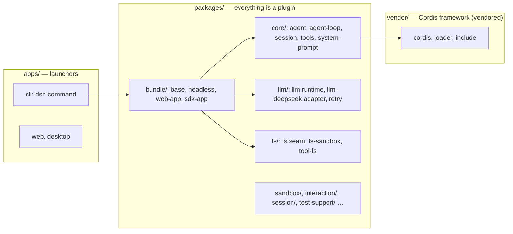

# પ્રકરણ 0 — પાયો અને પ્રથમ run

> **Level 0.** આ પ્રકરણ terminal, Git, Node.js, pnpm અને આ repository વાંચવા જેટલું TypeScript શીખવે છે,
> અને પછી Harness ને પહેલી વાર ચલાવે છે — API key વગર.

## આ પ્રકરણ પછી તમે શું કરી શકશો

- AI model, model provider, agent, harness અને plugin વચ્ચેનો તફાવત એક-એક ઉદાહરણથી સમજાવી શકશો.
- DeepSeek Harness નું repository clone કરી, તેની pinned commit પર checkout કરી, dependencies install અને build કરી શકશો.
- API key વગર પહેલો Cordis plugin ચલાવી શકશો અને output ની આગાહી કરી શકશો.
- આ repository ના TypeScript માં વારંવાર આવતા પાંચ pattern ઓળખી શકશો.
- Linux અને Windows + WSL2 બંને માટે setup નો માર્ગ જાણી શકશો.

## 0.1 પાંચ શબ્દો, એક-એક ઉદાહરણ

આ પુસ્તકમાં આ પાંચ શબ્દો વારંવાર આવશે. દરેક માટે English term રાખીએ છીએ, ગુજરાતી અર્થ આપીએ છીએ, અને એક નક્કર ઉદાહરણ આપીએ છીએ.

| English term | ગુજરાતી અર્થ | ઉદાહરણ |
|---|---|---|
| **AI model** | text વાંચીને આગલો text (અથવા tool call) બનાવતું ગણિતીય મોડેલ | `deepseek-flash` નામનું model |
| **Model provider** | model ને network પર ઉપલબ્ધ કરાવતી સેવા, જેનું પોતાનું HTTP API હોય | DeepSeek નું official API (`https://api.deepseek.com`) |
| **Agent** | એક loop જે model ને પૂછે, model કહે તે tool ચલાવે, અને પરિણામ પાછું model ને આપે — કામ પૂરું ન થાય ત્યાં સુધી | "README વાંચો" કહ્યું તો `read` tool ચલાવી પછી સાર લખે |
| **Harness** | agent ને ચલાવવા માટેનું આખું તંત્ર: loop, tools, session log, permissions, UI, provider adapter | DeepSeek Harness (`dsh`) |
| **Plugin** | harness માં ઉમેરાતો એક સ્વતંત્ર ભાગ, જે service, tool કે event listener ઉમેરે અને unload થતાં પોતાની નોંધણી પાછી ખેંચી લે | `@deepseek-ai/dsh-tool-fs` જે `read`, `write`, `edit` tools ઉમેરે છે |

એક વાક્યમાં: **model** વિચારે છે, **provider** તેને પહોંચાડે છે, **agent** loop ચલાવે છે, **harness** આખું ઘર છે, અને **plugin** એ ઘરની દરેક ઈંટ છે.

DeepSeek Harness ની ખાસ વાત એ છે કે agent loop પોતે પણ plugin છે. README તેને *everything-is-a-plugin* architecture કહે છે, જે [Cordis](https://github.com/cordiverse/cordis) framework પર બનેલું છે ([README.md](https://github.com/deepseek-ai/deepseek-harness/blob/fcc0ad462172522aaf5c93a7b2e01f6b9f0b0159/README.md)). ✅ *source-verified*

> **Verification marks.** આ પુસ્તકમાં ✅ = pinned source વાંચીને ચકાસ્યું, 🧪 = આ પુસ્તક લખતી વખતે ખરેખર ચલાવીને ચકાસ્યું,
> ⚠️ = ચકાસ્યું નથી (docs પર આધારિત). વિગત: [પરિશિષ્ટ G](../appendix/G-verification-log.md).

## 0.2 Pin: આખું પુસ્તક એક જ commit પર

Software બદલાય છે. આ repository README માં જ લખે છે કે તે *developer preview* છે અને "THERE WILL BE COMPATIBILITY-BREAKING CHANGES." તેથી આખું પુસ્તક એક જ commit પર બંધાયેલું છે:

| વિગત | મૂલ્ય |
|---|---|
| Repository | `https://github.com/deepseek-ai/deepseek-harness` |
| Branch | `master` |
| Commit SHA | `fcc0ad462172522aaf5c93a7b2e01f6b9f0b0159` |
| Commit date | 2026-11-04 16:40 +0800 ("Merge pull request #7873 … release-dsh-0.2.2-rc.1-to-master") |
| Root package version | `0.2.2-rc.1` |
| Inspection date | 2026-11-04 |
| Node.js used | v24.22.2 (repository માંગે છે `>=24.9.0`) |
| pnpm used | 11.28.5 (Corepack દ્વારા, `packageManager` field મુજબ) |
| Git used | 2.43.0 |
| TypeScript / Vitest / tsx (lockfile) | 6.0.3 / 4.1.11 / 4.23.13 |
| Cordis (vendored) | `4.0.0-rc.11`, upstream commit `0b96d9fd517b998e44e2209560c9e5f0671ce933` ([vendor/README.md][vendor-manifest]) |
| Machine | Linux x64, 4 CPU, 15 GB RAM |

દરેક source link `blob/fcc0ad46…/path#Lx-Ly` સ્વરૂપની permalink છે. upstream `master` આગળ વધે તો પણ આ link એ જ lines બતાવશે.

## 0.3 Terminal અને Git: જરૂર પૂરતું

**Terminal** એટલે text command લખીને computer ચલાવવાની બારી. ઉદાહરણ: `ls` લખો એટલે ચાલુ folder ની files દેખાય.

**Git** એટલે code ના દરેક ફેરફારનો ઇતિહાસ રાખતું tool. **Commit** એટલે ઇતિહાસમાં એક નામ-અને-SHA વાળું snapshot. ઉદાહરણ: `fcc0ad4` એ અમારું snapshot છે.

આ પુસ્તકમાં તમને ફક્ત આ Git command જોઈશે:

```bash
git clone https://github.com/deepseek-ai/deepseek-harness.git
```

```bash
git -C deepseek-harness checkout --detach fcc0ad462172522aaf5c93a7b2e01f6b9f0b0159
```

```bash
git -C deepseek-harness log -1 --format='%H %ci %s'
```

ત્રીજો command ચલાવો ત્યારે output `fcc0ad46…` થી શરૂ થવો જોઈએ. ન થાય તો બાકીનું પુસ્તક બીજા code પર ચાલશે, અને line numbers ખોટા પડશે.

`--detach` નો અર્થ: કોઈ branch પર નહીં, સીધા commit પર ઊભા રહો. તમે ફેરફાર કરશો તો તે કોઈ branch માં નહીં જાય — શીખવા માટે એ જ સારું.

## 0.4 Node.js, Corepack અને pnpm

**Node.js** એટલે browser વગર JavaScript ચલાવતું runtime. ઉદાહરણ: `node --version` → `v24.22.2`.

**Package manager** એટલે બીજાઓનો code (dependencies) download કરી ગોઠવતું tool. આ repository **pnpm** વાપરે છે, અને ચોક્કસ version root `package.json` માં pinned છે: `"packageManager": "pnpm@11.28.5"`, `"engines": { "node": ">=24.9.0" }`. ✅

**Corepack** એટલે Node સાથે આવતું નાનું tool, જે `packageManager` field વાંચીને સાચો pnpm version જાતે લાવે છે. ઉદાહરણ: `corepack enable` પછી `pnpm --version` → `11.28.5`.

**Workspace** એટલે એક repository માં ઘણાં package. અહીં `packages/<group>/<pkg>/` નીચે 50 થી વધુ group છે, અને દરેક package નું નામ `@deepseek-ai/dsh-<name>` છે ([AGENTS.md][agents-conventions]). ✅

### Linux પર setup (🧪 આ પુસ્તક માટે ચલાવ્યું)

1. Node 24 install કરો (nodejs.org નું official tarball, અથવા તમારું version manager). પછી:

```bash
node --version
```

`v24.9.0` કે તેથી નવું હોવું જોઈએ.

2. Corepack ચાલુ કરો:

```bash
corepack enable
```

3. Clone, pin, install:

```bash
git clone https://github.com/deepseek-ai/deepseek-harness.git && cd deepseek-harness
```

```bash
git checkout --detach fcc0ad462172522aaf5c93a7b2e01f6b9f0b0159
```

```bash
pnpm install
```

4. Build:

```bash
pnpm run build
```

અમારા machine પર `pnpm run build` એ 10 gates ચલાવ્યા: native addon, Host Typert, host compiler, Host bundle, Desktop bundle, client compiler, Client bundle, Web build, host aggregate check, client aggregate check — `10 passed, 0 failed, 0 skipped in 129.74s` ([evidence/build.log](../evidence/build.log)). 🧪

> **અમારા sandbox ની એક ખાસ વાત (તમને કદાચ નહીં નડે).** અમારા cloud sandbox નું network `cdn.sheetjs.com` ને block કરે છે.
> Client package `ui-sidebar-documentpreview` ત્યાંથી `xlsx-0.20.3.tgz` માંગે છે, તેથી `pnpm install` નિષ્ફળ ગયું.
> અમે ફક્ત અમારી scratch copy માં `pnpm-workspace.yaml` ના `overrides` માં `'xlsx': '0.18.5'` (npm નું) અને એક `.d.ts` shim ઉમેર્યા.
> આ Host/agent code ને સ્પર્શતું નથી. તમારું network એ CDN સુધી પહોંચતું હોય તો આવું કંઈ ન કરશો. વિગત: [પરિશિષ્ટ G](../appendix/G-verification-log.md).

### Windows + WSL2 (⚠️ આ પુસ્તક માટે ચલાવ્યું નથી)

Repository નો development guide કહે છે કે Windows પર native tools અથવા WSL 2 બંને ચાલે, અને WSL વૈકલ્પિક છે ([docs/development.md](https://github.com/deepseek-ai/deepseek-harness/blob/fcc0ad462172522aaf5c93a7b2e01f6b9f0b0159/docs/development.md)). તેના મુખ્ય નિયમો:

- **WSL2** એટલે Windows ની અંદર ચાલતું સાચું Linux kernel. ઉદાહરણ: PowerShell માં `wsl --install` પછી Ubuntu terminal મળે.
- checkout, dependencies અને toolchain **એક જ OS environment** માં રાખો. WSL માટે checkout ને Linux filesystem (`~/…`) માં રાખો, `/mnt/c/…` માં નહીં; બંને filesystem વચ્ચેની I/O ધીમી છે.
- દરેક environment માં dependencies અલગથી install કરો, કારણ કે native binaries OS પ્રમાણે જુદી હોય.
- WSL માં ચાલેલા tests Linux વર્તન સાબિત કરે છે; Windows-specific વર્તન માટે native Windows validation જોઈએ.

WSL ની અંદર ઉપરના Linux steps જ ચાલે. અમે Windows પર આ ચલાવ્યું નથી, તેથી કોઈ output નો દાવો કરતા નથી.

## 0.5 આ repository વાંચવા જેટલું TypeScript

**TypeScript** એટલે JavaScript + types. Types runtime પર ભૂંસાઈ જાય છે; તે ફક્ત compile વખતે ભૂલ પકડે છે. ઉદાહરણ: `const n: number = 'x'` compile વખતે error આપે.

આ repository માં પાંચ pattern વારંવાર દેખાય છે:

**(1) `import type`** — ફક્ત type લાવે, runtime પર કંઈ import ન થાય.

```ts
import type { Context } from '@deepseek-ai/cordis'
```

**(2) Declaration merging** એટલે બીજા package ના interface માં નવા field ઉમેરવા. Cordis ના `Context` પર `ctx.tools`, `ctx.llm` જેવા services આ રીતે type મેળવે છે. એક વિચિત્ર દેખાતી line ખરેખર આ જ કરે છે:

```ts
import type {} from '@deepseek-ai/dsh-tools' // dsh-tools ના merge (દા.ત. 'tools/result' event) types માં લાવે
```

**(3) Discriminated union** એટલે એક `kind`/`type` field પરથી કયો આકાર છે તે નક્કી થાય. ઉદાહરણ: `{ kind: 'enter' } | { kind: 'reject' }`. Repository નો નિયમ: closed union ના અંતે `assertNever` ([AGENTS.md][agents-conventions]).

**(4) `satisfies never`** — "બધા કેસ handle થયા" એવું compiler પાસે સાબિત કરાવવું. CLI entry point માં આ દેખાય છે:

```ts
    default:
      invocation satisfies never
      throw new Error(`dsh: unhandled invocation mode ${JSON.stringify(invocation)}`)
```

(repository code, [apps/cli/src/bin.ts][cli-runCli])

**(5) `async`/`await` અને `AbortSignal`** — લાંબું ચાલતું કામ અને તેને રદ કરવાનો signal. Agent loop દરેક await પછી `signal.throwIfAborted()` ચલાવે છે; પ્રકરણ 5 માં આપણે interruption આ જ રીતે પકડીશું.

## 0.6 Repository નો નકશો



| Diagram node | Folder | પહેલું ખોલવાનું file |
|---|---|---|
| cli | `apps/cli/` | `apps/cli/src/bin.ts` ([`runCli`][cli-runCli]) |
| cordis | `vendor/cordis/` | `vendor/cordis/bin.js` ([launcher][cordis-bin]) |
| bundle | `packages/bundle/` | `packages/bundle/base/cordis.patch.yml` ([rows][bundle-base]) |
| core | `packages/core/` | `packages/core/agent-loop/src/agent.ts` ([`ReactLoopAgent`][loop-class]) |
| llm | `packages/llm/` | `packages/llm/llm-deepseek/src/adapter.ts` ([`DeepSeekAdapter`][deepseek-adapter]) |
| fs | `packages/fs/` | `packages/fs/tool-fs/src/read.ts` ([`applyReadTool`][read-tool]) |

Arrows અહીં "આ layer એ layer પર બનેલું છે" બતાવે છે — call direction નહીં.

## Source map: આ ક્રમમાં ખોલો

| ક્રમ | File | Symbol | કેમ |
|---|---|---|---|
| 1 | `README.md` | Run from source | સત્તાવાર commands |
| 2 | `package.json` | `engines`, `packageManager`, `scripts.dsh` | `pnpm dsh` = `node --import tsx/esm apps/cli/src/bin.ts` |
| 3 | `vendor/cordis/bin.js` | [launcher][cordis-bin] | સૌથી નાનું Cordis app |
| 4 | `docs/cordis-tutorial/01-first-plugin.md` | ch. 1 | Lab નો સ્રોત |
| 5 | `apps/cli/src/bin.ts` | [`runCli`][cli-runCli] | `dsh` નો દરવાજો |

## Lab 0 — પહેલો plugin, key વગર

આ lab repository ના પોતાના tutorial નું પહેલું પ્રકરણ છે. તે repository ના gitignored `tmp/` folder માં કામ કરે છે, તેથી Git history ને કંઈ થતું નથી.

```bash
mkdir -p tmp/cordis-tutorial && cd tmp/cordis-tutorial
```

`hello.ts` બનાવો:

```ts
import type { Context } from '@deepseek-ai/cordis'

export const name = 'hello'

export function apply(ctx: Context) {
  console.log('hello from my first plugin')
}
```

`cordis.yml` બનાવો:

```yaml
- name: './hello.ts'
```

ચલાવો:

```bash
node --import tsx ../../vendor/cordis/bin.js
```

**અપેક્ષિત અવલોકન** (🧪 exit code 0):

```text
hello from my first plugin
```

શું થયું? [`vendor/cordis/bin.js`][cordis-bin] એ root `Context` બનાવ્યો, `Loader` plugin mount કર્યો, અને `@deepseek-ai/cordis-plugin-include` ને `./cordis.yml` વાંચવા કહ્યું. YAML ની દરેક row એક plugin છે; Loader એ `./hello.ts` import કરી `apply(ctx)` બોલાવ્યું.

`--import tsx` નો અર્થ: Node ને TypeScript file સીધી ચલાવવા દો. **tsx** repository ના `tsconfig` `paths` પણ વાંચે છે, તેથી `tmp/` ની અંદરથી `@deepseek-ai/dsh-tools` જેવા workspace package source માંથી મળી જાય છે — આ પુસ્તકની બધી labs આ જ કારણે `<harness>/tmp/` માં ચાલે છે. 🧪

## આગાહી કસોટી

`apply` ને આ રીતે બદલો અને **ચલાવતા પહેલાં** લખો: process નો exit code શું હશે, અને "hello" છપાશે કે નહીં?

```ts
export function apply(ctx: Context) {
  throw new Error('apply exploded')
}
```

જવાબ [પરિશિષ્ટ D](../appendix/D-lab-solutions.md#lab-0) માં છે. પહેલાં પોતે ચલાવો.

## નિષ્ફળતા: plugin "કંઈ જ નથી કરતો"

**લક્ષણ.** `cordis.yml` માં `- name: './helo.ts'` (spelling ભૂલ) લખ્યું, અથવા `apply` અંદર exception ફેંકાયો. બંને કિસ્સામાં process **exit code 0** સાથે, કંઈ છાપ્યા વગર પૂરું થાય છે. 🧪

**Docs અને code નો તફાવત.** Tutorial નું પ્રકરણ 1 ("Try breaking it") કહે છે કે `apply` throw કરે તો "the process dies with your error." Pinned commit પર અમે આ ત્રણ વાર ચલાવ્યું: exit 0, stdout/stderr ખાલી. 🧪
કારણ source માં દેખાય છે: Loader entry ની નિષ્ફળતા `this.ctx.logger.error(error)` થી log કરે છે ([vendor/loader/src/config/entry.ts][loader-entry-error]), અને [`vendor/cordis/bin.js`][cordis-bin] કોઈ log exporter mount કરતું નથી. Log છે, પણ જોનાર કોઈ નથી. ✅

**ટૂંકો નિદાન માર્ગ.**

1. Loader પહેલાં console exporter mount કરતો નાનો launcher વાપરો. પુસ્તકનો [`labs/cordis-basics/bin-with-logs.ts`](../labs/cordis-basics/bin-with-logs.ts) બરાબર આ કરે છે, અને અંતે દરેક entry ની `FiberState` છાપે છે:

```bash
node --import tsx ../book-labs/cordis-basics/bin-with-logs.ts
```

2. Throw વાળા `hello.ts` માટે અમને આ મળ્યું (path ટૂંકાવ્યો છે):

```text
2026-11-04 18:39:07 [E] hello Error: apply exploded
                            at new apply (…/tmp/cordis-tutorial/hello.ts:6:9)
[entry] @deepseek-ai/cordis-plugin-include -> ACTIVE
[entry] ./hello.ts -> FAILED
```

3. Typo વાળા path માટે: `[E] include Error [ERR_MODULE_NOT_FOUND]: Cannot find module '…/helo.ts'`.
4. સાચા `dsh` launcher માં આ સમસ્યા નથી: તે boot દરમિયાન પોતાનો diagnostics exporter રાખે છે અને અંતે startup audit ચલાવે છે ([`boot`][boot-boot], [`auditStartupEntries`][boot-audit]) — પ્રકરણ 2 માં તેનું output ખરેખર જોઈશું.

## Mastery check

1. "Harness" અને "agent" વચ્ચેનો તફાવત એક ઉદાહરણથી લખો.
2. `pnpm dsh` ખરેખર કયો Node command ચલાવે છે? (સંકેત: root `package.json`)
3. `import type {} from '@deepseek-ai/dsh-tools'` runtime પર શું import કરે છે, અને compile વખતે શું આપે છે?
4. WSL2 માં checkout `/mnt/c/` ને બદલે `~/` માં કેમ રાખવું?
5. Lab 0 માં `--import tsx` કાઢી નાખો તો શું થશે એવી તમારી ધારણા છે, અને કેમ?

જવાબો: [પરિશિષ્ટ D — પ્રકરણ 0](../appendix/D-lab-solutions.md#ch0).

---

આગળ: [પ્રકરણ 1 — એક requestની આખી મુસાફરી](01-request-ni-musafari.md)

<!-- citations:begin (generated by tools/refdefs.py) -->
[agents-conventions]: https://github.com/deepseek-ai/deepseek-harness/blob/fcc0ad462172522aaf5c93a7b2e01f6b9f0b0159/AGENTS.md#L130-L142
[boot-audit]: https://github.com/deepseek-ai/deepseek-harness/blob/fcc0ad462172522aaf5c93a7b2e01f6b9f0b0159/packages/boot/app-boot/src/index.ts#L1153-L1167
[boot-boot]: https://github.com/deepseek-ai/deepseek-harness/blob/fcc0ad462172522aaf5c93a7b2e01f6b9f0b0159/packages/boot/app-boot/src/index.ts#L1200-L1266
[bundle-base]: https://github.com/deepseek-ai/deepseek-harness/blob/fcc0ad462172522aaf5c93a7b2e01f6b9f0b0159/packages/bundle/base/cordis.patch.yml#L15-L18
[cordis-bin]: https://github.com/deepseek-ai/deepseek-harness/blob/fcc0ad462172522aaf5c93a7b2e01f6b9f0b0159/vendor/cordis/bin.js#L7-L16
[deepseek-adapter]: https://github.com/deepseek-ai/deepseek-harness/blob/fcc0ad462172522aaf5c93a7b2e01f6b9f0b0159/packages/llm/llm-deepseek/src/adapter.ts#L22
[loader-entry-error]: https://github.com/deepseek-ai/deepseek-harness/blob/fcc0ad462172522aaf5c93a7b2e01f6b9f0b0159/vendor/loader/src/config/entry.ts#L230
[loop-class]: https://github.com/deepseek-ai/deepseek-harness/blob/fcc0ad462172522aaf5c93a7b2e01f6b9f0b0159/packages/core/agent-loop/src/agent.ts#L112
[read-tool]: https://github.com/deepseek-ai/deepseek-harness/blob/fcc0ad462172522aaf5c93a7b2e01f6b9f0b0159/packages/fs/tool-fs/src/read.ts#L68-L163
[vendor-manifest]: https://github.com/deepseek-ai/deepseek-harness/blob/fcc0ad462172522aaf5c93a7b2e01f6b9f0b0159/vendor/README.md#L19
<!-- citations:end -->
