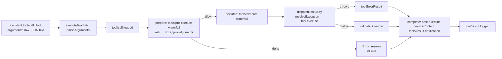

# પ્રકરણ 3 — Tools, sessions અને model adapters

> **Level 3.** ત્રણ seam ને અંદરથી ખોલીએ: built-in `read` tool, DeepSeek model adapter, અને session log.
> દરેક માટે: input schema/format, registration, execution, error handling, અને output conversion.

## આ પ્રકરણ પછી તમે શું કરી શકશો

- `read` tool નું schema, registration, execution, error handling અને result conversion source માં બતાવી શકશો.
- Tool call ના raw JSON થી `tool/result` event સુધીનો pipeline ક્રમ લખી શકશો.
- એક provider request ને `GenerateOptions` થી HTTP body સુધી અને SSE response ને `StreamChunk` સુધી અનુસરી શકશો.
- Session log કેવી રીતે model context બને છે, file માં કેવી રીતે persist થાય છે, અને interrupted session કેવી રીતે resume થાય છે તે ચલાવીને બતાવી શકશો.

## 3.1 સરળ સમજ: seam એટલે બદલી શકાય તેવો સાંધો

**Capability seam** એટલે ત્રણ ભૂમિકાવાળી બદલી શકાય તેવી capability: **Service Definition** (interface), **Service Provider** (implementation), **Consumer** (તેને વાપરનાર, ઘણી વાર model-facing tool). ઉદાહરણ: `@deepseek-ai/dsh-fs` નો abstract [`FileSystem`][fs-abstract] definition છે, `dsh-fs-sandbox` provider છે, અને `read` tool consumer છે ([architecture.md — Capability seams](https://github.com/deepseek-ai/deepseek-harness/blob/fcc0ad462172522aaf5c93a7b2e01f6b9f0b0159/docs/architecture.md#capability-seams)). ✅

આ પ્રકરણના ત્રણ seam:

| Seam | Definition | Provider (base bundle) | Consumer |
|---|---|---|---|
| Tools | `ctx.tools` ([`dsh-tools`][tools-execute]) | `tool-executor-native` ([`NativeToolExecutor`][native-executor]) | agent loop |
| Filesystem | `ctx.fs` ([`FileSystem`][fs-abstract]) | `dsh-fs-sandbox` ([policy][fs-sandbox-doc]) | `read`, `write`, `edit` tools |
| LLM | `ctx.llm` ([`LlmRuntime`][llm-runtime]) | `dsh-llm-deepseek-api-key` → [`DeepSeekAdapter`][deepseek-adapter] | agent loop |

## 3.2 `read` tool: પાંચ ભાગ

### (a) Input schema

[`applyReadTool`][read-tool] માંથી (repository code):

```ts
  ctx.tools.register(defineTool({
    name: 'read',
    description: 'Read a UTF-8 text file and return line-numbered content.',
    parameters: {
      file_path: { type: 'string', required: true, description: 'Path to read, resolved by the filesystem backend.' },
      offset: { type: 'number', description: '1-based first line to return. Defaults to 1.' },
      limit: { type: 'number', description: `Maximum number of lines to return. Defaults to ${caps.limit}.` },
    },
```

`defineTool` આ નાના DSL ને JSON Schema માં ફેરવે છે; model ને એ જ schema મળે છે (પ્રકરણ 1 ની wire capture માં 25 tools માંનું એક). `limit` નો default `READ_LIMIT = 2000` છે, અને તે `tool-fs` plugin config (`readLimit`) થી બદલી શકાય છે. ✅

### (b) Registration

બે નોંધણી, બંને effects: `ctx.systemPrompt.section({ name: 'tool:read', … })` — model ને "cat/sed નહીં, read વાપરો" એવી સૂચના, પણ ફક્ત ત્યારે જ જ્યારે આ scope માં `read` દેખાતું હોય — અને `ctx.tools.register(defineTool({...}))`. `tool-fs` plugin `inject = ['tools', 'fs', 'systemPrompt', 'workingDirectory']` જાહેર કરે છે ([source][toolfs-inject]); પ્રકરણ 2 ના lab માં જોયું કે `workingDirectory` ખૂટે તો આખો `tool-fs` pending રહે છે. 🧪

### (c) Execution

```ts
    async execute(args, exec) {
      const input = parseReadArgs(args, caps.limit)
      const { target, info } = await resolveRegularReadTarget(ctx, exec, input.filePath)
      const chunks = info.size === undefined || info.size >= caps.streamMinSize
        ? await ctx.fs.streamText(target, exec.signal)
        : [await ctx.fs.readText(target, exec.signal)]
```

(ટૂંકાવેલું; [source][read-tool].) [`resolveRegularReadTarget`][read-target] session ની current directory માં path resolve કરે છે, એક જ `stat` કરે છે, file ન હોય તો `fs/observed` (absent) emit કરી `FsError(..., 'FS_NOT_FOUND')` ફેંકે છે, અને directory હોય તો `FS_NOT_REGULAR_FILE`. 10 MB (`STREAM_MIN_SIZE`) થી મોટી કે size-unknown file stream થાય છે, જેથી backend આખી file memory માં ન ભરે.

### (d) Error handling — ત્રણ સ્તર

| સ્તર | ક્યાં | ઉદાહરણ | Model ને શું મળે |
|---|---|---|---|
| Schema | `defineTool` નું `execute` wrapper ([source][schema-defineTool-validate]) | `{"path":"README.md"}` | `Error: invalid arguments: missing required property "file_path"` (`INVALID_ARGS`) 🧪 |
| Value | [`parseReadArgs`][read-parse] | `offset: 0` | `Error: offset must be a positive integer` ✅ |
| Filesystem | [`resolveRegularReadTarget`][read-target] | `NOPE.md` | `Error: cannot read "…/NOPE.md": not found` (`FS_NOT_FOUND`) 🧪 |

દરેક throw ને pipeline [`toolErrorResult`][pipeline-errorResult] માં ફેરવે છે:

```ts
function toolErrorResult(error: unknown): ToolExecutionResult {
  const info = errorInfo(error)
  const message = toolErrorMessage(error)
  return {
    content: [{ type: 'text', text: `Error: ${message}` }],
    isError: true,
    error: { message, ...info ? { info } : {} },
  }
}
```

એટલે tool ની નિષ્ફળતા **crash નથી**, model માટે એક સામાન્ય `tool/result` છે, અને `info` (`name`, `code`) log માં રહે છે પણ model text નો ભાગ નથી.

### (e) Result conversion

`execute` એક **canonical value** આપે છે: `{ path, offset, lines: [{number, text}], totalLines }`. Pipeline તેને `output.schema` સામે validate કરે છે ([source][pipeline-materialize]), પછી `output.render` તેને model-facing text બનાવે છે ([source][read-output]), અને `presentationMeta` UI card માટે `meta` આપે છે (replay પર card ફરી બની શકે). અમારી wire capture માં model ને આવું text ગયું 🧪:

```text
<path><harness>/README.md</path>
<type>file</type>
<content>
1: # DeepSeek Harness
2: 
3: English | [中文](README.zh.md)
```

## 3.3 Tool pipeline: raw JSON થી `tool/result`



| Node | Owner | Symbol |
|---|---|---|
| executeToolBatch / parseArguments | `packages/core/tools/src/batch.ts` | [`executeToolBatch`][batch-execute], [`parseArguments`][batch-parse] |
| prepare | `packages/core/tools/src/pipeline.ts` | [`prepare`][pipeline-prepare] |
| dispatch | same | [`dispatch`][pipeline-dispatch] |
| dispatchToolBody | same | [`dispatchToolBody`][pipeline-body] |
| toolErrorResult | same | [`toolErrorResult`][pipeline-errorResult] |
| `tool/call` data | `packages/core/session/src/types.ts` | [`'tool/call'`][session-types-tool] |

બે નાની પણ મહત્વની વિગતો:

- [`parseArguments`][batch-parse]: invalid JSON હોય તો crash નહીં — raw string જ રાખે છે, જેથી tool પોતાનું argument diagnostic આપી શકે; ખાલી string → `{}`.
- [`dispatchToolBody`][pipeline-body]: tool registry માં ન મળે તો `ToolNotFoundError` ([source][contracts-notfound]); અમારા run માં model ને `Error: unknown tool "read_everything"` મળ્યું, code `UNKNOWN_TOOL`. 🧪

## 3.4 Adapter boundary: એક request અને એક streamed response

### Request: `GenerateOptions` → HTTP

1. Loop [`buildRequest`][loop-buildRequest] માં frozen `GenerateOptions` બનાવે છે: `provider`, `model`, `messages` (log માંથી), `tools`, `toolHistory`, `sessionId`, `signal`.
2. [`LlmRuntime.stream`][llm-stream] તેને `llm/stream` **waterfall** માંથી પસાર કરે છે; છેલ્લો handler adapter stream છે. એટલે કોઈ પણ plugin દરેક model request જોઈ/લપેટી શકે — પ્રકરણ 1 નો trace plugin અને પ્રકરણ 6 નો metrics plugin આ જ hook વાપરે છે.
3. [`DeepSeekAdapter.generate`][deepseek-generate] idle watchdog લગાવે છે (stream શાંત રહે તો `TIMEOUT`), અને errors ને `LlmError` codes માં ફેરવે છે: `TIMEOUT`, `ABORTED`, `TRANSPORT`.
4. `request()` images/files તૈયાર કરે છે, auth headers લાવે છે, [`serialize`][deepseek-serialize] થી Messages-format body બનાવે છે, request extensions ઉમેરે છે, અને [`fetch(…/messages)`][deepseek-fetch] કરે છે:

```ts
        const response = await fetch(`${messagesApiRoot(connection.baseURL)}/messages`, {
          method: 'POST', signal, body: extensions.payload, redirect: 'error',
          headers: {
            ...attributionHeaders(),
            'content-type': 'application/json', 'accept': 'text/event-stream',
            ...auth.headers,
            'anthropic-version': '2023-06-01',
```

Wire પર ખરેખર શું ગયું (🧪 [evidence/wire.json](../evidence/wire.json), user id redacted):

```json
    "bodyKeys": ["dsh_plugin_packages", "dsh_session_log", "max_tokens", "messages",
                 "model", "output_config", "stream", "system", "thinking", "tools"],
    "model": "deepseek-flash",
    "stream": true,
    "headers": {
      "anthropic-version": "2023-06-01",
      "x-deepseek-harness-user-id": "<redacted anonymous id>",
      "x-deepseek-harness-session-id": "session-…"
    }
```

`dsh_session_log` અને `dsh_plugin_packages` એ **request extensions** છે — DeepSeek-specific fields જે plugins ઉમેરે છે. `dsh_session_log` field `session-log-deepseek` plugin register કરે છે ([source][sessionlog-register]); તેનું README કહે છે: "Incremental canonical session-log upload for official DeepSeek LLM API requests … Disable it only when the official API must not receive a Session-log suffix." પ્રકરણ 5 માં આને data boundary તરીકે તપાસીશું. ✅🧪

### Response: SSE → `StreamChunk`

Provider HTTP 200 સાથે Server-Sent Events મોકલે છે. [`parseSse`][deepseek-sse] દરેક `data:` line ને JSON બનાવે છે, અને [`translate`][deepseek-translate] તેને harness ના provider-neutral [`StreamChunk`][llm-streamchunk] માં ફેરવે છે:

```ts
export type StreamChunk =
  | { type: 'block-start'; index: number; blockType: ContentBlockType }
  | { type: 'text-delta'; index: number; text: string }
  | { type: 'reasoning-delta'; index: number; text: string }
  | { type: 'tool-call-delta'; index: number; id: ToolCallId; name?: string; argumentsDelta: string }
  | { type: 'block-end'; index: number; block: ContentBlock }
  | { type: 'usage'; usage: TokenUsage }
  | { type: 'finish'; reason: FinishReason; replayState?: ReplayEnvelope }
```

(repository code; છેલ્લો `finish` variant source માં ઘણી lines માં છે, અહીં એક line માં સંક્ષિપ્ત કર્યો છે.)

Provider ના `stop_reason` નું mapping ([source][deepseek-finish]): `end_turn`/`stop_sequence` → `stop`, `tool_use` → `tool-calls`, `max_tokens` → `max-tokens`. HTTP error હોય તો adapter body વાંચી `providerError(raw, status, headers)` થી code (દા.ત. `AUTH`, `SERVER`, rate limit) બનાવે છે અને `LlmError` ફેંકે છે; `LlmRuntime` તેને `finish` chunk (`kind: 'error'`) માં ફેરવે છે, અને loop `agent/request-error` ચલાવે છે (પ્રકરણ 5).

**Adapter boundary નો નિયમ:** boundary ની ઉપર (loop, tools, session) કોઈ code DeepSeek wire format જાણતું નથી; boundary ની નીચે adapter harness ના session log ને જાણતું નથી — તે ફક્ત `GenerateOptions` લે છે અને `StreamChunk` આપે છે. નવો provider ઉમેરવો એટલે `ctx.llm.registerAdapter(...)` ([source][llm-registerAdapter]).

## 3.5 Session state → model context

**Session log** એટલે append-only events ની યાદી; દરેક event ને `seq` (0,1,2…) અને `time` મળે છે. ઉદાહરણ: પ્રકરણ 1 માં `#17 tool/call`.

[`Session.append`][session-append]:

```ts
    const dataSnapshot = snapshotJsonValue(data)
    if (dataSnapshot === undefined) {
      throw new Error(`session event "${type}" carries non-JSON-serializable data`)
    }
    …
    const event = deepFreeze({
      type,
      seq: SessionSeq(this.log.length),
      time: Date.now(),
```

ત્રણ ખાતરીઓ: data JSON-serializable હોવો જ જોઈએ (નહીં તો append જ નિષ્ફળ — ખરાબ event પછીથી flush વખતે નહીં, અહીં જ પકડાય), event deep-frozen છે, અને `seq` log ની લંબાઈ છે.

**Surface** એટલે log ના એવા nodes જે model history બનાવે છે: પાંચ message-producing types `system/message`, `developer/message`, `user/message`, `assistant/message`, `tool/result` ([`SurfaceEventType`][session-surface-types]). [`deriveMessages`][session-derive] surface nodes પરથી `Message[]` બનાવે છે અને cache કરે છે; compaction જેવી replacement થાય તો `contentGeneration` બદલાય અને cache ફરી બને. ખાલી content વાળો `assistant/message` (દા.ત. ફક્ત usage) history માં આવતો નથી.

### Persistence

Base bundle `session-persistence-jsonl` ને `root: dshHomePath('sessions')` સાથે mount કરે છે. ✅ અમારા runs માં file layout 🧪:

```text
$DSH_HOME/sessions/<cwd-key>/session-<uuid>/session.v4.jsonl.zstd
$DSH_HOME/sessions/<cwd-key>/session-<uuid>/session.lock
```

પહેલી line header છે (`{"type":"session","version":4,"id":…,"cwd":…}`), પછી એક event પ્રતિ line. Architecture doc મુજબ v1 અને પછીના format `session.vN.jsonl[.zstd]` નામ વાપરે છે, અને committed generation files ક્યારેય rename/replace/delete થતી નથી; જૂના version ની session ખોલતાં adjacent migrations ચાલે છે. ✅ Headless runner અંતે [`sessions.flush`][session-flush] બોલાવે છે, જે દરેક `session/flush` listener ની રાહ જુએ છે.

### Recovery અને resume

બે પ્રકારની recovery source માં છે:

- **Step ની અંદર:** step નિષ્ફળ જાય અને tool calls નાં પરિણામ ખૂટે, તો loop [`toolRecovery.results()`][loop-recovery] વડે ખૂટતા `tool/result` લખે છે — દરેક `tool/call` ને જવાબ મળે એ invariant જળવાય.
- **Process ની બહાર:** headless `--session-id <id>` થી persisted Session ફરી અપનાવી શકાય ([headless flags][headless-flags]).

## Source map: આ ક્રમમાં ખોલો

| ક્રમ | File | Symbol | Input → Output (side effect) |
|---|---|---|---|
| 1 | `packages/fs/tool-fs/src/read.ts` | [`applyReadTool`][read-tool] | caps → registrations (effects) |
| 2 | `packages/fs/tool-fs/src/read-target.ts` | [`resolveRegularReadTarget`][read-target] | path → `{target, info}` or `FsError` |
| 3 | `packages/core/tools/src/schema.ts` | [`defineTool` validation][schema-defineTool-validate] | args → `ToolArgsError` |
| 4 | `packages/core/tools/src/batch.ts` | [`executeToolBatch`][batch-execute] | calls → `ToolBatchResult` (`tool/*` events) |
| 5 | `packages/core/tools/src/pipeline.ts` | [`prepare`][pipeline-prepare], [`dispatch`][pipeline-dispatch] | exec → result |
| 6 | `packages/llm/llm/src/index.ts` | [`stream`][llm-stream] | `GenerateOptions` → `StreamChunk*` |
| 7 | `packages/llm/llm-deepseek/src/adapter.ts` | [`generate`][deepseek-generate], [`fetch`][deepseek-fetch] | → HTTP POST |
| 8 | `packages/llm/llm-deepseek/src/translate.ts` | [`translate`][deepseek-translate] | SSE JSON → `StreamChunk` |
| 9 | `packages/core/session/src/index.ts` | [`append`][session-append], [`deriveMessages`][session-derive] | event → log; log → `Message[]` |

## Lab 3 — completed અને interrupted session ને resume કરો

**ભાગ A: સામાન્ય resume.**

```bash
rm -rf tmp/book-home && bash tmp/book-labs/request-trace/run-mock.sh
```

```bash
SID=$(basename "$(find tmp/book-home/sessions -maxdepth 2 -name 'session-*' -type d | head -1)")
```

```bash
SEQUENCE=success SUCCESS_TEXT='ત્રણ મુદ્દા: 1) plugin 2) Cordis 3) session log.' TASK='હવે એ સાર ત્રણ મુદ્દામાં લખો.' DSH_ARGS="--session-id $SID" bash tmp/book-labs/request-trace/run-mock.sh
```

🧪 અવલોકનો ([evidence/resume-a2.err](../evidence/resume-a2.err)): exit 0; નવો event `#27 turn/start {"turn":2}` — એ જ log, આગલો seq; `request/header` reason **`resume`**; ફક્ત **એક** model call, જેમાં `messages=9` — પહેલા turn ની આખી history + નવો સંદેશ.

**ભાગ B: interrupted session ને resume.** Mock ને `--sequence stall` સાથે ચલાવી headless run ને 4 સેકન્ડે `SIGINT` મોકલ્યો, પછી `--session-id` થી resume કર્યું (પૂરા commands: [પરિશિષ્ટ B](../appendix/B-command-reference.md#interrupt-and-resume)). 🧪 Stored log ([evidence/int2.err](../evidence/int2.err)):

```text
#4 turn/start {"turn":1}
#8 user/message source={"kind":"user"} content=[…"આ repositoryનું README વાંચીને ગુજરાતી સાર આપો."…]
#16 assistant/attempt {"turn":1,"step":1,"stream":[]}
#18 turn/end {"turn":1,"reason":{"kind":"aborted","reason":{"kind":"disposed"}}}
#21 turn/start {"turn":2}
#24 user/message source={"kind":"user"} content=[…"ફરી પ્રયાસ કરો."…]
#25 request/header reason=resume model=deepseek-official/deepseek-flash tools=25
#35 turn/end {"turn":2,"reason":{"kind":"completed"}}
```

Interrupted turn 1 ગુમ થયો નથી: તેનો user message, ખાલી `assistant/attempt`, અને `aborted` reason સાથે `turn/end` durable છે. Turn 2 એ history સાથે ફરી `read` ચલાવ્યું અને પૂરો થયો.

## આગાહી કસોટી

`read` tool ને `{"file_path":"packages"}` (directory) argument સાથે call કરાવો:

```bash
TOOL_ARGS='{"file_path":"packages"}' bash tmp/book-labs/request-trace/run-mock.sh
```

**ચલાવતા પહેલાં લખો:** (1) model ને મળતું exact `Error:` text, (2) `tool/result` માં `error.info.code`, (3) turn નું reason. જવાબ: [પરિશિષ્ટ D — Lab 3](../appendix/D-lab-solutions.md#lab-3).

## નિષ્ફળતા: નવો tool model ને દેખાતો નથી

**લક્ષણ.** તમારો plugin load થયો છે (startup warning નથી), પણ `llm/stream` trace ની `tools=[…]` યાદીમાં તમારો tool નથી.

**ટૂંકો નિદાન માર્ગ.**

1. Tool `ctx.tools.register` થી register થાય છે કે ફક્ત object બને છે? `defineTool` એકલું કંઈ register કરતું નથી.
2. Preset કે agent scope માં ફક્ત અમુક tools દેખાય છે? Loop દરેક step માં `ctx.tools.resolve({ agent, … })` થી step-admitted tools લે છે ([`preStep`][loop-preStep]).
3. Plugin કોઈ agent ના `agent.ctx` ને બદલે બીજા scope માં mount થયો છે? Scope chain [`scopeChainOf`][scope-chain] જુઓ.
4. Trace plugin ની `tools=[…]` line એ wire પર ગયેલી યાદી છે; [`capture-wire.ts`](../labs/request-trace/capture-wire.ts) થી `toolNames` ચકાસો.

## Mastery check

1. `read` tool ની ત્રણ error layers અને દરેકનો code લખો.
2. Tool body throw કરે ત્યારે model ને શું મળે છે, અને `error.info` model text માં કેમ નથી?
3. Adapter boundary ની ઉપર અને નીચે કોણ શું જાણે છે?
4. `llm/stream` waterfall હોવાથી શું શક્ય બને છે? એક ઉદાહરણ આપો.
5. `Session.append` non-JSON data પર તરત કેમ નિષ્ફળ થાય છે?
6. Interrupted session resume પછી turn 1 ના કયા events બાકી રહે છે?

જવાબો: [પરિશિષ્ટ D — પ્રકરણ 3](../appendix/D-lab-solutions.md#ch3).

---

પાછળ: [પ્રકરણ 2](02-cordis-plugin-architecture.md) · આગળ: [પ્રકરણ 4 — પોતાનો plugin બનાવો](04-potano-plugin.md)

<!-- citations:begin (generated by tools/refdefs.py) -->
[batch-execute]: https://github.com/deepseek-ai/deepseek-harness/blob/fcc0ad462172522aaf5c93a7b2e01f6b9f0b0159/packages/core/tools/src/batch.ts#L50-L96
[batch-parse]: https://github.com/deepseek-ai/deepseek-harness/blob/fcc0ad462172522aaf5c93a7b2e01f6b9f0b0159/packages/core/tools/src/batch.ts#L99-L106
[contracts-notfound]: https://github.com/deepseek-ai/deepseek-harness/blob/fcc0ad462172522aaf5c93a7b2e01f6b9f0b0159/packages/core/tools/src/contracts.ts#L291
[deepseek-adapter]: https://github.com/deepseek-ai/deepseek-harness/blob/fcc0ad462172522aaf5c93a7b2e01f6b9f0b0159/packages/llm/llm-deepseek/src/adapter.ts#L22
[deepseek-fetch]: https://github.com/deepseek-ai/deepseek-harness/blob/fcc0ad462172522aaf5c93a7b2e01f6b9f0b0159/packages/llm/llm-deepseek/src/adapter.ts#L142-L170
[deepseek-finish]: https://github.com/deepseek-ai/deepseek-harness/blob/fcc0ad462172522aaf5c93a7b2e01f6b9f0b0159/packages/llm/llm-deepseek/src/translate.ts#L92-L94
[deepseek-generate]: https://github.com/deepseek-ai/deepseek-harness/blob/fcc0ad462172522aaf5c93a7b2e01f6b9f0b0159/packages/llm/llm-deepseek/src/adapter.ts#L65-L90
[deepseek-serialize]: https://github.com/deepseek-ai/deepseek-harness/blob/fcc0ad462172522aaf5c93a7b2e01f6b9f0b0159/packages/llm/llm-deepseek/src/serialize.ts#L57
[deepseek-sse]: https://github.com/deepseek-ai/deepseek-harness/blob/fcc0ad462172522aaf5c93a7b2e01f6b9f0b0159/packages/llm/llm-deepseek/src/sse.ts#L13
[deepseek-translate]: https://github.com/deepseek-ai/deepseek-harness/blob/fcc0ad462172522aaf5c93a7b2e01f6b9f0b0159/packages/llm/llm-deepseek/src/translate.ts#L104
[fs-abstract]: https://github.com/deepseek-ai/deepseek-harness/blob/fcc0ad462172522aaf5c93a7b2e01f6b9f0b0159/packages/fs/fs/src/index.ts#L103
[fs-sandbox-doc]: https://github.com/deepseek-ai/deepseek-harness/blob/fcc0ad462172522aaf5c93a7b2e01f6b9f0b0159/packages/fs/fs-sandbox/src/index.ts#L20-L24
[headless-flags]: https://github.com/deepseek-ai/deepseek-harness/blob/fcc0ad462172522aaf5c93a7b2e01f6b9f0b0159/packages/bundle/headless/src/startup.ts#L58-L63
[llm-runtime]: https://github.com/deepseek-ai/deepseek-harness/blob/fcc0ad462172522aaf5c93a7b2e01f6b9f0b0159/packages/llm/llm/src/index.ts#L354
[llm-stream]: https://github.com/deepseek-ai/deepseek-harness/blob/fcc0ad462172522aaf5c93a7b2e01f6b9f0b0159/packages/llm/llm/src/index.ts#L1170-L1185
[llm-streamchunk]: https://github.com/deepseek-ai/deepseek-harness/blob/fcc0ad462172522aaf5c93a7b2e01f6b9f0b0159/packages/llm/llm/src/types.ts#L496-L508
[loop-recovery]: https://github.com/deepseek-ai/deepseek-harness/blob/fcc0ad462172522aaf5c93a7b2e01f6b9f0b0159/packages/core/agent-loop/src/agent.ts#L376-L385
[native-executor]: https://github.com/deepseek-ai/deepseek-harness/blob/fcc0ad462172522aaf5c93a7b2e01f6b9f0b0159/packages/core/tool-executor-native/src/index.ts#L8-L35
[pipeline-body]: https://github.com/deepseek-ai/deepseek-harness/blob/fcc0ad462172522aaf5c93a7b2e01f6b9f0b0159/packages/core/tools/src/pipeline.ts#L258-L288
[pipeline-dispatch]: https://github.com/deepseek-ai/deepseek-harness/blob/fcc0ad462172522aaf5c93a7b2e01f6b9f0b0159/packages/core/tools/src/pipeline.ts#L295-L326
[pipeline-materialize]: https://github.com/deepseek-ai/deepseek-harness/blob/fcc0ad462172522aaf5c93a7b2e01f6b9f0b0159/packages/core/tools/src/pipeline.ts#L539
[pipeline-prepare]: https://github.com/deepseek-ai/deepseek-harness/blob/fcc0ad462172522aaf5c93a7b2e01f6b9f0b0159/packages/core/tools/src/pipeline.ts#L190-L236
[read-output]: https://github.com/deepseek-ai/deepseek-harness/blob/fcc0ad462172522aaf5c93a7b2e01f6b9f0b0159/packages/fs/tool-fs/src/read.ts#L107-L121
[read-parse]: https://github.com/deepseek-ai/deepseek-harness/blob/fcc0ad462172522aaf5c93a7b2e01f6b9f0b0159/packages/fs/tool-fs/src/read.ts#L55-L62
[read-target]: https://github.com/deepseek-ai/deepseek-harness/blob/fcc0ad462172522aaf5c93a7b2e01f6b9f0b0159/packages/fs/tool-fs/src/read-target.ts#L19-L34
[read-tool]: https://github.com/deepseek-ai/deepseek-harness/blob/fcc0ad462172522aaf5c93a7b2e01f6b9f0b0159/packages/fs/tool-fs/src/read.ts#L68-L163
[scope-chain]: https://github.com/deepseek-ai/deepseek-harness/blob/fcc0ad462172522aaf5c93a7b2e01f6b9f0b0159/packages/core/scope/src/index.ts#L98
[session-append]: https://github.com/deepseek-ai/deepseek-harness/blob/fcc0ad462172522aaf5c93a7b2e01f6b9f0b0159/packages/core/session/src/index.ts#L806-L836
[session-derive]: https://github.com/deepseek-ai/deepseek-harness/blob/fcc0ad462172522aaf5c93a7b2e01f6b9f0b0159/packages/core/session/src/index.ts#L999-L1021
[session-flush]: https://github.com/deepseek-ai/deepseek-harness/blob/fcc0ad462172522aaf5c93a7b2e01f6b9f0b0159/packages/core/session/src/index.ts#L1342-L1360
[session-surface-types]: https://github.com/deepseek-ai/deepseek-harness/blob/fcc0ad462172522aaf5c93a7b2e01f6b9f0b0159/packages/core/session/src/types.ts#L447-L452
[session-types-tool]: https://github.com/deepseek-ai/deepseek-harness/blob/fcc0ad462172522aaf5c93a7b2e01f6b9f0b0159/packages/core/session/src/types.ts#L369
[sessionlog-register]: https://github.com/deepseek-ai/deepseek-harness/blob/fcc0ad462172522aaf5c93a7b2e01f6b9f0b0159/packages/session/session-log-deepseek/src/index.ts#L196
[toolfs-inject]: https://github.com/deepseek-ai/deepseek-harness/blob/fcc0ad462172522aaf5c93a7b2e01f6b9f0b0159/packages/fs/tool-fs/src/index.ts#L24
[tools-execute]: https://github.com/deepseek-ai/deepseek-harness/blob/fcc0ad462172522aaf5c93a7b2e01f6b9f0b0159/packages/core/tools/src/index.ts#L375-L377
<!-- citations:end -->
