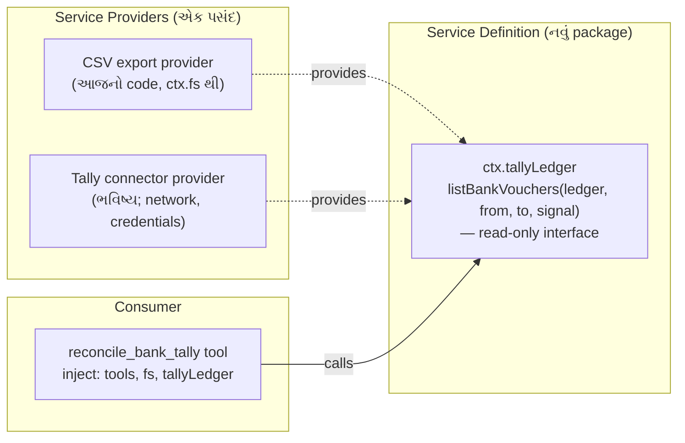

# પ્રકરણ 7 — અંતિમ પ્રોજેક્ટ અને mastery પરીક્ષા

> **Level 7.** Synthetic bank statement અને sample Tally export પર **read-only reconciliation workflow** બનાવીએ.
> દરેક પરિણામ તેની input rows અને matching rule સુધી trace થાય. Fixtures માં malformed files, duplicate rows અને ambiguous matches છે.
> પછી ભવિષ્યનો read-only Tally connector કેવી રીતે ફિટ થાય તે **extension** તરીકે ડિઝાઇન કરીએ, અને mastery પરીક્ષા આપીએ.

## આ પ્રકરણ પછી તમે શું કરી શકશો

- Money, dates, signs અને references ને deterministic રીતે normalize કરી શકશો — floating point કે local timezone વગર.
- ક્રમબદ્ધ, traceable matching rules ડિઝાઇન કરી, "first-come" greedy matching ની ભૂલ ટાળી શકશો.
- Golden report, invariant test, અને rule-wise unit tests થી workflow સાબિત કરી શકશો.
- Read-only Tally connector ને capability seam (Definition / Provider / Consumer) તરીકે ડિઝાઇન કરી શકશો.
- Code walkthrough, debugging challenge અને design review પૂરાં કરી rubric સામે પોતાનું મૂલ્યાંકન કરી શકશો.

## 7.1 સરળ સમજ: reconciliation એટલે બે ચોપડા સરખાવવા

**Bank reconciliation** એટલે bank statement અને પોતાના ચોપડા (અહીં Tally નું bank ledger) ની entries જોડીને બતાવવું કે કઈ મેળ ખાય છે, કઈ ફક્ત એક બાજુ છે, અને કેમ. ઉદાહરણ: bank charges ₹59 statement માં છે પણ Tally માં હજી નોંધાયા નથી.

**Read-only** એટલે tool ફક્ત વાંચે છે: કોઈ voucher બનાવતો/બદલતો નથી. પરિણામ માનવ reviewer માટે પુરાવા સાથેની યાદી છે, ચોપડામાં ફેરફાર નહીં.

**બે sign convention** (આ આખા પ્રોજેક્ટની સૌથી સામાન્ય ભૂલ):

| Export | Money **in** to bank | Money **out** |
|---|---|---|
| Bank statement | `Credit` | `Debit` |
| Tally bank ledger | `Debit` | `Credit` |

તેથી બંનેને એક જ દૃષ્ટિ — "bank account માં +" — માં ફેરવીએ છીએ ([normalize.ts](../labs/reconcile/src/normalize.ts)): bank માટે `credit − debit`, Tally માટે `debit − credit`, બંને **integer paise** માં.

> **Data notice.** Fixtures ના બધા નામ, reference numbers અને રકમ પુસ્તક માટે બનાવેલાં **synthetic** છે ([fixtures/README.md](../labs/reconcile/fixtures/README.md)). Tally export નો column layout પણ અમે ધારેલો નમૂનો છે; સાચા Tally export સાથે સરખાવ્યો નથી. ⚠️ તેથી column names `Config` માં છે.

## 7.2 Rules — ક્રમ સાથે

[reconcile.ts](../labs/reconcile/src/reconcile.ts) ના header માં લખેલા નિયમો, આ ક્રમમાં ચાલે છે:

| Rule | Status | શરત | કેમ આ ક્રમ |
|---|---|---|---|
| **V1** | `rejected` | CSV problem, ખોટી date (દા.ત. `31-02-2026`), ખોટી રકમ, debit અને credit બંને ભરેલા | ખરાબ input પર matching ન ચલાવો |
| **D1** | `duplicate` | **એક જ file** માં date, amount, reference, text સરખાં | બધી copies review માટે રોકો; એક પસંદ કરવી guess છે |
| **R1** | `matched` | normalized reference + signed amount સરખાં, 1↔1 | સૌથી મજબૂત પુરાવો પહેલાં |
| **R2** | `matched` | signed amount સરખું, તારીખ ±`windowDays`, candidate group બરાબર 1 bank + 1 Tally | reference વગરની entries |
| **A1** | `ambiguous` | R1 કે R2 નો group 1+1 કરતાં મોટો | ક્યારેય guess નહીં |
| **U1** | `unmatched` | બાકી બધું; held duplicate સાથે reference મળે તો નોંધ | |

**Connected components કેમ?** Greedy matching ("પહેલી મળે તે લઈ લો") input ના ક્રમ પર આધાર રાખે છે. અમે bank અને Tally rows ને graph ના nodes બનાવીએ છીએ, rule ની શરત edge છે, અને દરેક connected component ને એક સાથે નક્કી કરીએ છીએ: 1+1 → match; મોટું → ambiguous. પરિણામ input ક્રમથી સ્વતંત્ર છે. Test "two bank rows competing for one Tally row are ambiguous, not first-come" આ સાબિત કરે છે.

## 7.3 Fixtures → rules નકશો

| Input line | શું છે | અપેક્ષિત |
|---|---|---|
| bank L2 ↔ tally L2 | UTR `N0914000123`, ₹15,000 in | R1 matched |
| bank L3 ↔ tally L3 | cheque `004512` vs `4512` (leading zeros), ₹8,250.50 out | R1 matched (normalized ref) |
| bank L4 ↔ tally L4 | ₹4,300 in, ref ફક્ત bank માં, તારીખ 1 દિવસ અલગ | R2 matched |
| bank L5 ↔ tally L5, L6 | ₹12,000 in, Tally માં બે receipts (Desai, Rana) | A1 ambiguous |
| bank L6 | bank charges ₹59 out, ref `-` | U1 unmatched |
| bank L7, L8 | Joshi Pharma ₹6,100 બે વાર, એકસરખું | D1 duplicate |
| tally L7 | Joshi Pharma ₹6,100, ref સરખો | U1 + નોંધ "held bank duplicates (lines 7, 8)" |
| tally L8 | cheque `004513`, ₹2,500 out — હજી clear નથી | U1 unmatched |
| bank L9 | `31-02-2026` | V1 rejected |
| bank L10 | debit અને credit બંને | V1 rejected |
| bank L11 | ફક્ત 3 fields | V1 rejected (`COLUMN_COUNT`) |
| tally L9 | રકમ `12,00x.00` | V1 rejected |

**Golden report** ([expected-report.txt](../labs/reconcile/fixtures/expected-report.txt)) — 🧪 library, tool pipeline, અને real headless turn ત્રણેયમાં byte-identical:

```text
bank rows 10, tally rows 8, window ±3 day(s)
matched 3 (₹11049.50), ambiguous 1, unmatched bank 1, unmatched tally 2, duplicates 1, rejected 4
unexplained difference (unmatched bank - unmatched tally): -₹3659.00
MATCHED [R1] bank L2 ↔ tally L2 ₹15000.00: reference N0914000123 and amount ₹15000.00 agree
MATCHED [R1] bank L3 ↔ tally L3 -₹8250.50: reference 4512 and amount -₹8250.50 agree
MATCHED [R2] bank L4 ↔ tally L4 ₹4300.00: amount ₹4300.00 agrees; dates 1 day(s) apart (window 3)
AMBIGUOUS [A1] bank L5 ↔ tally L5,L6 ₹12000.00: amount ₹12000.00 within 3 day(s) fits 1 bank and 2 Tally rows
UNMATCHED [U1] bank L6 -₹59.00: no tally row with this reference or amount within 3 day(s)
UNMATCHED [U1] tally L7 ₹6100.00: reference N0970000456 also appears in held bank duplicates (lines 7, 8)
UNMATCHED [U1] tally L8 -₹2500.00: no bank row with this reference or amount within 3 day(s)
DUPLICATE [D1] bank L7,L8 ₹6100.00: 2 identical bank rows (date 2026-04-07, ₹6100.00); held for review
REJECTED [V1] bank L9: invalid date "31-02-2026"
REJECTED [V1] tally L9: invalid debit "12,00x.00"
REJECTED [V1] bank L10: both debit and credit are filled
REJECTED [V1] bank L11: COLUMN_COUNT: expected 7 fields, found 3
```

હાથથી ચકાસો: matched = 15,000 − 8,250.50 + 4,300 = **11,049.50**; unexplained = (−59) − (6,100 − 2,500) = **−3,659.00**.

## 7.4 Harness wiring

[plugin.ts](../labs/reconcile/src/plugin.ts) એ પ્રકરણ 4 નો જ નમૂનો છે, ત્રણ ઉમેરા સાથે:

1. **Column names config માં** (`bankColumns`, `tallyColumns`) — બીજી bank નું export? Overlay માં names બદલો, code નહીં. ખોટું નામ હોય તો fail loud: integration test બતાવે છે કે `date: 'Posting Date'` હોય તો દરેક bank row `V1 invalid date ""` થાય.
2. **`windowDays`** — config default 3, અને model દરેક call માં `window_days` (integer) આપી શકે. Negative value schema-level validation માં error બને છે (test).
3. **Canonical JSON report** — દરેક `ResultRow` માં `status`, `rule`, `bankLines`, `tallyLines`, `amount`, `reason`. UI કે બીજો tool line-level trace આ JSON માંથી બનાવી શકે.

## Source map: આ ક્રમમાં ખોલો

| ક્રમ | File | Symbol | કેમ |
|---|---|---|---|
| 1 | `labs/reconcile/src/normalize.ts` | `parseDate`, `parseAmount`, `normalizeRef`, `normalizeBank`/`normalizeTally` | ડેટા એક જ ભાષામાં |
| 2 | `labs/reconcile/src/reconcile.ts` | `splitDuplicates`, `components`, `reconcileTables` | rules |
| 3 | `labs/reconcile/src/plugin.ts` | `Config`, `apply` | harness wiring |
| 4 | `labs/csv-inspect/src/csv.ts` | `parseCsv` | પ્રકરણ 4 નો parser ફરી વાપર્યો |
| 5 | `packages/core/tools/src/schema.ts` | [`defineTool` validation][schema-defineTool-validate] | `window_days` schema |
| 6 | `packages/fs/fs/src/index.ts` | [`FileSystem`][fs-abstract] | read-only seam |

## Lab 7 — આખો workflow

```bash
node --import tsx --test reconcile/test/*.test.ts
```

🧪 `tests 10, pass 10` (rule-wise tests + golden + "every input row appears in exactly one result" invariant + determinism + 3 integration tests).

Real headless turn:

```bash
O=$(bash tmp/book-labs/reconcile/make-overlay.sh)
```

```bash
TOOL_NAME=reconcile_bank_tally TOOL_ARGS='{"bank_path":"tmp/book-labs/reconcile/fixtures/bank-statement.csv","tally_path":"tmp/book-labs/reconcile/fixtures/tally-bank-ledger.csv"}' EXTRA_PATCH=$O TASK='bank statement અને Tally export reconcile કરો.' bash tmp/book-labs/request-trace/run-mock.sh
```

🧪 exit 0; trace: `tools/result reconcile_bank_tally isError=false chars=1210`; `turn/end completed` ([evidence/rec.err](../evidence/rec.err)).

## 7.5 Extension: ભવિષ્યનો read-only Tally connector

> **આ વિભાગ extension design છે — અમલમાં મૂક્યો નથી, ચલાવ્યો નથી.** ⚠️ Tally ની કોઈ API વિગત અહીં ચકાસેલી નથી.

હાલમાં tool CSV files વાંચે છે. Connector આવે ત્યારે આખો tool ફરી લખવો ન પડે તે માટે, architecture doc નો **capability seam** નમૂનો ([architecture.md — Capability seams](https://github.com/deepseek-ai/deepseek-harness/blob/fcc0ad462172522aaf5c93a7b2e01f6b9f0b0159/docs/architecture.md#capability-seams)) વાપરીએ:



ડિઝાઇન નિયમો (દરેક નિયમ પાછળ upstream સ્રોત):

1. **Interface માં write method જ નહીં.** Read-only ની ખાતરી type level પર; reviewer ને ફક્ત interface જોવાનું રહે.
2. **Provider swap = config.** બંને provider એક જ service નામ (`tallyLedger`) provide કરે; overlay એક row disable કરી બીજી insert કરે. એક સાથે બે register થાય તો Cordis સ્પષ્ટ error આપે છે ([`provide`][cordis-provide]). ✅
3. **Normalization consumer માં જ રહે.** Provider raw vouchers આપે; signs/paise/dates `normalize.ts` જ નક્કી કરે, જેથી CSV અને connector એક જ નિયમથી સરખાવાય.
4. **Network અને credentials.** Connector ને network જોઈએ; deployment એ approval/sandbox policy અને credentials service વિચારવા પડશે. Model-visible input log થવું જોઈએ ("Model-visible ⟺ logged", [AGENTS.md][agents-conventions]) — tool result આપોઆપ `tool/result` તરીકે log થાય છે.
5. **Fail loud.** Connector unreachable હોય તો ખાલી યાદી નહીં, structured error — નહીં તો "બધું unmatched" એવો ખોટો report બને.

## 7.6 Code walkthrough (જવાબ સાથે મોટેથી વાંચો)

1. `parseAmount('1,23,456.50')` floating point વગર `12345650` કેવી રીતે આપે છે?
2. `fingerprint` માં text કેમ uppercase થાય છે, અને balance column કેમ સામેલ નથી? (સંકેત: duplicate rows નું balance જુદું હોય.)
3. `components` એક જ graph function બંને R1 અને R2 માટે કેવી રીતે વપરાય છે?
4. `firstLine` sort key માં bank lines ને `2n` અને Tally ને `2n+1` કેમ બનાવ્યા?
5. `totals.bankRows` માં `COLUMN_COUNT` problems કેમ ઉમેર્યા?

જવાબો: [પરિશિષ્ટ D — પ્રકરણ 7](../appendix/D-lab-solutions.md#ch7).

## 7.7 Debugging challenge

એક reviewer ને production માં આ મળ્યું: "₹100 નો refund **આપ્યો** (Tally payment) અને એ જ દિવસે ₹100 **મળ્યા** (bank receipt) — report કહે છે R2 matched." તમારું કામ:

1. Planted bug લગાવો (patch ખોલ્યા વગર):

```bash
cd tmp/book-labs && patch -p1 < reconcile/challenge/planted-bug.patch
```

2. Test suite ચલાવો:

```bash
node --import tsx --test reconcile/test/*.test.ts
```

🧪 **બધા 10 tests pass થાય છે.** એ જ challenge છે: test suite માં ખાડો છે.
3. Reviewer ના વર્ણન પરથી નિષ્ફળ થતો test લખો, bug શોધો, fix કરો, અને સાબિત કરો કે તમારો test fix વગર fail અને fix સાથે pass થાય છે.

અમારો solution test: [challenge/sign.test.ts](../labs/reconcile/challenge/sign.test.ts) (🧪 bug સાથે `fail 1`: `actual: ['matched']`, fix સાથે `pass 1`). સમજૂતી: [પરિશિષ્ટ D — challenge](../appendix/D-lab-solutions.md#challenge).

## 7.8 Design review

આ પ્રોજેક્ટ પર reviewer તરીકે નીચેના પ્રશ્નો લખીને જવાબ આપો. સારા જવાબ source કે test ટાંકે છે.

| # | પ્રશ્ન | શું તપાસવું |
|---|---|---|
| 1 | Duplicates ની બધી copies રોકવી યોગ્ય છે? એક જ દિવસે સાચે જ બે સરખી payments થાય તો? | Business rule vs safety; reviewer override કેવી રીતે? |
| 2 | `windowDays` નો default 3 કોણે નક્કી કર્યો? | Config માં છે — "No hardcoded tunables" ✅ |
| 3 | R1 પછી R2 નો ક્રમ ઉલટાવો તો કયા fixtures નું પરિણામ બદલાય? | bank L2/L3 |
| 4 | 5 MB `maxBytes` મર્યાદા પૂરતી છે? મોટી file stream થવી જોઈએ? | upstream `read` નું `streamMinSize` નમૂનો |
| 5 | Report model ને જાય છે — તેમાં party names છે. Data boundary? | પ્રકરણ 5 નું `dsh_session_log` |
| 6 | Tool read-only છે તેની ખાતરી કોણ આપે? | ફક્ત `ctx.fs.stat/readText`; write API વપરાતી નથી |

## 7.9 Mastery પરીક્ષા

પરીક્ષાના ચાર ભાગ છે; દરેકનો અપેક્ષિત પુરાવો [પરિશિષ્ટ E — mastery rubric](../appendix/E-mastery-rubric.md) માં છે.

1. **Code walkthrough** (7.6) — ખુલ્લા source સાથે, 15 મિનિટ.
2. **Debugging challenge** (7.7) — failing test + fix + fail/pass પુરાવો.
3. **Design review** (7.8) — ઓછામાં ઓછા 4 પ્રશ્નોના લેખિત જવાબ, દરેકમાં source/test link.
4. **Architecture trace** — કોઈ મદદ વગર, `reconcile_bank_tally` call માટે પ્રકરણ 1 જેવો sequence diagram બનાવો: overlay row → Loader → `ctx.tools.register` → model tool call → pipeline → `ctx.fs` → `tool/result` → step 2.

## આગાહી કસોટી

Fixture માં કંઈ બદલ્યા વગર `window_days: 0` સાથે tool ચલાવો. **ચલાવતા પહેલાં લખો:** matched, ambiguous, unmatched bank, unmatched tally ની સંખ્યા. જવાબ: [પરિશિષ્ટ D — Lab 7](../appendix/D-lab-solutions.md#lab-7).

## નિષ્ફળતા: "બધી bank rows rejected"

**લક્ષણ.** બીજી bank નું export આપ્યું; report માં દરેક bank row `REJECTED [V1] … invalid date ""`.

**ટૂંકો નિદાન માર્ગ.** `""` નો અર્થ: configured date column header માં **નથી**, એટલે value ખાલી. Export નું header જુઓ, અને overlay માં `bankColumns.date` (અને બીજાં names) સુધારો. Integration test "column names come from config, so a renamed export fails loudly until configured" બરાબર આ લક્ષણ ઉત્પન્ન કરે છે.

## Mastery check

1. Bank અને Tally ના signs કેમ ઊંધા છે, અને code તેમને ક્યાં એક કરે છે?
2. Greedy matching ની કઈ ખામી connected components ટાળે છે? Test નું નામ આપો.
3. Rejected rows ને અલગ result તરીકે રાખવાનો ફાયદો શું — ચૂપચાપ skip કરવાને બદલે?
4. Tally connector ના interface માં write method ન હોવાનો શું ફાયદો?
5. Planted bug એ 10 tests માંથી કોઈને fail કેમ ન કર્યો?

જવાબો: [પરિશિષ્ટ D — પ્રકરણ 7](../appendix/D-lab-solutions.md#ch7).

---

પાછળ: [પ્રકરણ 6](06-maintainer-architecture.md) · [વિષયસૂચિ](../README.md)

<!-- citations:begin (generated by tools/refdefs.py) -->
[agents-conventions]: https://github.com/deepseek-ai/deepseek-harness/blob/fcc0ad462172522aaf5c93a7b2e01f6b9f0b0159/AGENTS.md#L130-L142
[cordis-provide]: https://github.com/deepseek-ai/deepseek-harness/blob/fcc0ad462172522aaf5c93a7b2e01f6b9f0b0159/vendor/cordis/src/reflect.ts#L291-L311
[fs-abstract]: https://github.com/deepseek-ai/deepseek-harness/blob/fcc0ad462172522aaf5c93a7b2e01f6b9f0b0159/packages/fs/fs/src/index.ts#L103
<!-- citations:end -->
