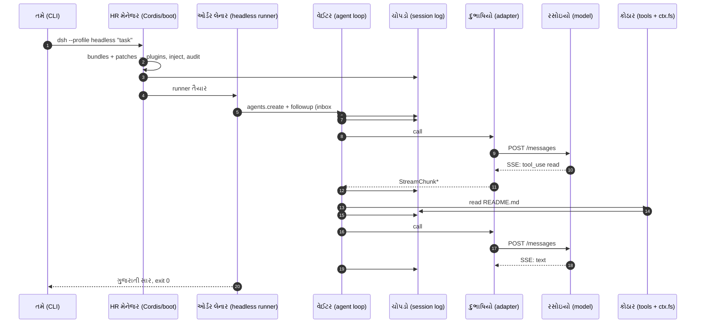

# વાર્તા 1 — "હાર્નેસ ભોજનાલય"નો પહેલો દિવસ

> **વાર્તા આવૃત્તિ, પ્રકરણ 1.** ધોરણ 12 ના વિદ્યાર્થી માટે: આખું DeepSeek Harness એક દિવસની વાર્તામાં.
> વાર્તા સરળ છે, પણ દરેક દ્રશ્ય પાછળ **સાચો code** છે: ક્યાં (file, symbol), કેવી રીતે (code શું કરે), શા માટે (design નું કારણ).
> વાર્તાનો દરેક બનાવ અમે ખરેખર ચલાવેલા run ના ચોપડામાં (session log) એક ચોક્કસ લીટી નંબર તરીકે દેખાય છે. અંતે lab માં તમે પોતે એ મેળવશો.
>
> આ પ્રકરણ મુખ્ય પુસ્તકના [પ્રકરણ 0](../book/00-paayo-ane-pratham-run.md), [પ્રકરણ 1](../book/01-request-ni-musafari.md) અને [પ્રકરણ 2](../book/02-cordis-plugin-architecture.md) ને એક વાર્તામાં જોડે છે; ઊંડા જવું હોય ત્યારે ત્યાં જાઓ.

## આ વાર્તા પછી તમે શું કરી શકશો

- DeepSeek Harness શરૂથી અંત સુધી કેવી રીતે કામ કરે છે તે એક વાર્તા તરીકે કોઈને પણ સમજાવી શકશો.
- વાર્તાના દરેક પાત્રનું સાચું ટેકનિકલ નામ અને તેનો code ક્યાં છે તે કહી શકશો.
- દરેક design નિર્ણય **શા માટે** આવો છે તે કહી શકશો, જે expert developer ને બીજાથી અલગ પાડે છે.
- ચોપડાની 25 લીટીઓ (#0 થી #24) વાંચીને કહી શકશો કે દરેક લીટી વાર્તાના કયા દ્રશ્યની છે.

## વાર્તાનાં પાત્રો અને તેમનાં સાચાં નામ

આ table વાર્તા દરમિયાન વારંવાર જોવી પડશે. પહેલી વાર ફક્ત એક નજર નાખો.

| વાર્તામાં | સાચું ટેકનિકલ નામ | એક લીટીમાં કામ |
|---|---|---|
| તમે | developer | ભોજનાલય ચલાવો અને સુધારો |
| મુખ્ય દરવાજો | `dsh` CLI | program શરૂ કરવાનો રસ્તો |
| શાખાનો પ્રકાર | profile (`headless`) | કયું composition ચલાવવું |
| મેનુ-પાનાં | bundles (`dsh-base`, `dsh-headless`) | config rows ના તૈયાર સંગ્રહ |
| મેનુ પરની ચિઠ્ઠી | patch / overlay | row ને બદલવી, ઉમેરવી કે બંધ કરવી |
| HR મેનેજર | Cordis (Loader + Context) | plugins ચાલુ-બંધ કરે, services ગોઠવે |
| ખુરશી પરનો કર્મચારી | service (`ctx.tools`, `ctx.fs`, `ctx.llm`, …) | નામથી બોલાવાતી સેવા |
| નોકરીની શરત | `inject` | જરૂરી services વગર plugin શરૂ ન થાય |
| ઓર્ડર લેનાર | headless runner | task લઈ agent ને આપે |
| વેઈટર | agent loop (`ReactLoopAgent`) | model ↔ tools નો loop |
| ઓર્ડર-પેટી | inbox | હજી ન લીધેલા સંદેશા |
| ઓર્ડર-ચોપડો | session log | ફક્ત ઉમેરાતી ઘટનાઓની યાદી |
| રસોઇયો | AI model (`deepseek-flash`) | text અથવા tool call બનાવે; હાથ નથી |
| દુભાષિયો | LLM adapter (`DeepSeekAdapter`) | harness ની ભાષા ↔ provider ની HTTP ભાષા |
| કોઠારનો મુખ્ય | tool executor + pipeline | tool call ચલાવે, નીતિ લાગુ કરે |
| રેસીપી-ચોપડી લાવનાર | `read` tool | file વાંચી line-numbered text આપે |
| કોઠારી | filesystem service (`ctx.fs`) | ખરી file સુધી પહોંચે |
| રસોડાની વાડ | sandbox (`workspace-write`) | ફેરફાર ક્યાં સુધી માન્ય |

---

## દ્રશ્ય 0 — ચાવી સોંપાય છે

**કથા.** વેકેશનમાં તમને "હાર્નેસ ભોજનાલય" માં કામ મળ્યું. માલિક ચાવી આપતાં એક જ નિયમ કહે છે: *"આ ભોજનાલયમાં **દરેક** કર્મચારી બદલી શકાય છે, રસોઇયો, વેઈટર, મેનેજર પણ. કોઈ કાયમી નથી."* પછી ઉમેરે છે: *"અને અહીં ચોપડામાંથી ક્યારેય કંઈ ભૂંસાતું નથી."*

**ટેકનિકલ નામ.** આ બે નિયમ DeepSeek Harness ના બે પાયા છે:

1. **Everything is a plugin.** Agent loop, tool registry, session log, model adapter, બધું plugin છે.
2. **Append-only session log.** ઘટનાઓ ફક્ત ઉમેરાય છે, બદલાતી નથી.

**ક્યાં.** README અને [architecture.md][arch-turnflow]; repository ના નિયમો [AGENTS.md][agents-conventions] માં.

**શા માટે.** પહેલા નિયમથી ભોજનાલયનો કોઈ પણ ભાગ config થી બદલી શકાય, મુખ્ય code ને અડ્યા વગર. બીજા નિયમથી દરેક ઘટના પછીથી ફરી તપાસી શકાય (debugging), ફરી શરૂ કરી શકાય (resume), અને સાબિત કરી શકાય.

> **Expert નજર.** મોટાભાગનાં agent programs માં loop "મુખ્ય" હોય છે અને બાકીનું તેની આસપાસ હોય છે. અહીં loop પણ plugin છે, એટલે તમે આખો loop બીજો મૂકી શકો. આ એક architectural પસંદગી છે, જેની કિંમત એ છે કે startup વધુ જટિલ બને છે (દ્રશ્ય 1).

---

## દ્રશ્ય 1 — સવારે દુકાન ખોલવી (startup)

**કથા.** તમે મુખ્ય દરવાજો ખોલો છો અને કહો છો: *"આજે ટિફિન-સેવા શાખા."* એટલે ગ્રાહક-હૉલ નથી; ફક્ત એક ઓર્ડર લો, પૂરો કરો, બંધ કરો. HR મેનેજર બે મેનુ-પાનાં ખોલે છે: "દરેક શાખામાં જોઈએ" (base) અને "ટિફિન-સેવાના ફેરફાર" (headless). પછી તે પાનાં પર ચોંટાડેલી ચિઠ્ઠીઓ ક્રમમાં વાંચે છે. એક ચિઠ્ઠી પર લખ્યું છે: *"આજે ઓર્ડરનું નામ પાડનાર બીજો રસોઇયો રજા પર."*

પછી બધા ~100 કર્મચારીઓને **એક સાથે** બોલાવે છે. પણ દરેકની નોકરીની શરત છે: રેસીપી-ચોપડી લાવનાર કહે છે, *"કોઠારી અને સાધન-ઘર હાજર હોય તો જ હું કામ શરૂ કરીશ."* છેલ્લે મેનેજર હાજરીપત્રક તપાસે છે: વેઈટર અને કોઠારના મુખ્ય જેવા **ફરજિયાત** કર્મચારી ગેરહાજર હોય તો દુકાન ખૂલે જ નહીં.

**ટેકનિકલ નામ.** startup: profile → bundles → patches → config rows → plugin fibers → startup audit.

**ક્યાં.**

| પગલું | File | Symbol |
|---|---|---|
| દરવાજો | `apps/cli/src/bin.ts` | [`runCli`][cli-runCli] |
| શાખા ચાલુ કરવી | `apps/cli/src/profile-boot.ts` | [`runProfile`][cli-runProfile] |
| ચિઠ્ઠીઓનો ક્રમ | `packages/boot/app-boot/src/profile-context.ts` | [`readProfilePatches`][boot-readProfilePatches] |
| HR મેનેજર કામે | `packages/boot/app-boot/src/index.ts` | [`boot`][boot-boot] |
| હાજરીપત્રક | same | [`auditStartupEntries`][boot-audit], [ફરજિયાત યાદી][boot-required] |
| ટિફિન-સેવાનું પાનું | `packages/bundle/headless/cordis.patch.yml` | [headless patch][bundle-headless] |

**કેવી રીતે.**

1. `pnpm dsh --profile headless "…"` ચલાવો. તે `node --import tsx/esm apps/cli/src/bin.ts` છે.
2. ચિઠ્ઠીઓ આ ક્રમમાં લાગે છે, અને **પાછળની ચિઠ્ઠી જીતે**: bundles → profile નું `cordis.patch.yml` → `$DSH_HOME/cordis.patch.yml` → તમારું `--patch` → telemetry switch.
3. Cordis દરેક row ને plugin તરીકે શરૂ કરે છે. જે plugin નું `inject` પૂરું ન થાય તે `PENDING` રહે છે.
4. અંતે audit: `agent-loop` કે `tool-executor-native` જેવી required entry inactive હોય તો `StartupError` અને exit 1. બાકીની માટે ફક્ત warning.

**શા માટે.**

- **ચિઠ્ઠીઓ (patches) કેમ?** મૂળ મેનુ ક્યારેય બદલવું ન પડે. તમારો ફેરફાર એક નાની YAML file છે, જે કાઢી નાખો એટલે બધું મૂળ જેવું.
- **એક સાથે શરૂઆત + `inject` કેમ?** ક્રમ હાથથી ગોઠવવો ન પડે. "કોને શું જોઈએ" લખો, ક્રમ જાતે નક્કી થાય.
- **Required vs optional કેમ?** શણગારનો કર્મચારી ગેરહાજર હોય તો પણ જમવાનું મળે. રસોઇયાનો સહાયક ગેરહાજર હોય તો દુકાન ખોલવી નકામી, અને ખતરનાક પણ.

**ઉપમા ક્યાં તૂટે છે.** મેનુમાં ઉપર લખેલો કર્મચારી પહેલાં આવે એવું **નથી**. YAML નો ક્રમ startup નો ક્રમ નથી; ફક્ત `inject` ક્રમ નક્કી કરે છે. મુખ્ય પુસ્તકના પ્રકરણ 2 માં tutorial નો race આ જ ભૂલથી થયો હતો.

> **Expert નજર.** Service registration પોતે એક *effect* છે ([`ReflectService.provide`][cordis-provide]): plugin unload થાય ત્યારે service આપોઆપ પાછી ખેંચાય છે. એટલે "રજા પર ગયેલો કર્મચારી પોતાની ખુરશી પણ સાથે લઈ જાય". એક જ નામે બીજો કર્મચારી બેસવા જાય તો મેનેજર ના પાડે છે (`service "…" has been registered at …`).

---

## દ્રશ્ય 2 — ચોપડાનાં પહેલાં ત્રણ પાનાં: રસોડાના નિયમ

**કથા.** દુકાન ખૂલતાં જ, હજી કોઈ ઓર્ડર લખાય તે પહેલાં, ચોપડાની પહેલી ત્રણ લીટીઓ લખાય છે: *"આજે વાડ: પોતાના રસોડામાં જ રાંધવું. મોટું કામ હોય તો શેઠને પૂછવું."*

**ચોપડામાં** (અમારો ખરો run):

```text
#0 permission/preset {"preset":"workspace-write"}
#1 sandbox/mode {"mode":"workspace-write"}
#2 approval/policy {"policy":"ask"}
```

**ટેકનિકલ નામ.** permission preset, sandbox mode, approval policy.

**ક્યાં.** Base bundle ની [sandbox અને approval rows][bundle-base-sandbox]; filesystem ની વાડ [`dsh-fs-sandbox`][fs-sandbox-doc].

**કેવી રીતે.** `workspace-write` એટલે current directory (workspace) ની અંદર ફેરફાર માન્ય, બહાર નહીં. `ask` એટલે વધુ છૂટ માંગવી હોય તો મંજૂરી પૂછવી.

**શા માટે ચોપડામાં?** પછીથી કોઈ પૂછે, "આ session માં agent ને કેટલી છૂટ હતી?", તો જવાબ ચોપડામાં લખેલો હોય. યાદ પર આધાર ન રાખવો પડે.

**ઉપમા ક્યાં તૂટે છે.** ભોજનાલયની વાડ ચોરને પણ રોકે. આ વાડ ફક્ત **ફેરફાર** પર છે; **વાંચવું ખુલ્લું છે** (મુખ્ય પુસ્તક, પ્રકરણ 5). તેથી કોઈ secret હોય તેવા machine પર agent ચલાવતાં પહેલાં વિચારો.

---

## દ્રશ્ય 3 — ઓર્ડર આવે છે

**કથા.** ઓર્ડર લેનાર તમારો ઓર્ડર લખે છે: **"આ repositoryનું README વાંચીને ગુજરાતી સાર આપો."** તે નવો વેઈટર નીમે છે, ઓર્ડરને ઓર્ડર-પેટીમાં મૂકે છે, અને રાહ જુએ છે.

**ચોપડામાં.**

```text
#3 agent/inbox/spliced {"target":"next-turn", "inserted":[{… "આ repositoryનું README …" …}]}
```

**ટેકનિકલ નામ.** headless runner, `agents.create`, `agent.followup`, inbox.

**ક્યાં.** `packages/bundle/headless/src/index.ts`: [`run`][headless-run], [`agents.create`][headless-create], [`agent.followup`][headless-followup].

**કેવી રીતે.**

```ts
      agent.followup(createUserMessage({
        content: [{ type: 'text', text: task }],
        source: { kind: 'user' },
      }))
```

(repository code) `followup` સંદેશ inbox માં મૂકે છે અને driver ([`kick`][loop-kick]) ને જગાડે છે: `while (await this.turn()) {}`.

**શા માટે inbox?** વેઈટર કામમાં હોય ત્યારે નવો સંદેશ આવે તો ખોવાય નહીં; તે પેટીમાં રાહ જુએ. Inbox નો ફેરફાર પણ ચોપડામાં લખાય છે (#3), એટલે process બંધ થાય તો પણ "શું બાકી હતું" ખબર રહે.

---

## દ્રશ્ય 4 — ઓર્ડર નંબર પડે છે (turn શરૂ)

**કથા.** વેઈટર ચોપડામાં લખે છે: **"ઓર્ડર નં. 1 શરૂ."** પછી પેટીમાંથી ઓર્ડર ઉપાડે છે.

**ચોપડામાં.**

```text
#4 turn/start {"turn":1}
#5 agent/inbox/spliced {"removedCount":1, …}
```

**ટેકનિકલ નામ.** **Turn** = user ના એક સંદેશથી "કંઈ બાકી નથી" ત્યાં સુધીનું આખું કામ.

**ક્યાં.** [`ReactLoopAgent.turn`][loop-turn]; `turn/start` [અહીં][loop-turn-start] લખાય છે, અને `turn/end` [અહીં][loop-turn-end], `finally` block માં.

**શા માટે `finally`?** **`finally`** એટલે "સફળતા, ભૂલ કે રદ, ગમે તે થાય, આ code ચાલશે જ". તેથી દરેક શરૂ થયેલા ઓર્ડરનો અંત ચોપડામાં હોય છે. મુખ્ય પુસ્તકના પ્રકરણ 3 માં Ctrl+C પછી પણ `turn/end {"kind":"aborted"}` લખાયેલું જોયું હતું.

---

## દ્રશ્ય 5 — રસોઇયા પાસે જતાં પહેલાં વેઈટરની થાળી

**કથા.** વેઈટર ખાલી હાથે રસોઇયા પાસે નથી જતો. તે એક થાળીમાં પાંચ વસ્તુ ગોઠવે છે:

1. **રસોડાના નિયમ** (system prompt): "તમે DeepSeek Harness નો AI agent છો…"
2. **ગ્રાહકનો ઓર્ડર** (તમારું task)
3. **આ ઘરના ખાસ નિયમ** (`AGENTS.md` માંથી workspace instructions)
4. **આજની વિગત** (runtime context: current directory વગેરે)
5. **કૌશલ્યોની યાદી** (skill catalog)

સાથે **કોઠારની યાદી**: આપણી પાસે 25 સાધનો છે (`read`, `write`, `bash`, `grep`, …). થાળી રસોડામાં જાય તે પહેલાં **ટેબલ-ટેબલ હાથોહાથ** પસાર થાય છે. કોઈ પણ ટેબલ પરનો કર્મચારી તેમાં ઉમેરો કરી શકે કે ઓર્ડર રોકી શકે, પણ આગળ આપવો તેની જવાબદારી છે.

**ચોપડામાં.**

```text
#6  step/start {"turn":1,"step":1}
#7  system/message
#8  user/message source={"kind":"user"}                 ← ગ્રાહકનો ઓર્ડર
#9  user/message source={"kind":"agent-instructions"}   ← ઘરના નિયમ
#10 user/message source={"kind":"runtime-context"}      ← આજની વિગત
#11 user/message source={"kind":"skill-catalog"}        ← કૌશલ્ય-યાદી
#12 request/header reason=initial model=deepseek-official/deepseek-flash tools=25
#13 request/context {"contextWindow":1048576, …}
```

**ટેકનિકલ નામ.** **Step** = એક model request + તેણે માંગેલા tools. તૈયારી = `preStep`; હાથોહાથ પસાર થવું = `agent/pre-step` **waterfall** event.

**ક્યાં.** [`preStep`][loop-preStep], [user message admission][loop-admit], [`buildRequest`][loop-buildRequest]; dispatch modes: [Cordis primer][primer-dispatch].

**કેવી રીતે.** `preStep` inbox માંથી સંદેશ લે છે, model selection જુએ છે, આ step ના tools નક્કી કરે છે (`tools.resolve`), system prompt ભેગો કરે છે (`systemPrompt.assemble`), અને `agent/pre-step` waterfall ચલાવે છે. પછી `step()` દરેક સંદેશ ચોપડામાં `user/message` તરીકે લખે છે, અને `request/header` માં provider, model અને 25 tools નોંધે છે.

**શા માટે પહેલાં ચોપડામાં, પછી રસોઇયાને?** Repository નો સૌથી મહત્વનો નિયમ: **"Model-visible ⟺ logged"**. Model ને જતી દરેક વસ્તુ પહેલાં ચોપડામાં હોવી જોઈએ. પછી `session.deriveMessages()` **ચોપડામાંથી** history બનાવે છે ([source][loop-derive]). ફાયદો: કોઈ પણ model request પછીથી ચોપડામાંથી **બરાબર ફરી બનાવી** શકાય. Debugging, resume, fork બધું આના પર ટકે છે.

**Waterfall કેમ?** પ્લગિન્સને loop બદલ્યા વગર દરમિયાનગીરી કરવાની જગ્યા મળે છે. Compaction plugin અહીં જ લાંબો ઇતિહાસ ટૂંકો કરે છે. **નિયમ:** દરેક listener એ `next()` બોલાવવું જ પડે, નહીં તો સાંકળ ત્યાં જ અટકે.

**ઉપમા ક્યાં તૂટે છે.** સાચો વેઈટર રસોઇયાને દરેક વખતે આખી કથા નથી કહેતો. અહીં **દરેક model call માં આખો ઇતિહાસ** જાય છે, કારણ કે model ને પાછલી વાત યાદ રહેતી નથી. યાદ ચોપડો રાખે છે.

> **Expert નજર.** ચોપડામાં ચાર user messages છે, પણ wire પર (HTTP request માં) તે **એક** `user` message ના ચાર text blocks તરીકે ગયા (`messageRoles: ["user"]`, [evidence/wire.json](../evidence/wire.json)). ચોપડાનું માળખું અને provider નું wire format અલગ વસ્તુ છે, અને બંને વચ્ચેનો અનુવાદ દુભાષિયાનું કામ છે (દ્રશ્ય 6).

---

## દ્રશ્ય 6 — દુભાષિયા દ્વારા રસોઇયાને ફોન

**કથા.** રસોઇયો આપણા ભોજનાલયમાં નથી; તે બહારની agency નો છે. વેઈટર ગુજરાતીમાં બોલે છે, agency બીજી ભાષા સમજે છે. વચ્ચે **દુભાષિયો** છે. તે થાળીની વસ્તુઓને agency ની ભાષામાં ગોઠવીને ફોન કરે છે. રસોઇયો જવાબ **વાક્યે-વાક્યે** બોલે છે, અને દુભાષિયો દરેક વાક્ય તરત ભોજનાલયની ભાષામાં ફેરવતો જાય છે. રસોડામાં બધા એ વાક્યો સાંભળે છે, પણ ચોપડામાં **ફક્ત પૂરો જવાબ** લખાય છે.

**ટેકનિકલ નામ.** LLM runtime (`ctx.llm`), `llm/stream` waterfall, adapter (`DeepSeekAdapter`), HTTP `POST /messages`, SSE (Server-Sent Events), `StreamChunk`, live `agent/assistant-stream` frames.

**ક્યાં.**

| પગલું | Symbol |
|---|---|
| loop stream માંગે | [`step` નો stream loop][loop-stream] |
| દરેક request આ ધોધમાંથી પસાર થાય | [`LlmRuntime.stream` → `llm/stream`][llm-stream] |
| ફોન | [`fetch(…/messages)`][deepseek-fetch] |
| વાક્યોનો અનુવાદ | [`translate`][deepseek-translate] → [`StreamChunk`][llm-streamchunk] |
| live frames નું માળખું | [`AssistantStreamFrame`][agent-stream-frame] |
| પૂરો જવાબ ચોપડામાં | [`assistant/message`][loop-assistant-message] |

**કેવી રીતે.**

1. Loop ચોપડામાંથી બનેલો frozen request (`GenerateOptions`) આપે છે.
2. `llm/stream` waterfall: કોઈ પણ plugin દરેક request જોઈ કે લપેટી શકે. મુખ્ય પુસ્તકના trace અને metrics plugins અહીં જ બેસે છે.
3. Adapter body બનાવે છે અને `POST …/messages` કરે છે (`stream: true`).
4. જવાબ SSE માં આવે છે; `translate` તેને `text-delta`, `tool-call-delta`, `finish` જેવા `StreamChunk` માં ફેરવે છે.
5. દરેક chunk live frame તરીકે UI સુધી જાય છે. સફળ અંતે આખો compact stream એક `assistant/message` માં સચવાય છે.

**ચોપડામાં** (આ દ્રશ્યની વચ્ચે બે બાજુ-ઘટના પણ):

```text
#14 session/title {"title":"આ repositoryનું README વાં", "source":{"kind":"fallback"}}
#15 session-log-deepseek/delivery-accepted {…"throughSeq":14}
#16 assistant/message content=[{"type":"tool-call","name":"read","arguments":"{\"file_path\":\"README.md\"}"}]
```

- **#14 — ઓર્ડરનું નામ.** "નામ પાડનાર રસોઇયો રજા પર" હતો (દ્રશ્ય 1 ની ચિઠ્ઠી), તેથી ઓર્ડરના પહેલા શબ્દોમાંથી સાદું નામ બન્યું (`fallback`). રજા ન હોત તો નામ પાડવા **બીજો** model call થાત: કુલ 3 calls.
- **#15 — agency ને ચોપડાની નકલ.** `session-log-deepseek` plugin ચોપડાનો ભાગ request સાથે `dsh_session_log` field માં મોકલે છે ([source][sessionlog-register]). આ data boundary ની બાબત છે: model provider ને તમારું session log પણ જાય છે, સિવાય કે row બંધ કરો.

**શા માટે દુભાષિયો અલગ?** **Adapter boundary:** boundary ની ઉપર (loop, tools, ચોપડો) કોઈ DeepSeek ની wire ભાષા જાણતું નથી. નીચે adapter ચોપડો જાણતો નથી. તેથી નવો provider ઉમેરવો એટલે ફક્ત નવો દુભાષિયો (`ctx.llm.registerAdapter`). Loop ને અડવું ન પડે.

**શા માટે live અને stored અલગ?** UI ને તરત અક્ષરો દેખાય (live). પણ replay, resume અને પુરાવા માટે એક જ પાકો રેકોર્ડ જોઈએ (stored). **"વાત હવામાં, હિસાબ ચોપડામાં."**

---

## દ્રશ્ય 7 — રસોઇયાની ચિઠ્ઠી: "રેસીપી-ચોપડી લાવો"

**કથા.** રસોઇયો રાંધતો નથી. તે ચિઠ્ઠી મોકલે છે: **"README.md ખોલીને લાવો."** રસોઇયાને હાથ નથી; તે ફક્ત લખી શકે છે. વેઈટર ચિઠ્ઠી કોઠારના મુખ્યને આપે છે. મુખ્ય પહેલાં ચોપડામાં લખે છે "આ ચિઠ્ઠી આવી", પછી ચિઠ્ઠીને પાંચ ચોકીમાંથી પસાર કરે છે:

1. **ભાષા-તપાસ:** ચિઠ્ઠી સાચા રૂપમાં છે? `file_path` લખ્યો છે?
2. **શેઠની નીતિ:** આ કામ માન્ય છે, કે મંજૂરી જોઈએ?
3. **ચોકીદાર:** કોઈ ખાસ નિયમ ના પાડે છે?
4. **કામ:** રેસીપી-ચોપડી લાવનાર કોઠારીને કહે, કોઠારી વાડની અંદર રહીને ચોપડી શોધે.
5. **લેબલ:** ચોપડીના દરેક પાનાને નંબર આપી, સાફ રસીદ બનાવી પાછી મોકલે.

સામાન ન મળે તો? ઝઘડો નહીં, ફક્ત **લાલ ચિઠ્ઠી**: "Error: … not found."

**ચોપડામાં.**

```text
#17 tool/call read {"file_path":"README.md"}
#18 tool/result isError=false content=[{"type":"text","text":"<path>…/README.md</path>\n<type>file</type>\n<content>\n1: # DeepSeek Harness …"}]
#19 step/end {"turn":1,"step":1}
```

**ટેકનિકલ નામ.** tool call, tool executor, tool pipeline (`tools/pre-execute` → guards → `tools/execute` → body → `tools/post-execute`), `read` tool, `ctx.fs`, canonical value, render, `isError`.

**ક્યાં.**

| ચોકી | Symbol |
|---|---|
| કોઠારના મુખ્યને સોંપવું | [`tools.execute` from loop][loop-tools-execute] → [`selectExecutor`][tools-selectExecutor] |
| ચિઠ્ઠીઓનો batch | [`executeToolBatch`][batch-execute] |
| નીતિ + ચોકીદાર | [`prepare`][pipeline-prepare] |
| કામ | [`dispatch`][pipeline-dispatch] |
| લાલ ચિઠ્ઠી | [`toolErrorResult`][pipeline-errorResult] |
| રેસીપી-ચોપડી લાવનાર | [`applyReadTool`][read-tool] |
| કોઠારી સુધી | [`resolveRegularReadTarget`][read-target] |

**કેવી રીતે.** `read` tool `file_path` ને session ની directory માં resolve કરે છે, `ctx.fs.stat` કરે છે, file વાંચે છે (10 MB થી મોટી હોય તો stream), અને `{path, lines, totalLines}` આપે છે. `render` તેને `1: # DeepSeek Harness` જેવું line-numbered text બનાવે છે; model ને એ જ text મળે છે.

**શા માટે "લાલ ચિઠ્ઠી", crash નહીં?** Tool નિષ્ફળ જાય તો model ને જણાવવું સૌથી ઉપયોગી છે: તે બીજો path અજમાવી શકે. તેથી દરેક throw `Error: <message>` અને `isError: true` વાળું સામાન્ય `tool/result` બને છે, અને step 2 ચાલે જ છે. (Error નો code, જેમ કે `FS_NOT_FOUND`, ચોપડામાં રહે છે, model ના text માં નહીં.)

**શા માટે tool અને filesystem અલગ?** **Capability seam:** `read` tool (વાપરનાર) ને ખબર નથી કે file local disk પર છે કે remote sandbox માં. Filesystem provider (કોઠારી) બદલો, tool એ જ રહે.

**ઉપમા ક્યાં તૂટે છે.** સાચો રસોઇયો પોતે કોઠારમાં જઈ શકે. **Model ક્યારેય file ખોલતું નથી.** તે ફક્ત "આ tool, આ arguments" લખે છે; ચલાવવાનું, નીતિ અને વાડ harness ના હાથમાં છે. એ જ કારણે harness સુરક્ષા લાગુ કરી શકે છે.

> **Expert નજર.** Step 1 tool calls સાથે પૂરો થાય ત્યારે `step()` **`null`** return કરે છે, એટલે "turn હજી પૂરો નથી" ([source][loop-tools-execute]). `turn()` એ જોઈને આગલો step શરૂ કરે છે. આ નાનો `null` જ agent ને "loop" બનાવે છે.

---

## દ્રશ્ય 8 — બીજી વાતચીત

**કથા.** વેઈટર ફરી રસોઇયા પાસે જાય છે. થાળીમાં હવે બધું છે: પહેલાંની પાંચ વસ્તુ, રસોઇયાની ચિઠ્ઠી, **અને** ચોપડીનું પાનું. રસોઇયો વાંચે છે અને આ વખતે વાનગી બનાવે છે: ગુજરાતી સાર. કોઈ નવી ચિઠ્ઠી નથી.

**ચોપડામાં.**

```text
#20 step/start {"turn":1,"step":2}
#21 session-log-deepseek/delivery-accepted {…"throughSeq":20}
#22 assistant/message content=[{"type":"text","text":"README નો સાર: DeepSeek Harness એ plugin આધારિત agent harness છે."}]
#23 step/end {"turn":1,"step":2}
```

**ગણતરી.** Model call #1 માં 5 messages ગયા (1 system + 4 user). Call #2 માં 7: એ જ 5, વત્તા assistant નો tool-call, વત્તા tool result.

**શા માટે આખો ઇતિહાસ ફરી?** Model **stateless** છે: તેને પાછલો call યાદ નથી. દરેક call માં ચોપડામાંથી આખી કથા ફરી બને છે. તેથી ચોપડો લાંબો થાય તેમ request મોટો થાય; એટલે જ compaction જેવા plugins છે.

> **ધ્યાન.** આ lab માં "ગુજરાતી સાર" mock (નકલી) રસોઇયાએ script મુજબ આપ્યો છે. Lab model ની બુદ્ધિ નહીં, આખી પાઇપ-લાઇન ચકાસે છે.

---

## દ્રશ્ય 9 — થાળી પીરસાય છે, દુકાન બંધ

**કથા.** રસોઇયાએ ચિઠ્ઠી વગર વાનગી આપી, એટલે ઓર્ડર પૂરો. વેઈટર લખે છે: **"ઓર્ડર નં. 1 પૂર્ણ."** ઓર્ડર લેનાર ચોપડો તિજોરીમાં મૂકાવે છે (flush), ગ્રાહકને થાળી આપે છે (stdout), અને ટિફિન-સેવા શાખા બંધ થાય છે (exit 0).

**ચોપડામાં.**

```text
#24 turn/end {"turn":1,"reason":{"kind":"completed"}}
```

**Terminal માં.**

```text
README નો સાર: DeepSeek Harness એ plugin આધારિત agent harness છે.
```

**ક્યાં.** [`sessions.flush` અને અંતિમ output][headless-flush].

**તિજોરી ક્યાં?** `$DSH_HOME/sessions/<cwd-key>/session-<uuid>/session.v4.jsonl.zstd`: format version 4, એક લીટી = એક ઘટના, zstd થી દબાવેલું. આવતીકાલે `--session-id` થી એ જ ચોપડો ખોલી ઓર્ડર આગળ વધારી શકાય (resume).

**Turn ના પાંચ શક્ય અંત:** `completed` (પૂર્ણ), `error` (ભૂલ), `aborted` (રદ), `blocked` (રોક્યો), `max-tokens` (મર્યાદા). **યાદ-ચાવી "પૂ-ભૂ-ર-રો-મ".**

---

## આખો દિવસ એક ચિત્રમાં



## ક્યાં, કેવી રીતે, શા માટે: એક જ table માં

| દ્રશ્ય | ક્યાં (code) | કેવી રીતે (એક લીટી) | શા માટે (design કારણ) |
|---|---|---|---|
| 1 Startup | `runProfile`, `boot`, `auditStartupEntries` | patches → rows → `inject` → audit | બધું બદલી શકાય; ખામી તરત દેખાય |
| 2 વાડ | sandbox-policy, fs-sandbox | `workspace-write`, `ask` | ફેરફારોની સીમા; ચોપડામાં પુરાવો |
| 3 ઓર્ડર | headless `run`, `followup` | inbox માં સંદેશ | કામમાં હોય ત્યારે પણ સંદેશ ન ખોવાય |
| 4 Turn | `turn()` | `turn/start` … `finally turn/end` | દરેક શરૂઆતનો અંત ચોપડામાં |
| 5 તૈયારી | `preStep`, `buildRequest` | log કરો, પછી `deriveMessages` | Model-visible ⟺ logged |
| 6 ફોન | `llm/stream`, `DeepSeekAdapter` | POST, SSE → `StreamChunk` | provider બદલવો સહેલો; live vs stored |
| 7 Tool | executor, pipeline, `read`, `ctx.fs` | 5 ચોકી; ભૂલ = `isError` | model સુધારી શકે; સુરક્ષા harness પાસે |
| 8 Step 2 | `turn()` loop | `null` → આગલો step | model stateless; history ચોપડામાંથી |
| 9 અંત | headless flush | `turn/end completed`, exit 0 | resume માટે ચોપડો તિજોરીમાં |

---

## Lab — વાર્તાને તમારી આંખે જુઓ

**તૈયારી** (મુખ્ય પુસ્તકનું [પ્રકરણ 0](../book/00-paayo-ane-pratham-run.md) પૂરું કર્યું હોય: harness checkout, `pnpm install`, `pnpm run build`, અને `cp -r <book>/labs tmp/book-labs`).

**1. આખો દિવસ ચલાવો** (API key વગર):

```bash
rm -rf tmp/book-home && bash tmp/book-labs/request-trace/run-mock.sh
```

**2. ચોપડો ખોલો:**

```bash
node tmp/book-labs/request-trace/print-session.mjs "$(find tmp/book-home/sessions -name 'session.v*.jsonl*' | head -1)"
```

**3. મેળવો.** તમારા ચોપડાની દરેક લીટીની સામે વાર્તાનું દ્રશ્ય લખો. Session id અને timestamps જુદા હશે, પણ ઘટનાઓના પ્રકાર અને ક્રમ આ જ હોવા જોઈએ:

| લીટી | ઘટના | દ્રશ્ય |
|---|---|---|
| #0–#2 | permission, sandbox, approval | 2 |
| #3 | inbox માં ઓર્ડર | 3 |
| #4–#5 | turn/start, inbox ખાલી | 4 |
| #6–#13 | step/start, system, 4 user, header, context | 5 |
| #14–#16 | title, ચોપડાની નકલ, assistant tool-call | 6 |
| #17–#19 | tool/call, tool/result, step/end | 7 |
| #20–#23 | step 2, assistant text, step/end | 8 |
| #24 | turn/end completed | 9 |

અમારો ચલાવેલો ચોપડો: [evidence/two-calls.session.txt](../evidence/two-calls.session.txt). 🧪

## આગાહી કસોટી

"નામ પાડનાર રસોઇયો રજા પર" ની ચિઠ્ઠી કાઢી નાખો:

```bash
rm -rf tmp/book-home && TITLE=on SEQUENCE=tool_call_success,success,success bash tmp/book-labs/request-trace/run-mock.sh
```

**ચલાવતા પહેલાં લખો:** (1) કુલ કેટલા model calls થશે? (2) ચોપડાની #14 લીટીમાં title નો `source` હવે `fallback` રહેશે? (3) `SEQUENCE` માં ત્રીજો `success` કેમ ઉમેર્યો?

<details><summary>જવાબ (અમે ચલાવીને જોયો 🧪)</summary>

1. **3 model calls**, exit 0.
2. **હા, #14 હજી `fallback` છે.** પહેલાં તરત જ સાદું નામ પડે છે. પછી #15 માં `session/title-llm-request` (નામ પાડનાર રસોઇયાને ફોન) અને #20 માં **બીજી** `session/title` લીટી, `source: provider` સાથે. ચોપડામાં જૂનું નામ ભૂંસાયું નથી; નવું નામ નવી લીટી તરીકે ઉમેરાયું — append-only નિયમ.
3. Mock નો script બધા callers વચ્ચે એક જ કતાર છે. Title નો call પણ એક entry ખાય છે, તેથી ત્રીજો `success` ન હોય તો agent નો step 2 ખાલી script પર પહોંચે: HTTP 500, પાંચ retries, exit 1 (મુખ્ય પુસ્તક, [પરિશિષ્ટ D — Lab 1](../appendix/D-lab-solutions.md#lab-1)).

રમૂજી વિગત: mock દરેક `success` માં એ જ text આપે છે, એટલે LLM એ પાડેલું નામ પણ "README નો સાર: DeepSeek Harness એ plugin આધારિત agent ha…" બન્યું. સાચા model સાથે ટૂંકું નામ આવત. Turn હવે #24 ને બદલે #27 પર પૂરો થાય છે. ત્રણ લીટીઓ વધી: #15 `session/title-llm-request`, #20 નવું `session/title`, અને #19 એક વધારાની `session-log-deepseek/delivery-accepted` — નામ પાડવાના call સાથે પણ ચોપડાની નકલ provider ને ગઈ.
</details>

## Expert બનવાનો માર્ગ — ક્યાં, કેવી રીતે, શા માટે

ધોરણ 12 થી શરૂ કરીને આ harness નું expert-level જ્ઞાન મેળવવા, આ ક્રમમાં ચાલો. દરેક પગથિયે ત્રણ પ્રશ્ન છે: **ક્યાં** શીખવું, **કેવી રીતે** પ્રેક્ટિસ કરવી, **શા માટે** જરૂરી છે.

| પગથિયું | શું શીખવું | ક્યાં | કેવી રીતે | શા માટે |
|---|---|---|---|---|
| 1 | Terminal, Git, Node | મુખ્ય પુસ્તક [પ્રકરણ 0](../book/00-paayo-ane-pratham-run.md) | clone, pin, build પોતે કરો | બધું અહીંથી જ શરૂ થાય |
| 2 | JavaScript → TypeScript (types, `async/await`, union) | પ્રકરણ 0 નો TypeScript વિભાગ; repo નું [Cordis tutorial](https://github.com/deepseek-ai/deepseek-harness/blob/fcc0ad462172522aaf5c93a7b2e01f6b9f0b0159/docs/cordis-tutorial/index.md) | `hello.ts` બદલો, ભૂલ કરી જુઓ | આખું harness TypeScript માં છે |
| 3 | JSON, HTTP, streaming (SSE) | મુખ્ય પુસ્તક [પ્રકરણ 3](../book/03-tools-sessions-adapters.md) | `capture-wire.ts` થી wire જુઓ | model સાથે વાત HTTP પર થાય છે |
| 4 | Plugin, service, `inject`, events | [પ્રકરણ 2](../book/02-cordis-plugin-architecture.md); repo [cordis-primer.md](https://github.com/deepseek-ai/deepseek-harness/blob/fcc0ad462172522aaf5c93a7b2e01f6b9f0b0159/docs/cordis-primer.md) | `--dump-config`; row disable કરી શું તૂટે તે જુઓ | આ harness નું હાડપિંજર |
| 5 | Agent loop: turn, step, tool call | આ વાર્તા + [પ્રકરણ 1](../book/01-request-ni-musafari.md); repo [architecture.md](https://github.com/deepseek-ai/deepseek-harness/blob/fcc0ad462172522aaf5c93a7b2e01f6b9f0b0159/docs/architecture.md) | trace plugin સાથે run, ચોપડો વાંચો | દરેક AI agent નું હૃદય |
| 6 | પોતાનો tool | [પ્રકરણ 4](../book/04-potano-plugin.md) | `csv_compare` બનાવો, tests લખો | વાંચનારમાંથી બનાવનાર બનો |
| 7 | Failures, retry, sandbox | [પ્રકરણ 5](../book/05-debugging-permissions-reliability.md) | દરેક નિષ્ફળતા જાણી જોઈને ઉત્પન્ન કરો | expert તે, જે તૂટે ત્યારે શાંતિથી કારણ શોધે |
| 8 | માપન અને contribution | [પ્રકરણ 6](../book/06-maintainer-architecture.md) | patch + regression test + review notes | બીજાના code માં જવાબદારીથી સુધારો |
| 9 | આખો project | [પ્રકરણ 7](../book/07-antim-project-mastery.md) | reconciliation + debugging challenge | બધું એક સાથે વાપરવું |

**Expert ને બીજાથી શું અલગ પાડે છે.** ફક્ત "કેવી રીતે ચલાવવું" નહીં, પણ દરેક ભાગ માટે ત્રણ જવાબ:

1. **ક્યાં:** કયો file, કયો symbol.
2. **કેવી રીતે:** code શું કરે છે, અને ચોપડામાં શું દેખાય છે.
3. **શા માટે:** આ design કેમ પસંદ કર્યો, અને બીજો હોત તો શું તૂટત.

ઉપરનું "ક્યાં, કેવી રીતે, શા માટે" table મોઢે કહી શકો, તો તમે આ harness ને મોટાભાગના વાપરનારાઓ કરતાં ઊંડું સમજો છો.

## પુનરાવર્તન કાર્ડ

<details><summary>1. આ ભોજનાલયના બે પાયાના નિયમ?</summary>

Everything is a plugin (દરેક કર્મચારી બદલી શકાય), અને append-only session log (ચોપડામાંથી કંઈ ભૂંસાતું નથી).
</details>

<details><summary>2. Startup માં ક્રમ કોણ નક્કી કરે: YAML ની લીટીઓ કે બીજું કંઈ?</summary>

`inject`. Rows એક સાથે શરૂ થાય છે; જરૂરી services હાજર થાય ત્યારે જ plugin ચાલુ થાય.
</details>

<details><summary>3. રસોઇયો (model) README પોતે ખોલે છે?</summary>

ના. Model ફક્ત `read` tool call લખે છે; harness નો tool pipeline file ખોલે છે, નીતિ અને વાડ સાથે.
</details>

<details><summary>4. Model call #2 માં 7 messages કેમ?</summary>

1 system + 4 user + assistant નો tool-call + tool result. Model stateless છે, તેથી history ચોપડામાંથી ફરી જાય છે.
</details>

<details><summary>5. ચોપડાની #15 લીટી શું છે, અને તે કેમ મહત્વની છે?</summary>

`session-log-deepseek` એ session log નો ભાગ provider ને મોકલ્યો (`dsh_session_log`). Model provider ને શું data જાય છે તેની આ સીમા છે.
</details>

<details><summary>6. Tool નિષ્ફળ જાય તો turn તૂટે?</summary>

ના. `isError: true` વાળું `tool/result` બને છે; step 2 ચાલે છે અને model સુધારી શકે છે.
</details>

## મિત્રને સમજાવો (5 મિનિટ)

ફક્ત ભોજનાલયની વાર્તાથી મિત્રને આખો દિવસ કહો. પછી એ જ વાર્તા ફરી કહો, પણ દરેક પાત્રનું સાચું નામ વાપરીને: CLI, Cordis, inject, headless runner, agent loop, turn, step, session log, adapter, tool call, `read`, `ctx.fs`. બંને વાર્તા અટક્યા વગર કહી શકો, તો આ પ્રકરણ તમારું થઈ ગયું.

---

આગળ (વાર્તા આવૃત્તિ): વાર્તા 2 — "HR મેનેજરની ડાયરી": Cordis, services, effects અને `inject` અંદરથી (ટૂંક સમયમાં). ત્યાં સુધી: મુખ્ય પુસ્તકનું [પ્રકરણ 2](../book/02-cordis-plugin-architecture.md).

<!-- citations:begin (generated by tools/refdefs.py) -->
[agent-stream-frame]: https://github.com/deepseek-ai/deepseek-harness/blob/fcc0ad462172522aaf5c93a7b2e01f6b9f0b0159/packages/core/agent/src/runtime-types.ts#L155-L188
[agents-conventions]: https://github.com/deepseek-ai/deepseek-harness/blob/fcc0ad462172522aaf5c93a7b2e01f6b9f0b0159/AGENTS.md#L130-L142
[arch-turnflow]: https://github.com/deepseek-ai/deepseek-harness/blob/fcc0ad462172522aaf5c93a7b2e01f6b9f0b0159/docs/architecture.md#L81-L111
[batch-execute]: https://github.com/deepseek-ai/deepseek-harness/blob/fcc0ad462172522aaf5c93a7b2e01f6b9f0b0159/packages/core/tools/src/batch.ts#L50-L96
[boot-audit]: https://github.com/deepseek-ai/deepseek-harness/blob/fcc0ad462172522aaf5c93a7b2e01f6b9f0b0159/packages/boot/app-boot/src/index.ts#L1153-L1167
[boot-boot]: https://github.com/deepseek-ai/deepseek-harness/blob/fcc0ad462172522aaf5c93a7b2e01f6b9f0b0159/packages/boot/app-boot/src/index.ts#L1200-L1266
[boot-required]: https://github.com/deepseek-ai/deepseek-harness/blob/fcc0ad462172522aaf5c93a7b2e01f6b9f0b0159/packages/boot/app-boot/src/index.ts#L946-L957
[bundle-base-sandbox]: https://github.com/deepseek-ai/deepseek-harness/blob/fcc0ad462172522aaf5c93a7b2e01f6b9f0b0159/packages/bundle/base/cordis.patch.yml#L243-L278
[bundle-headless]: https://github.com/deepseek-ai/deepseek-harness/blob/fcc0ad462172522aaf5c93a7b2e01f6b9f0b0159/packages/bundle/headless/cordis.patch.yml#L9-L46
[cordis-provide]: https://github.com/deepseek-ai/deepseek-harness/blob/fcc0ad462172522aaf5c93a7b2e01f6b9f0b0159/vendor/cordis/src/reflect.ts#L291-L311
[deepseek-fetch]: https://github.com/deepseek-ai/deepseek-harness/blob/fcc0ad462172522aaf5c93a7b2e01f6b9f0b0159/packages/llm/llm-deepseek/src/adapter.ts#L142-L170
[deepseek-translate]: https://github.com/deepseek-ai/deepseek-harness/blob/fcc0ad462172522aaf5c93a7b2e01f6b9f0b0159/packages/llm/llm-deepseek/src/translate.ts#L104
[fs-sandbox-doc]: https://github.com/deepseek-ai/deepseek-harness/blob/fcc0ad462172522aaf5c93a7b2e01f6b9f0b0159/packages/fs/fs-sandbox/src/index.ts#L20-L24
[headless-create]: https://github.com/deepseek-ai/deepseek-harness/blob/fcc0ad462172522aaf5c93a7b2e01f6b9f0b0159/packages/bundle/headless/src/index.ts#L389-L396
[headless-flush]: https://github.com/deepseek-ai/deepseek-harness/blob/fcc0ad462172522aaf5c93a7b2e01f6b9f0b0159/packages/bundle/headless/src/index.ts#L435-L444
[headless-followup]: https://github.com/deepseek-ai/deepseek-harness/blob/fcc0ad462172522aaf5c93a7b2e01f6b9f0b0159/packages/bundle/headless/src/index.ts#L420-L433
[headless-run]: https://github.com/deepseek-ai/deepseek-harness/blob/fcc0ad462172522aaf5c93a7b2e01f6b9f0b0159/packages/bundle/headless/src/index.ts#L322-L455
[llm-stream]: https://github.com/deepseek-ai/deepseek-harness/blob/fcc0ad462172522aaf5c93a7b2e01f6b9f0b0159/packages/llm/llm/src/index.ts#L1170-L1185
[llm-streamchunk]: https://github.com/deepseek-ai/deepseek-harness/blob/fcc0ad462172522aaf5c93a7b2e01f6b9f0b0159/packages/llm/llm/src/types.ts#L496-L508
[loop-admit]: https://github.com/deepseek-ai/deepseek-harness/blob/fcc0ad462172522aaf5c93a7b2e01f6b9f0b0159/packages/core/agent-loop/src/agent.ts#L463-L478
[loop-assistant-message]: https://github.com/deepseek-ai/deepseek-harness/blob/fcc0ad462172522aaf5c93a7b2e01f6b9f0b0159/packages/core/agent-loop/src/agent.ts#L566-L586
[loop-derive]: https://github.com/deepseek-ai/deepseek-harness/blob/fcc0ad462172522aaf5c93a7b2e01f6b9f0b0159/packages/core/agent-loop/src/agent.ts#L728-L745
[loop-kick]: https://github.com/deepseek-ai/deepseek-harness/blob/fcc0ad462172522aaf5c93a7b2e01f6b9f0b0159/packages/core/agent-loop/src/agent.ts#L268-L282
[loop-stream]: https://github.com/deepseek-ai/deepseek-harness/blob/fcc0ad462172522aaf5c93a7b2e01f6b9f0b0159/packages/core/agent-loop/src/agent.ts#L490-L498
[loop-tools-execute]: https://github.com/deepseek-ai/deepseek-harness/blob/fcc0ad462172522aaf5c93a7b2e01f6b9f0b0159/packages/core/agent-loop/src/agent.ts#L586-L601
[loop-turn]: https://github.com/deepseek-ai/deepseek-harness/blob/fcc0ad462172522aaf5c93a7b2e01f6b9f0b0159/packages/core/agent-loop/src/agent.ts#L327-L433
[loop-turn-end]: https://github.com/deepseek-ai/deepseek-harness/blob/fcc0ad462172522aaf5c93a7b2e01f6b9f0b0159/packages/core/agent-loop/src/agent.ts#L422
[loop-turn-start]: https://github.com/deepseek-ai/deepseek-harness/blob/fcc0ad462172522aaf5c93a7b2e01f6b9f0b0159/packages/core/agent-loop/src/agent.ts#L336
[pipeline-dispatch]: https://github.com/deepseek-ai/deepseek-harness/blob/fcc0ad462172522aaf5c93a7b2e01f6b9f0b0159/packages/core/tools/src/pipeline.ts#L295-L326
[pipeline-prepare]: https://github.com/deepseek-ai/deepseek-harness/blob/fcc0ad462172522aaf5c93a7b2e01f6b9f0b0159/packages/core/tools/src/pipeline.ts#L190-L236
[primer-dispatch]: https://github.com/deepseek-ai/deepseek-harness/blob/fcc0ad462172522aaf5c93a7b2e01f6b9f0b0159/docs/cordis-primer.md#L19-L25
[read-target]: https://github.com/deepseek-ai/deepseek-harness/blob/fcc0ad462172522aaf5c93a7b2e01f6b9f0b0159/packages/fs/tool-fs/src/read-target.ts#L19-L34
[read-tool]: https://github.com/deepseek-ai/deepseek-harness/blob/fcc0ad462172522aaf5c93a7b2e01f6b9f0b0159/packages/fs/tool-fs/src/read.ts#L68-L163
[sessionlog-register]: https://github.com/deepseek-ai/deepseek-harness/blob/fcc0ad462172522aaf5c93a7b2e01f6b9f0b0159/packages/session/session-log-deepseek/src/index.ts#L196
<!-- citations:end -->
