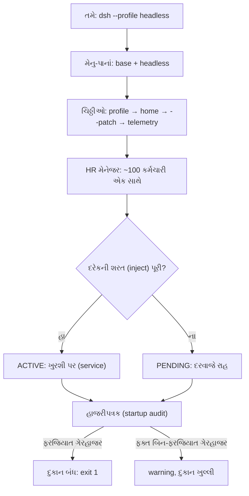

# વાર્તા 2 — HR મેનેજરની ડાયરી

> **વાર્તા આવૃત્તિ, પ્રકરણ 2.** વાર્તા 1 માં ભોજનાલય ખૂલ્યું અને એક ઓર્ડર પૂરો થયો. હવે પડદા પાછળ જઈએ: **HR મેનેજર** (Cordis) કર્મચારીઓને કેવી રીતે બોલાવે છે, કોણ ક્યારે કામ શરૂ કરે છે, અને કોઈ ગેરહાજર હોય તો શું થાય છે.
> ઊંડી ટેકનિકલ વિગત: મુખ્ય પુસ્તકનું [પ્રકરણ 2](../book/02-cordis-plugin-architecture.md).

## આ વાર્તા પછી તમે શું કરી શકશો

- Startup (સવારે દુકાન ખૂલવી) અને request (દિવસનો ઓર્ડર) ને અલગ પાડી શકશો.
- મેનુ-પાનાં અને ચિઠ્ઠીઓ (bundles, patches) કયા ક્રમમાં લાગે છે તે કહી શકશો.
- Service, `inject`, fiber, effect, event ને વાર્તાથી અને code થી બંને રીતે સમજાવી શકશો.
- કોઈ plugin ચાલુ ન થાય ત્યારે "ફક્ત warning" અને "દુકાન બંધ" વચ્ચેનો ફરક ચલાવીને બતાવી શકશો.

## આ વાર્તાનાં નવાં પાત્રો

| વાર્તામાં | સાચું ટેકનિકલ નામ |
|---|---|
| HR મેનેજરની ડાયરી | Cordis Loader + Include (YAML વાંચનાર) |
| ઇમારત | `Context` (`ctx`) |
| ખુરશી અને તેના પરનો કર્મચારી | service (`ctx.tools`, `ctx.fs`, …) |
| નોકરીની શરત | `inject` |
| હાજરી કાર્ડ | fiber અને તેની state |
| ઉધારની પહોંચ | effect અને disposer |
| ઘંટડીઓ | events (`emit`, `waterfall`, `serial`, …) |
| ખાનગી ટેબલ | scope |

---

## દ્રશ્ય 1 — બે ઘડિયાળ

**કથા.** મેનેજરની ડાયરીના પહેલા પાને બે ઘડિયાળ દોરેલી છે. એક ઉપર લખ્યું છે **"સવાર"**, બીજી ઉપર **"આખો દિવસ"**. મેનેજર તમને કહે છે: *"સવારે હું એક જ વાર બધાને બોલાવું છું. પછી આખો દિવસ ઓર્ડર આવે, ત્યારે વેઈટર કામ કરે છે, હું નહીં."*

**ટેકનિકલ નામ.** **Startup** (એક વાર) અને **request execution** (દરેક ઓર્ડરે).

| | સવાર (startup) | આખો દિવસ (request) |
|---|---|---|
| કોણ | launcher + Cordis | agent loop (વેઈટર) |
| શું બને | plugins, services, listeners | ચોપડાની ઘટનાઓ, model calls, tool calls |
| ભૂલ થાય તો | plugin `PENDING`/`FAILED`; ફરજિયાત હોય તો exit 1 | turn `error`/`aborted`; tool `isError` |

**ક્યાં.** Startup: [`runProfile`][cli-runProfile] → [`boot`][boot-boot]. Request: [`ReactLoopAgent.turn`][loop-turn].

**શા માટે અલગ?** "દુકાન ખૂલી જ નથી" અને "એક ઓર્ડર બગડ્યો" એ બે જુદી તકલીફ છે, તેમના ઉપાય પણ જુદા છે. પહેલો પ્રશ્ન હંમેશા આ જ પૂછો: *"આ ભૂલ સવારની છે કે દિવસની?"*

---

## દ્રશ્ય 2 — મેનુ-પાનાં અને ચિઠ્ઠીઓનો ક્રમ

**કથા.** મેનેજર એક ફાઇલ ખોલે છે. તેમાં બે છાપેલાં મેનુ-પાનાં છે: **"દરેક શાખાનું"** અને **"ટિફિન-સેવાનું"**. પાનાં પર ચિઠ્ઠીઓ ચોંટાડેલી છે. કેટલીક શાખાના સંચાલકે લખી છે, કેટલીક માલિકે, અને એક આજે સવારે તમે લખી. મેનેજર તેને **નક્કી ક્રમમાં** વાંચે છે. એક જ લીટી પર બે ચિઠ્ઠી હોય તો **છેલ્લે વાંચેલી ચિઠ્ઠી જીતે**.

**ટેકનિકલ નામ.** profile → bundles → patches (layers).

**ક્યાં.** [`readProfilePatches`][boot-readProfilePatches]:

```ts
  const patches = structuredClone([
    ...readBundlePatches(binName, context, initialProfile),
    ...(initialProfile?.patches ?? loadOptionalPatches(binName, context.patchPath) ?? []),
    ...(loadOptionalPatches(binName, join(context.home, PROFILE_PATCH_FILENAME)) ?? []),
    ...context.overlays,
  ])
```

(repository code)

**કેવી રીતે.** ક્રમ:

1. Bundles (`dsh-base`, પછી `dsh-headless`)
2. Profile નું `cordis.patch.yml`
3. `$DSH_HOME/cordis.patch.yml`
4. તમારા `--patch` overlays
5. Telemetry switch

**યાદ-ચાવી:** "**બપોરે ઘરે પેટી ટેબલ પર**" — **બ**ંડલ, **પ્રો**ફાઇલ (બપો), **ઘ**ર (home), **પે**ચ, **ટે**લિમેટ્રી.

**શા માટે આ ક્રમ?** સૌથી સામાન્ય નિયમ (base) પહેલાં, સૌથી ખાસ ઇચ્છા (તમારું `--patch`) છેલ્લે. એટલે તમે મૂળ મેનુને અડ્યા વગર કંઈ પણ બદલી શકો, અને તમારી ચિઠ્ઠી કાઢો એટલે બધું પાછું મૂળ જેવું.

**ઉપમા ક્યાં તૂટે છે.** સાચી ચિઠ્ઠી ગમે ત્યાં ચોંટાડો તો ચાલે. અહીં તમારી ચિઠ્ઠીમાં plugin file નું સરનામું **absolute** (પૂરું) જોઈએ, કારણ કે મેનેજર સરનામાં શાખાની directory સામે શોધે છે, ચિઠ્ઠીની જગ્યા સામે નહીં.

> **Expert નજર.** શાખાનું મૂળ `cordis.yml` દરેક સવારે ફરી `[]` (ખાલી) લખાય છે ([`prepareProfile`](https://github.com/deepseek-ai/deepseek-harness/blob/fcc0ad462172522aaf5c93a7b2e01f6b9f0b0159/apps/cli/src/profile-boot.ts#L194-L200)). આખું composition ચિઠ્ઠીઓમાં જ છે; ખાલી file ફક્ત મેનેજરને "ઘરનું સરનામું" આપે છે.

---

## દ્રશ્ય 3 — છાપેલું પૂરું મેનુ

**કથા.** તમે મેનેજરને પૂછો છો: *"બધી ચિઠ્ઠીઓ લગાવ્યા પછી આજનું મેનુ કેવું દેખાય છે?"* મેનેજર છાપેલું પાનું આપે છે. દરેક લીટીની ઉપર લખ્યું છે કે એ કયા પાનાંમાંથી આવી અને કઈ ચિઠ્ઠીએ બદલી.

**ટેકનિકલ નામ.** `--dump-config`.

**કેવી રીતે.**

```bash
DSH_HOME=$PWD/tmp/book-home pnpm dsh --profile headless --dump-config
```

🧪 અમારા run માં: **101 rows**, 395 lines. ઉદાહરણ ([evidence/dump.yml](../evidence/dump.yml)):

```yaml
# == @deepseek-ai/dsh-base, patched by @deepseek-ai/dsh-headless
- id: hmr
  name: '@deepseek-ai/dsh-hmr'
  disabled: true
```

**શા માટે.** Plugin કેમ ચાલતો નથી તેની તપાસ હંમેશા અહીંથી શરૂ કરો: તમારી row અંતિમ મેનુમાં છે? `disabled` તો નથી?

---

## દ્રશ્ય 4 — ખુરશીઓ (services)

**કથા.** ઇમારતમાં નામવાળી ખુરશીઓ છે: "સાધન-ઘર" (`tools`), "કોઠારી" (`fs`), "રસોઇયાનો ફોન" (`llm`). કર્મચારી આવે ત્યારે પોતાના નામની ખુરશી પર બેસે છે. બીજાઓ તેને **ખુરશીના નામથી** બોલાવે છે, માણસના નામથી નહીં. એક દિવસ બે કર્મચારી એક જ "કોઠારી" ખુરશી પર બેસવા આવે છે. મેનેજર તરત ના પાડે છે: *"એક ખુરશી, એક જ માણસ."*

**ટેકનિકલ નામ.** **Service** = `ctx` પર નામવાળી સેવા. **Context** = services રાખતી ઇમારત.

**ક્યાં.** [`Service` constructor][cordis-service] અંતે [`ReflectService.provide`][cordis-provide] બોલાવે છે:

```ts
      if (this.store[key]) {
        throw new Error(`service "${name}" has been registered at <${this.store[key].ctx.fiber.name}>`)
      }
      this.store[key] = impl
```

(repository code, ટૂંકાવેલું)

**શા માટે નામથી બોલાવવું?** `read` tool ને ખબર નથી કે કોઠારી કોણ છે: local disk વાળો કે sandbox વાળો. ફક્ત `ctx.fs` જોઈએ. કોઠારી બદલો, `read` એ જ રહે. **શા માટે duplicate ની ના?** બે કોઠારી હોય તો કોનું સાંભળવું? "છેલ્લો જીતે" જેવો ચૂપ નિયમ ભૂલો છુપાવે છે; સ્પષ્ટ error તરત બતાવે છે.

> **Expert નજર.** `provide` પોતે `fiber.effect(...)` ની અંદર છે. એટલે plugin unload થાય ત્યારે ખુરશી **આપોઆપ** ખાલી થાય છે. કોઈએ હાથથી "unregister" લખવું પડતું નથી.

---

## દ્રશ્ય 5 — નોકરીની શરત (`inject`)

**કથા.** રેસીપી-ચોપડી લાવનાર (`tool-fs`) ની નોકરીની શરત છે: *"સાધન-ઘર, કોઠારી, નિયમ-લેખક અને working directory વાળો, ચારેય હાજર હોય તો જ હું શરૂ કરીશ."* મેનેજર બધાને **એક સાથે** બોલાવે છે. જેની શરત પૂરી થાય તે કામ શરૂ કરે; બાકીના દરવાજે રાહ જુએ.

**ટેકનિકલ નામ.** **Dependency Injection** એટલે plugin ને જરૂરી service runtime દ્વારા મળવી. `inject` એ જરૂરી services ની યાદી છે.

**ક્યાં.** `tool-fs` ની શરત ([source][toolfs-inject]): `inject = ['tools', 'fs', 'systemPrompt', 'workingDirectory']`. Agent loop ની ([source][agentloop-inject]): `['agents', 'sessions', 'llm', 'tools', 'systemPrompt', 'sessionProjections']`. Cordis આ યાદી [`RegistryService.plugin`][cordis-plugin] માં fiber ને સોંપે છે.

**શા માટે.** 100 કર્મચારીઓનો ક્રમ હાથથી ગોઠવવો અશક્ય છે. દરેક ફક્ત "મારે શું જોઈએ" લખે, ક્રમ જાતે બને.

**ઉપમા ક્યાં તૂટે છે.** મેનુમાં ઉપર લખેલો પહેલાં આવે એવું **નથી**. ક્રમ ફક્ત `inject` થી આવે છે.

---

## દ્રશ્ય 6 — હાજરી કાર્ડ (fiber)

**કથા.** દરેક કર્મચારી પાસે હાજરી કાર્ડ છે, જેમાં એક જ શબ્દ લખાય છે:

| કાર્ડ પર | અર્થ |
|---|---|
| `PENDING` | દરવાજે રાહ; શરત પૂરી નથી |
| `LOADING` | કામ શરૂ કરી રહ્યો છે |
| `ACTIVE` | કામ પર |
| `FAILED` | શરૂ કરતાં જ બીમાર પડ્યો (ભૂલ) |
| `UNLOADING` | રજા પર જતાં પહેલાં વાસણ પાછાં આપે છે |
| `DISPOSED` | નોકરી છોડી; પાછો નહીં આવે |

**ક્યાં.** [`FiberState`][cordis-fiberstate], અને state કેવી રીતે નક્કી થાય: [`_getState`][cordis-getstate].

**શા માટે.** "ચાલતો નથી" ને બદલે ચોક્કસ શબ્દ મળે: રાહ જુએ છે (કોઈ service ખૂટે છે) કે બીમાર છે (code માં ભૂલ). બંનેનો ઉપાય અલગ છે.

---

## દ્રશ્ય 7 — ઉધારની પહોંચ (effects)

**કથા.** કર્મચારી કોઠારમાંથી વાસણ ઉધાર લે ત્યારે મેનેજર પહોંચ લખે છે. રજા પર જતી વખતે બધાં વાસણ **ઊંધા ક્રમમાં** પાછાં: છેલ્લે લીધેલું પહેલાં. એક નિયમ: *"જતાં-જતાં નવું વાસણ ઉધાર ન લઈ શકાય."*

**ટેકનિકલ નામ.** **Effect** = undo થઈ શકે તેવી નોંધણી; **disposer** = તેને undo કરતી function. Tool register કરવો, listener મૂકવો, service provide કરવી, બધું effect છે.

**ક્યાં.** [`Fiber.effect`][cordis-effect]: disposers `splice(0).reverse()` થી ઊંધા ક્રમમાં ચાલે; `UNLOADING` વખતે નવું effect `INACTIVE_EFFECT` error આપે.

**શા માટે ઊંધો ક્રમ?** છેલ્લે લીધેલું વાસણ કદાચ પહેલાંના પર મૂકેલું છે. નીચેનું પહેલાં ખેંચો તો ઉપરનું પડે. **યાદ-ચાવી: "પાછળથી ચડ્યો, પહેલો ઊતરે."**

> **Expert નજર.** Repository નો નિયમ: "Registrations are effects" ([AGENTS.md][agents-conventions]). એટલે plugin unload થાય ત્યારે તેનું **બધું** પાછું ખેંચાય છે: tools, listeners, services. મુખ્ય પુસ્તકના પ્રકરણ 4 નો test આ સાબિત કરે છે.

---

## દ્રશ્ય 8 — ઘંટડીઓ (events)

**કથા.** ઇમારતમાં પાંચ પ્રકારની ઘંટડી છે:

| ઘંટડી | ભોજનાલયમાં | Cordis mode |
|---|---|---|
| લાઉડસ્પીકર | જાહેરાત; કોઈ જવાબ નહીં | `emit` |
| હાથોહાથ થાળી | દરેક ટેબલ જુએ, બદલે, **આગળ આપે** | `waterfall` (`next()`) |
| બધા એક સાથે | બધાને એક સાથે કહો, બધા પૂરું કરે ત્યાં સુધી રાહ | `parallel` |
| એક પછી એક | ક્રમમાં દરેકને, એકે પૂરું કર્યા પછી બીજાને | `serial` |
| પહેલો જવાબ | જે પહેલો જવાબ આપે, ત્યાં અટકો | `bail` |

**ક્યાં.** [Dispatch modes table][primer-dispatch]; [`EventsService.on`][cordis-on], [`waterfall`][cordis-waterfall]; harness ના `agent/*` events ની યાદી, દરેક `@mode` સાથે: [runtime-types.ts][agent-events].

**શા માટે ઘણા પ્રકાર?** દરેક ઘટનાનું કામ જુદું છે. "ચોપડામાં લીટી લખાઈ" ફક્ત જાહેરાત છે (`session/event`, emit). "Model ને જતો request" ને plugins બદલી શકે તે માટે waterfall (`llm/stream`). Event નો mode તેના વચન (contract) નો ભાગ છે.

**ઉપમા ક્યાં તૂટે છે.** હાથોહાથ થાળીમાં કોઈ થાળી આગળ ન આપે તો બૂમ પડે. Waterfall માં listener `next()` ભૂલી જાય તો **ચૂપચાપ** સાંકળ અટકે ("Waterfall listeners MUST call `next()`").

---

## દ્રશ્ય 9 — કોઠારી ગેરહાજર: દુકાન ખૂલે છે, ખૂણો ખાલી

**કથા.** એક સવારે ચિઠ્ઠી પર લખ્યું છે: *"આજે કોઠારી (`fs-sandbox`) રજા પર."* મેનેજર બધાને બોલાવે છે. Working-directory વાળો કહે, "કોઠારી નથી, હું રાહ જોઉં છું." પછી જેને working-directory જોઈએ તે બધા રાહ જુએ છે, જાણે **ડોમિનો**. પણ આમાંથી કોઈ **ફરજિયાત** નથી. એટલે મેનેજર ફક્ત નોટિસ લગાવે છે અને દુકાન ખૂલે છે, રેસીપી-ચોપડી વગર.

**ટેકનિકલ નામ.** ખૂટતી service → pending cascade → warning.

**Terminal માં** (🧪 [evidence/nofs.err](../evidence/nofs.err)):

```text
dsh: warning: 18 entries did not activate
working-directory (@deepseek-ai/dsh-working-directory): pending (waiting for service: fs)
tool-working-directory (@deepseek-ai/dsh-tool-working-directory): pending (waiting for service: workingDirectory)
tool-bash (@deepseek-ai/dsh-tool-bash): pending (waiting for service: workingDirectory)
tool-fs (@deepseek-ai/dsh-tool-fs): pending (waiting for services: fs, workingDirectory)
…
```

**ક્યાં.** Warning [`auditStartupEntries`][boot-audit] માંથી આવે છે.

---

## દ્રશ્ય 10 — નિયમ-લેખક ગેરહાજર: દુકાન બંધ

**કથા.** બીજી સવારે ચિઠ્ઠી: *"નિયમ-લેખક (`system-prompt`) રજા પર."* સાધન-ઘરની શરત છે "નિયમ-લેખક હાજર હોય તો." સાધન-ઘર નથી, એટલે વેઈટર (`agent-loop`) અને કોઠારનો મુખ્ય (`tool-executor-native`) પણ રાહ જુએ છે. આ બંને **ફરજિયાત** છે. મેનેજર દરવાજે તાળું મારે છે.

**Terminal માં** (🧪 [evidence/nosp.err](../evidence/nosp.err), exit 1):

```text
dsh: startup failed: 2 required plugins did not activate

Plugins waiting for services (29):
  Plugin                           Missing services
  tool-executor-native (required)  tools
  agent-loop (required)            tools, systemPrompt
```

**ક્યાં.** ફરજિયાત યાદી: [`requiredStartupEntryIds`][boot-required] (`agent-loop`, `tool-executor-native`, `headless-runner`, …).

**શા માટે બે નિયમ?** શણગાર વગર ભોજનાલય ચાલે; વેઈટર વગર ખોલવું નકામું, અને ગ્રાહકને ગૂંચવે. "Misconfiguration fails loud" ([AGENTS.md][agents-conventions]).

**યાદ-ચાવી:** "**ઈંટ ખેંચો, દીવાલ જુઓ.** શણગારની ઈંટ: ખૂણો ખાલી. પાયાની ઈંટ: ઘર પડે."

---

## દ્રશ્ય 11 — દોડની સ્પર્ધા (race)

**કથા.** નવો કર્મચારી (`greet` tool, repository ના tutorial માંથી) આવતાંની સાથે જ એક demo ઓર્ડર ચલાવે છે. પણ કોઠારનો મુખ્ય (executor) હજી આવ્યો નથી. ક્યારેક મુખ્ય પહેલાં પહોંચે અને બધું ચાલે; ક્યારેક મોડો પહોંચે અને ભૂલ આવે. નસીબનો ખેલ.

**Terminal માં** (🧪 executor row tutorial ના composition માં ન હોય, અથવા છેલ્લે હોય):

```text
ToolExecutorUnavailableError: The selected tool executor is unavailable. Load an executor in this composition before running the agent.
  code: 'TOOL_EXECUTOR_UNAVAILABLE'
```

**શા માટે `inject` બચાવી ન શક્યું?** Executor ખુરશી (service) નથી. તે સાધન-ઘરમાં `setExecutor(...)` થી નોંધાય છે ([`selectExecutor`][tools-selectExecutor]). `inject` ફક્ત ખુરશીઓની રાહ જોઈ શકે.

**ઉપાય** (book lab code, [greet-tool-settled.ts](../labs/cordis-basics/greet-tool-settled.ts)): *"બધા કર્મચારી આવી જાય પછી જ પહેલો ઓર્ડર."*

```ts
    await ctx.get('loader')?.await()
```

🧪 Executor row **છેલ્લે** રાખી 3/3 runs સફળ: `[tool-logger] greet -> નમસ્તે, Cordis!`.

> **Expert નજર.** Tutorial ના docs મુજબ આ composition ચાલવી જોઈએ, પણ pinned commit પર નિષ્ફળ જાય છે. Docs અને code જુદાં પડે ત્યારે **code જ સાચો**; તફાવત લખી રાખો (મુખ્ય પુસ્તક, [પરિશિષ્ટ G](../appendix/G-verification-log.md)).

---

## દ્રશ્ય 12 — ખાનગી ટેબલ (scope)

**કથા.** એક ખાસ ગ્રાહક માટે અલગ ટેબલ છે, જ્યાં તેના માટે ખાસ વાસણ મૂકેલાં છે. વેઈટર પહેલાં **એ ટેબલ** પર જુએ છે; ત્યાં ન મળે તો આખા ભોજનાલયનાં સામાન્ય વાસણ.

**ટેકનિકલ નામ.** **Scope** = registrations ને એક ઓળખ (દા.ત. એક Agent) સાથે tag કરતો context.

**ક્યાં.** [`createScope`][scope-create], [`scopeChainOf`][scope-chain]; executor પસંદગી પહેલાં scope chain માં, પછી root ([`selectExecutor`][tools-selectExecutor]).

**શા માટે.** એક જ ભોજનાલયમાં બે agent ને જુદા tools કે જુદો executor આપી શકાય, બીજાને અસર કર્યા વગર.

---

## સવાર એક ચિત્રમાં



## ક્યાં, કેવી રીતે, શા માટે

| દ્રશ્ય | ક્યાં | કેવી રીતે | શા માટે |
|---|---|---|---|
| 2 ચિઠ્ઠીઓ | `readProfilePatches` | 5 layers, પાછળનું જીતે | મૂળને અડ્યા વગર ફેરફાર |
| 4 ખુરશી | `Service`, `provide` | નામથી service; duplicate = error | provider બદલવો સહેલો; ચૂપ ભૂલ નહીં |
| 5 શરત | `inject`, `RegistryService.plugin` | services હાજર થાય ત્યારે start | ક્રમ હાથથી ન ગોઠવવો પડે |
| 6 કાર્ડ | `FiberState` | PENDING / ACTIVE / FAILED … | ભૂલનું ચોક્કસ નામ |
| 7 પહોંચ | `Fiber.effect` | ઊંધા ક્રમમાં undo | unload પર બધું સ્વચ્છ |
| 8 ઘંટડી | events, `@mode` | emit / waterfall / … | દરેક ઘટનાનું યોગ્ય વચન |
| 9–10 હાજરી | `auditStartupEntries` | required → exit 1, બાકી warning | ખામી તરત દેખાય |
| 12 ટેબલ | `createScope` | agent દીઠ registrations | agent ને અલગ capability |

## Lab — મેનેજરની ડાયરી જાતે વાંચો

**1. પૂરું મેનુ:**

```bash
DSH_HOME=$PWD/tmp/book-home pnpm dsh --profile headless --dump-config > tmp/dump.yml
```

`tools`, `tool-executor-native`, `agent-loop`, `fs-sandbox`, `session-title-llm` rows શોધો; દરેક કયા પાનાંમાંથી આવી તે લખો.

**2. કોઠારીને રજા આપો.** `/abs/path/nofs.yml` નામની file બનાવો:

```yaml
- id: fs-sandbox
  disabled: true
```

```bash
DSH_HOME=$PWD/tmp/book-home pnpm dsh --profile headless --patch /abs/path/nofs.yml "hi"
```

અપેક્ષિત: `dsh: warning: 18 entries did not activate` (દ્રશ્ય 9). (પછી network ન હોય તો `TRANSPORT` error આવે; તે દિવસની ભૂલ છે, સવારની નહીં.)

## આગાહી કસોટી

`fs-sandbox` ને બદલે **`working-directory`** row ને રજા આપો. **પહેલાં લખો:** (1) warning માં 18 કરતાં વધુ, ઓછી કે સરખી entries? (2) `tool-fs` કઈ ખુરશીની રાહ જોશે? (3) દુકાન બંધ થશે?

<details><summary>જવાબ (🧪 અમે ચલાવ્યું)</summary>

1. **16**, ઓછી: `working-directory` પોતે રજા પર છે (ગણાતો નથી), અને કોઠારી હાજર હોવાથી `ptc-runtime` હવે કામ પર છે.
2. ફક્ત `workingDirectory`: `tool-fs … pending (waiting for service: workingDirectory)`.
3. ના, કોઈ ફરજિયાત ગેરહાજર નથી. ([evidence/no-working-directory.err](../evidence/no-working-directory.err))
</details>

## Expert બનવાના પગથિયે

આ વાર્તા [વાર્તા 1 ના "Expert બનવાનો માર્ગ"](01-bhojanalay-no-pehlo-divas.md) નું **પગથિયું 4** છે: plugin, service, `inject`, events. આગળ વધતાં પહેલાં repository ના [Cordis tutorial](https://github.com/deepseek-ai/deepseek-harness/blob/fcc0ad462172522aaf5c93a7b2e01f6b9f0b0159/docs/cordis-tutorial/index.md) નાં 7 પ્રકરણ જાતે ચલાવો; દરેકમાં કંઈક જાણી જોઈને તોડો અને હાજરી કાર્ડ (`bin-with-logs.ts`) જુઓ.

## પુનરાવર્તન કાર્ડ

<details><summary>1. ચિઠ્ઠીઓનો ક્રમ અને કોણ જીતે?</summary>

Bundles → profile patch → home patch → `--patch` → telemetry. છેલ્લી જીતે.
</details>

<details><summary>2. Startup નો ક્રમ YAML ની લીટીઓ નક્કી કરે?</summary>

ના. Rows એક સાથે શરૂ થાય છે; ક્રમ `inject` થી.
</details>

<details><summary>3. એક જ નામની બે services આવે તો?</summary>

`provide` error: `service "<name>" has been registered at <fiber>`.
</details>

<details><summary>4. Effects ઊંધા ક્રમમાં કેમ undo થાય?</summary>

પાછળથી બનેલી નોંધણી પહેલાંની પર આધાર રાખી શકે; ઉપરનું પહેલાં ઉતારવું પડે.
</details>

<details><summary>5. `fs` ખૂટે તો warning, `systemPrompt` ખૂટે તો exit 1. કેમ?</summary>

`systemPrompt` વગર `tools` આવતું નથી, તેથી ફરજિયાત `agent-loop` અને `tool-executor-native` pending રહે છે.
</details>

<details><summary>6. Tutorial race માં `inject` કેમ મદદ ન કરી શક્યું?</summary>

Executor service નથી (`setExecutor` registration); `inject` ફક્ત services ની રાહ જુએ.
</details>

## મિત્રને સમજાવો (3 મિનિટ)

"એક કર્મચારી રજા પર હોય તો ભોજનાલય ક્યારે ચાલે અને ક્યારે બંધ?" — કોઠારી અને નિયમ-લેખકનાં બે ઉદાહરણથી જવાબ આપો, પછી એ જ વાત `inject`, `PENDING`, required entry શબ્દોથી ફરી કહો.

---

પાછળ: [વાર્તા 1](01-bhojanalay-no-pehlo-divas.md) · આગળ: [વાર્તા 3 — કોઠાર, દુભાષિયો અને ચોપડો અંદરથી](03-kothar-dubhashiyo-chopdo.md)

<!-- citations:begin (generated by tools/refdefs.py) -->
[agent-events]: https://github.com/deepseek-ai/deepseek-harness/blob/fcc0ad462172522aaf5c93a7b2e01f6b9f0b0159/packages/core/agent/src/runtime-types.ts#L309-L419
[agentloop-inject]: https://github.com/deepseek-ai/deepseek-harness/blob/fcc0ad462172522aaf5c93a7b2e01f6b9f0b0159/packages/core/agent-loop/src/index.ts#L291
[agents-conventions]: https://github.com/deepseek-ai/deepseek-harness/blob/fcc0ad462172522aaf5c93a7b2e01f6b9f0b0159/AGENTS.md#L130-L142
[boot-audit]: https://github.com/deepseek-ai/deepseek-harness/blob/fcc0ad462172522aaf5c93a7b2e01f6b9f0b0159/packages/boot/app-boot/src/index.ts#L1153-L1167
[boot-boot]: https://github.com/deepseek-ai/deepseek-harness/blob/fcc0ad462172522aaf5c93a7b2e01f6b9f0b0159/packages/boot/app-boot/src/index.ts#L1200-L1266
[boot-required]: https://github.com/deepseek-ai/deepseek-harness/blob/fcc0ad462172522aaf5c93a7b2e01f6b9f0b0159/packages/boot/app-boot/src/index.ts#L946-L957
[cordis-effect]: https://github.com/deepseek-ai/deepseek-harness/blob/fcc0ad462172522aaf5c93a7b2e01f6b9f0b0159/vendor/cordis/src/fiber.ts#L424-L448
[cordis-fiberstate]: https://github.com/deepseek-ai/deepseek-harness/blob/fcc0ad462172522aaf5c93a7b2e01f6b9f0b0159/vendor/cordis/src/fiber.ts#L147-L154
[cordis-getstate]: https://github.com/deepseek-ai/deepseek-harness/blob/fcc0ad462172522aaf5c93a7b2e01f6b9f0b0159/vendor/cordis/src/fiber.ts#L580-L585
[cordis-on]: https://github.com/deepseek-ai/deepseek-harness/blob/fcc0ad462172522aaf5c93a7b2e01f6b9f0b0159/vendor/cordis/src/events.ts#L294
[cordis-plugin]: https://github.com/deepseek-ai/deepseek-harness/blob/fcc0ad462172522aaf5c93a7b2e01f6b9f0b0159/vendor/cordis/src/registry.ts#L316-L330
[cordis-provide]: https://github.com/deepseek-ai/deepseek-harness/blob/fcc0ad462172522aaf5c93a7b2e01f6b9f0b0159/vendor/cordis/src/reflect.ts#L291-L311
[cordis-service]: https://github.com/deepseek-ai/deepseek-harness/blob/fcc0ad462172522aaf5c93a7b2e01f6b9f0b0159/vendor/cordis/src/service.ts#L42-L59
[cordis-waterfall]: https://github.com/deepseek-ai/deepseek-harness/blob/fcc0ad462172522aaf5c93a7b2e01f6b9f0b0159/vendor/cordis/src/events.ts#L246
[loop-turn]: https://github.com/deepseek-ai/deepseek-harness/blob/fcc0ad462172522aaf5c93a7b2e01f6b9f0b0159/packages/core/agent-loop/src/agent.ts#L327-L433
[primer-dispatch]: https://github.com/deepseek-ai/deepseek-harness/blob/fcc0ad462172522aaf5c93a7b2e01f6b9f0b0159/docs/cordis-primer.md#L19-L25
[scope-chain]: https://github.com/deepseek-ai/deepseek-harness/blob/fcc0ad462172522aaf5c93a7b2e01f6b9f0b0159/packages/core/scope/src/index.ts#L98
[scope-create]: https://github.com/deepseek-ai/deepseek-harness/blob/fcc0ad462172522aaf5c93a7b2e01f6b9f0b0159/packages/core/scope/src/index.ts#L137-L153
[toolfs-inject]: https://github.com/deepseek-ai/deepseek-harness/blob/fcc0ad462172522aaf5c93a7b2e01f6b9f0b0159/packages/fs/tool-fs/src/index.ts#L24
<!-- citations:end -->
