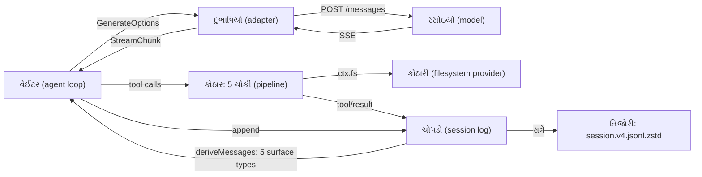

# વાર્તા 3 — કોઠાર, દુભાષિયો અને ચોપડો અંદરથી

> **વાર્તા આવૃત્તિ, પ્રકરણ 3.** વાર્તા 1 માં ત્રણ ઓરડા બહારથી જોયા હતા. આજે મેનેજર તમને ચાવી આપે છે: **કોઠાર** (tools), **દુભાષિયાની કેબિન** (model adapter), અને **તિજોરી** (session log). દરેક ઓરડો અંદરથી ખોલીએ.
> ઊંડી ટેકનિકલ વિગત: મુખ્ય પુસ્તકનું [પ્રકરણ 3](../book/03-tools-sessions-adapters.md).

## આ વાર્તા પછી તમે શું કરી શકશો

- "Capability seam" ની ત્રણ ભૂમિકા વાર્તા અને code બંનેથી સમજાવી શકશો.
- `read` tool ના પાંચ ભાગ અને ત્રણ પ્રકારની ભૂલ કહી શકશો.
- Model ને જતો request HTTP પર કેવો દેખાય છે, અને જવાબ પાછો કેવી રીતે આવે છે, તે કહી શકશો.
- ચોપડો કેવી રીતે model ની "યાદશક્તિ" બને છે, અને અધૂરો ઓર્ડર બીજા દિવસે કેવી રીતે પૂરો થાય છે, તે ચલાવીને બતાવી શકશો.

## આ વાર્તાનાં નવાં પાત્રો

| વાર્તામાં | સાચું ટેકનિકલ નામ |
|---|---|
| નોકરીનું વર્ણન / કારીગર / વાપરનાર | Service Definition / Provider / Consumer (capability seam) |
| કોઠારનો દરવાજો | `ctx.tools.execute` |
| પાંચ ચોકી | tool pipeline |
| રેસીપી-ચોપડી લાવનાર | `read` tool |
| દુભાષિયો | `DeepSeekAdapter` |
| ટીપે ટીપે આવતો જવાબ | SSE stream → `StreamChunk` |
| તિજોરી | session persistence (`session.v4.jsonl.zstd`) |

---

## દ્રશ્ય 1 — ત્રણ કાગળ: નોકરીનું વર્ણન, કારીગર, વાપરનાર

**કથા.** કોઠારના દરવાજે ત્રણ કાગળ ચોંટાડેલા છે:

1. **નોકરીનું વર્ણન:** "કોઠારીએ file શોધવી, વાંચવી, લખવી, આ રીતે."
2. **કારીગરનું નામ:** "આજે કોઠારી: sandbox વાળો."
3. **વાપરનારાઓ:** "રેસીપી-ચોપડી લાવનાર, લખનાર, ફેરફાર કરનાર."

મેનેજર કહે છે: *"કાલે કારીગર બદલું, તો પણ વર્ણન અને વાપરનારા એ જ રહેશે."*

**ટેકનિકલ નામ.** **Capability seam** = ત્રણ ભૂમિકાવાળો બદલી શકાય તેવો સાંધો.

| ભૂમિકા | Filesystem માં |
|---|---|
| Service Definition | abstract [`FileSystem`][fs-abstract] |
| Service Provider | `dsh-fs-sandbox` ([policy][fs-sandbox-doc]) |
| Consumer | `read` tool ([`applyReadTool`][read-tool]) |

**શા માટે.** File remote sandbox માં હોય તો ફક્ત provider બદલો; `read`, `write`, bash, બધું આપોઆપ ત્યાં કામ કરે. **યાદ-ચાવી "નિ-ક-વા": નિયમ, કારીગર, વાપરનાર.**

---

## દ્રશ્ય 2 — રેસીપી-ચોપડી લાવનારના પાંચ ભાગ

**કથા.** રેસીપી-ચોપડી લાવનાર પોતાનો પરિચય પાંચ વાક્યમાં આપે છે:

1. *"મને આ ત્રણ વસ્તુ કહો: કઈ file (ફરજિયાત), કઈ લીટીથી, કેટલી લીટી (વધુમાં વધુ 2000)."*
2. *"હું સવારે મારા નામની નોંધણી કરું છું, અને રસોઇયાને સૂચના આપું છું: 'cat નહીં, મને બોલાવો.'"*
3. *"Path ને ઓર્ડરની directory માં શોધું છું, એક જ વાર તપાસું છું (stat), 10 MB થી મોટી હોય તો ટુકડે-ટુકડે વાંચું છું."*
4. *"ભૂલ થાય તો ઝઘડો નહીં, લાલ ચિઠ્ઠી."*
5. *"દરેક લીટીને નંબર આપી સાફ રસીદ બનાવું છું."*

**ટેકનિકલ નામ.** input schema, registration, execution, error handling, result conversion.

**ક્યાં.** [`applyReadTool`][read-tool] (schema, નોંધણી, execute, render); [`resolveRegularReadTarget`][read-target] (path અને stat); [`parseReadArgs`][read-parse] (value તપાસ); [render][read-output].

**કેવી રીતે** (schema, repository code):

```ts
    parameters: {
      file_path: { type: 'string', required: true, description: 'Path to read, resolved by the filesystem backend.' },
      offset: { type: 'number', description: '1-based first line to return. Defaults to 1.' },
      limit: { type: 'number', description: `Maximum number of lines to return. Defaults to ${caps.limit}.` },
    },
```

**યાદ-ચાવી "ઇ-ન-ચ-ભ-રૂ"** — **ઇ**નપુટ, **ન**ોંધણી, **ચ**લાવવું, **ભ**ૂલ, **રૂ**પાંતર: "**ઇનામ ચલાવ્યું, ભૂલ રૂપે.**"

---

## દ્રશ્ય 3 — ત્રણ પ્રકારની લાલ ચિઠ્ઠી

**કથા.** એક દિવસમાં ત્રણ ખોટી ચિઠ્ઠીઓ આવે છે. દરેક વખતે લાવનાર ઝઘડતો નથી; ફક્ત કારણ લખીને પાછી મોકલે છે. રસોઇયો વાંચીને સુધારે છે.

| ચિઠ્ઠી | ક્યાં પકડાઈ | પાછું શું ગયું | Code |
|---|---|---|---|
| `{"path":"README.md"}` (નામ જ ખોટું) | ભાષા-તપાસ ([`defineTool`][schema-defineTool-validate]) | `Error: invalid arguments: missing required property "file_path"` 🧪 | `INVALID_ARGS` |
| `offset: 0` | value તપાસ ([`parseReadArgs`][read-parse]) | `Error: offset must be a positive integer` ✅ | (code નથી) |
| `NOPE.md` / `packages` | કોઠારી ([`resolveRegularReadTarget`][read-target]) | `…: not found` / `…: not a regular file` 🧪 | `FS_NOT_FOUND` / `FS_NOT_REGULAR_FILE` |

**કેવી રીતે.** દરેક ભૂલ [`toolErrorResult`][pipeline-errorResult] માં સામાન્ય result બને છે:

```ts
  return {
    content: [{ type: 'text', text: `Error: ${message}` }],
    isError: true,
    error: { message, ...info ? { info } : {} },
  }
```

**શા માટે crash નહીં?** Model ને સુધારવાની તક મળે. Code (`info`) ચોપડામાં રહે છે, debugging માટે; model ને ફક્ત વાંચી શકાય તેવો સંદેશ.

---

## દ્રશ્ય 4 — પાંચ ચોકીનો રસ્તો

**કથા.** રસોઇયાની ચિઠ્ઠી કોઠારના દરવાજે આવે છે. પહેલાં ચોપડામાં લખાય છે "ચિઠ્ઠી આવી." પછી પાંચ ચોકી:

```text
ચિઠ્ઠી (raw JSON)
  → [ભાષા ઉકેલ] parseArguments — ખરાબ JSON પણ ફેંકતો નથી, સાચવે છે
  → ચોપડો: tool/call
  → [શેઠની નીતિ] tools/pre-execute — allow / deny / ask
  → [ચોકીદાર] guards — ના પાડી શકે, હા નહીં
  → [કામ] tools/execute → tool.execute()
  → [લેબલ] validate + render (અથવા "Error: …")
  → post-execute, finalize, tools/result
  → ચોપડો: tool/result
```

**ક્યાં.** [`executeToolBatch`][batch-execute], [`parseArguments`][batch-parse], [`prepare`][pipeline-prepare], [`dispatch`][pipeline-dispatch], [`dispatchToolBody`][pipeline-body].

**શા માટે ચોપડામાં "આવી" પહેલાં?** કામ વચ્ચે અટકે (Ctrl+C) તો પણ ખબર રહે કે કઈ ચિઠ્ઠી અધૂરી હતી. Step નિષ્ફળ જાય તો loop ખૂટતા `tool/result` જાતે લખે છે ([`toolRecovery`][loop-recovery]), જેથી દરેક `tool/call` ને જવાબ મળે.

**ઉપમા ક્યાં તૂટે છે.** સાચો ચોકીદાર "હા" પણ કહી શકે. **Guards ફક્ત "ના" કહી શકે** (monotonic denial); પરવાનગી શેઠની નીતિ (pre-execute, approval) આપે છે.

---

## દ્રશ્ય 5 — દુભાષિયાની કેબિન: ફોન કેવો દેખાય છે

**કથા.** દુભાષિયો તમને બતાવે છે કે તે રસોઇયાની agency ને શું મોકલે છે. કાગળ પર દસ ખાનાં છે: સંદેશા, સાધનોની યાદી, નિયમ, વિચારવાની રીત, "ટીપે ટીપે જવાબ આપજો", અને બે ખાસ ખાનાં: "**ચોપડાની નકલ**" અને "**ભોજનાલયના કર્મચારીઓની યાદી**". કાગળના માથે મથાળું છે: ગ્રાહક-ઓળખ અને ઓર્ડર-ઓળખ.

**ટેકનિકલ નામ.** HTTP `POST /messages` body અને headers.

**ક્યાં.** [`DeepSeekAdapter.generate`][deepseek-generate], [`serialize`][deepseek-serialize], [`fetch`][deepseek-fetch].

**Wire પર ખરેખર** (🧪 [evidence/wire.json](../evidence/wire.json), user id છુપાવેલ):

```json
    "bodyKeys": ["dsh_plugin_packages", "dsh_session_log", "max_tokens", "messages",
                 "model", "output_config", "stream", "system", "thinking", "tools"],
    "headers": {
      "anthropic-version": "2023-06-01",
      "x-deepseek-harness-user-id": "<redacted anonymous id>",
      "x-deepseek-harness-session-id": "session-…"
    }
```

**શા માટે દુભાષિયો અલગ?** **Adapter boundary:** ઉપર (વેઈટર, કોઠાર, ચોપડો) ફક્ત ભોજનાલયની ભાષા (`GenerateOptions`, `StreamChunk`) જાણે; નીચે દુભાષિયો agency ની ભાષા જાણે. નવી agency = નવો દુભાષિયો ([`registerAdapter`][llm-registerAdapter]); વેઈટર એ જ.

> **Expert નજર.** `dsh_session_log` એ **request extension** છે: ચોપડાનો ભાગ official API ને જાય છે ([source][sessionlog-register]). આ "data boundary" છે, permission નહીં. ન મોકલવું હોય તો `session-log-deepseek` row બંધ કરો.

---

## દ્રશ્ય 6 — ટીપે ટીપે જવાબ

**કથા.** રસોઇયો જવાબ એક સાથે નથી આપતો; ફોન પર વાક્યે-વાક્યે બોલે છે. દુભાષિયો દરેક વાક્યને સાત પ્રકારના કાર્ડમાંથી એક પર લખે છે: "નવો ભાગ શરૂ", "લખાણ", "વિચાર", "સાધનની ચિઠ્ઠીનો ટુકડો", "ભાગ પૂરો", "ખર્ચ", "અંત".

**ટેકનિકલ નામ.** SSE → [`parseSse`][deepseek-sse] → [`translate`][deepseek-translate] → [`StreamChunk`][llm-streamchunk]:

```ts
export type StreamChunk =
  | { type: 'block-start'; … } | { type: 'text-delta'; … } | { type: 'reasoning-delta'; … }
  | { type: 'tool-call-delta'; … } | { type: 'block-end'; … } | { type: 'usage'; … }
  | { type: 'finish'; reason: FinishReason; … }
```

(teaching summary of the repository type)

**અંતનું કારણ** ([source][deepseek-finish]): `end_turn` → `stop`, `tool_use` → `tool-calls`, `max_tokens` → `max-tokens`.

**ભૂલ હોય તો?** Agency HTTP error આપે તો દુભાષિયો `LlmError` બનાવે છે (`AUTH`, `SERVER`, `TIMEOUT`, `TRANSPORT` જેવા codes). Stream શાંત પડી જાય તો idle watchdog `TIMEOUT` આપે.

**યાદ-ચાવી:** "**દુભાષિયો ભાષા બદલે, અર્થ નહીં.**"

---

## દ્રશ્ય 7 — તિજોરીના ત્રણ નિયમ

**કથા.** તિજોરીનો રખેવાળ ત્રણ નિયમ કહે છે:

1. *"ફક્ત એવી નોંધ લઉં જે કાગળ પર સાફ લખી શકાય (JSON). નહીં તો ત્યાં જ પાછી."*
2. *"લખેલી નોંધ પર તાળું (deep-freeze). કોઈ બદલી ન શકે."*
3. *"દરેક નોંધને આગલો નંબર (`seq`)."*

**ક્યાં.** [`Session.append`][session-append]:

```ts
    const dataSnapshot = snapshotJsonValue(data)
    if (dataSnapshot === undefined) {
      throw new Error(`session event "${type}" carries non-JSON-serializable data`)
    }
```

**શા માટે નિયમ 1 તરત?** ખરાબ નોંધ પછીથી તિજોરીમાં મૂકતી વખતે નહીં, **લખતી વખતે જ** પકડાય. ભૂલનું સ્થાન સ્પષ્ટ રહે.

---

## દ્રશ્ય 8 — ચોપડો = model ની યાદશક્તિ

**કથા.** રસોઇયાને કંઈ યાદ રહેતું નથી. દરેક ફોન પહેલાં વેઈટર ચોપડામાંથી **ફક્ત પાંચ પ્રકારની લીટીઓ** વાંચીને કથા બનાવે છે: નિયમ, વિકાસકર્તાની નોંધ, ગ્રાહક, રસોઇયાનો જવાબ, સાધનનું પરિણામ. બાકીની લીટીઓ (title, sandbox, inbox) ચોપડામાં છે, પણ કથામાં નથી.

**ટેકનિકલ નામ.** **Surface** = model history બનાવતી log લીટીઓ: [`SurfaceEventType`][session-surface-types] = `system/message`, `developer/message`, `user/message`, `assistant/message`, `tool/result`. History: [`deriveMessages`][session-derive] (cache સાથે).

**યાદ-ચાવી "સિ-ડે-યુ-આ-ટૂ" — "સીડી યુવાન આગળ ટૂંકી".**

**શા માટે cache?** ચોપડો લાંબો હોય તો દરેક ફોને આખો ફરી વાંચવો ધીમો પડે. નવી લીટીઓ જ ઉમેરાય; compaction જેવી ઘટના પછી જ આખું ફરી બને.

---

## દ્રશ્ય 9 — તિજોરીનું સરનામું

**કથા.** રાત્રે ચોપડો તિજોરીમાં જાય છે, દબાવેલી પોટલી તરીકે.

```text
$DSH_HOME/sessions/<cwd-key>/session-<uuid>/session.v4.jsonl.zstd
$DSH_HOME/sessions/<cwd-key>/session-<uuid>/session.lock
```

**કેવી રીતે.** પહેલી લીટી header (`version: 4`), પછી એક લીટી = એક ઘટના, zstd compression. Format બદલાય તો જૂની file કદી બદલાતી નથી; નવી version-નામવાળી file બાજુમાં બને છે (architecture doc).

**વાંચવું હોય તો** (book tool):

```bash
node tmp/book-labs/request-trace/print-session.mjs "$(find tmp/book-home/sessions -name 'session.v*.jsonl*' | head -1)"
```

---

## દ્રશ્ય 10 — ગઈકાલનો અધૂરો ઓર્ડર

**કથા.** ગઈકાલે ઓર્ડર વચ્ચે અચાનક લાઈટ ગઈ (Ctrl+C). આજે તમે એ જ ચોપડો ખોલો છો. તેમાં લખેલું છે: ઓર્ડર, ખાલી ફોન-પ્રયાસ, અને "ઓર્ડર રદ — દુકાન બંધ થઈ." તમે નવો સંદેશ લખો છો, "ફરી પ્રયાસ કરો." વેઈટર **ઓર્ડર નં. 2** ખોલે છે, આખી જૂની કથા સાથે, અને આ વખતે કામ પૂરું કરે છે.

**ચોપડામાં** (🧪 [evidence/int2.err](../evidence/int2.err)):

```text
#4  turn/start {"turn":1}
#16 assistant/attempt {"turn":1,"step":1,"stream":[]}
#18 turn/end {"turn":1,"reason":{"kind":"aborted","reason":{"kind":"disposed"}}}
#21 turn/start {"turn":2}
#25 request/header reason=resume
#35 turn/end {"turn":2,"reason":{"kind":"completed"}}
```

**ક્યાં.** Headless નો `--session-id` flag ([source][headless-flags]).

**શા માટે શક્ય?** બે નિયમ સાથે કામ કરે છે: `turn/end` હંમેશા `finally` માં લખાય (રદ થયું હોય તો પણ), અને model ની કથા હંમેશા ચોપડામાંથી બને. તેથી ઓર્ડર ગમે ત્યારે, ગમે તે process માં ફરી શરૂ થઈ શકે.

---

## ત્રણ ઓરડા એક ચિત્રમાં



## ક્યાં, કેવી રીતે, શા માટે

| દ્રશ્ય | ક્યાં | કેવી રીતે | શા માટે |
|---|---|---|---|
| 1 Seam | `FileSystem`, fs-sandbox, `read` | 3 ભૂમિકા | provider બદલો, consumer એ જ |
| 2–3 `read` | `applyReadTool`, `parseReadArgs` | 5 ભાગ, 3 ભૂલ | model સુધારી શકે |
| 4 Pipeline | `executeToolBatch`, `prepare`, `dispatch` | 5 ચોકી, ચોપડામાં પહેલાં | નીતિ અને પુરાવો |
| 5–6 Adapter | `DeepSeekAdapter`, `translate` | POST, SSE → `StreamChunk` | નવો provider = નવો adapter |
| 7 Append | `Session.append` | JSON, freeze, `seq` | ભૂલ તરત, બદલાવ અશક્ય |
| 8 Surface | `deriveMessages` | 5 types, cache | model stateless; યાદ ચોપડામાં |
| 9–10 Resume | persistence, `--session-id` | એ જ log, નવો turn | ગમે ત્યારે ફરી શરૂ |

## Lab — અધૂરો ઓર્ડર પૂરો કરો

```bash
rm -rf tmp/book-home && bash tmp/book-labs/request-trace/run-mock.sh
```

```bash
SID=$(basename "$(find tmp/book-home/sessions -maxdepth 2 -name 'session-*' -type d | head -1)")
```

```bash
SEQUENCE=success TASK='હવે એ સાર ત્રણ મુદ્દામાં લખો.' DSH_ARGS="--session-id $SID" bash tmp/book-labs/request-trace/run-mock.sh
```

અપેક્ષિત (🧪): `turn/start {"turn":2}` આગલા નંબરથી, `request/header reason=resume`, અને એક જ model call (`messages=9`). Ctrl+C વાળો પ્રયોગ: [પરિશિષ્ટ B — Interrupt અને resume](../appendix/B-command-reference.md#interrupt-and-resume).

## આગાહી કસોટી

રેસીપી-ચોપડી લાવનારને **directory** આપો:

```bash
rm -rf tmp/book-home && TOOL_ARGS='{"file_path":"packages"}' bash tmp/book-labs/request-trace/run-mock.sh
```

**પહેલાં લખો:** લાલ ચિઠ્ઠીનું લખાણ, code, અને ઓર્ડર (turn) કેવી રીતે પૂરો થશે.

<details><summary>જવાબ (🧪)</summary>

`Error: cannot read "<harness>/packages": not a regular file`, code `FS_NOT_REGULAR_FILE`, અને turn `completed`: ભૂલ ચિઠ્ઠી છે, crash નહીં ([evidence/read-directory.err](../evidence/read-directory.err)).
</details>

## Expert બનવાના પગથિયે

આ [માર્ગ](01-bhojanalay-no-pehlo-divas.md) નું **પગથિયું 3** (JSON, HTTP, streaming) છે. `capture-wire.ts` ચલાવો અને `wire.json` માં દરેક ખાનાનો અર્થ લખો. Expert ની કસોટી: "ચોપડામાં ચાર user messages, wire પર એક જ user message કેમ?" સમજાવી શકો.

## પુનરાવર્તન કાર્ડ

<details><summary>1. Seam ની ત્રણ ભૂમિકા?</summary>

Service Definition (નિયમ), Provider (કારીગર), Consumer (વાપરનાર).
</details>

<details><summary>2. ત્રણ લાલ ચિઠ્ઠી અને તેમના codes?</summary>

Schema: `INVALID_ARGS`; value: code વગરનો Error; filesystem: `FS_NOT_FOUND` / `FS_NOT_REGULAR_FILE`.
</details>

<details><summary>3. Wire body નાં બે DeepSeek-ખાસ ખાનાં?</summary>

`dsh_session_log` અને `dsh_plugin_packages`.
</details>

<details><summary>4. Model history કઈ પાંચ પ્રકારની લીટીઓમાંથી બને?</summary>

`system/message`, `developer/message`, `user/message`, `assistant/message`, `tool/result`.
</details>

<details><summary>5. રદ થયેલો ઓર્ડર ફરી કેમ શરૂ થઈ શકે?</summary>

`turn/end` `finally` માં હંમેશા લખાય, અને history હંમેશા ચોપડામાંથી બને; `--session-id` એ જ ચોપડો ખોલે.
</details>

## મિત્રને સમજાવો (3 મિનિટ)

"દુભાષિયો" ઉપમાથી સમજાવો કે નવો AI provider ઉમેરવા વેઈટર (loop) કેમ બદલવો પડતો નથી. પછી "તિજોરી" ઉપમાથી સમજાવો કે લાઈટ જાય તો પણ ઓર્ડર કેમ ખોવાતો નથી.

---

પાછળ: [વાર્તા 2](02-hr-manager-ni-diary.md) · આગળ: [વાર્તા 4 — પહેલી ભરતી](04-paheli-bharti.md)

<!-- citations:begin (generated by tools/refdefs.py) -->
[batch-execute]: https://github.com/deepseek-ai/deepseek-harness/blob/fcc0ad462172522aaf5c93a7b2e01f6b9f0b0159/packages/core/tools/src/batch.ts#L50-L96
[batch-parse]: https://github.com/deepseek-ai/deepseek-harness/blob/fcc0ad462172522aaf5c93a7b2e01f6b9f0b0159/packages/core/tools/src/batch.ts#L99-L106
[deepseek-fetch]: https://github.com/deepseek-ai/deepseek-harness/blob/fcc0ad462172522aaf5c93a7b2e01f6b9f0b0159/packages/llm/llm-deepseek/src/adapter.ts#L142-L170
[deepseek-finish]: https://github.com/deepseek-ai/deepseek-harness/blob/fcc0ad462172522aaf5c93a7b2e01f6b9f0b0159/packages/llm/llm-deepseek/src/translate.ts#L92-L94
[deepseek-generate]: https://github.com/deepseek-ai/deepseek-harness/blob/fcc0ad462172522aaf5c93a7b2e01f6b9f0b0159/packages/llm/llm-deepseek/src/adapter.ts#L65-L90
[deepseek-serialize]: https://github.com/deepseek-ai/deepseek-harness/blob/fcc0ad462172522aaf5c93a7b2e01f6b9f0b0159/packages/llm/llm-deepseek/src/serialize.ts#L57
[deepseek-sse]: https://github.com/deepseek-ai/deepseek-harness/blob/fcc0ad462172522aaf5c93a7b2e01f6b9f0b0159/packages/llm/llm-deepseek/src/sse.ts#L13
[deepseek-translate]: https://github.com/deepseek-ai/deepseek-harness/blob/fcc0ad462172522aaf5c93a7b2e01f6b9f0b0159/packages/llm/llm-deepseek/src/translate.ts#L104
[fs-abstract]: https://github.com/deepseek-ai/deepseek-harness/blob/fcc0ad462172522aaf5c93a7b2e01f6b9f0b0159/packages/fs/fs/src/index.ts#L103
[fs-sandbox-doc]: https://github.com/deepseek-ai/deepseek-harness/blob/fcc0ad462172522aaf5c93a7b2e01f6b9f0b0159/packages/fs/fs-sandbox/src/index.ts#L20-L24
[headless-flags]: https://github.com/deepseek-ai/deepseek-harness/blob/fcc0ad462172522aaf5c93a7b2e01f6b9f0b0159/packages/bundle/headless/src/startup.ts#L58-L63
[llm-streamchunk]: https://github.com/deepseek-ai/deepseek-harness/blob/fcc0ad462172522aaf5c93a7b2e01f6b9f0b0159/packages/llm/llm/src/types.ts#L496-L508
[loop-recovery]: https://github.com/deepseek-ai/deepseek-harness/blob/fcc0ad462172522aaf5c93a7b2e01f6b9f0b0159/packages/core/agent-loop/src/agent.ts#L376-L385
[pipeline-body]: https://github.com/deepseek-ai/deepseek-harness/blob/fcc0ad462172522aaf5c93a7b2e01f6b9f0b0159/packages/core/tools/src/pipeline.ts#L258-L288
[pipeline-dispatch]: https://github.com/deepseek-ai/deepseek-harness/blob/fcc0ad462172522aaf5c93a7b2e01f6b9f0b0159/packages/core/tools/src/pipeline.ts#L295-L326
[pipeline-prepare]: https://github.com/deepseek-ai/deepseek-harness/blob/fcc0ad462172522aaf5c93a7b2e01f6b9f0b0159/packages/core/tools/src/pipeline.ts#L190-L236
[read-output]: https://github.com/deepseek-ai/deepseek-harness/blob/fcc0ad462172522aaf5c93a7b2e01f6b9f0b0159/packages/fs/tool-fs/src/read.ts#L107-L121
[read-parse]: https://github.com/deepseek-ai/deepseek-harness/blob/fcc0ad462172522aaf5c93a7b2e01f6b9f0b0159/packages/fs/tool-fs/src/read.ts#L55-L62
[read-target]: https://github.com/deepseek-ai/deepseek-harness/blob/fcc0ad462172522aaf5c93a7b2e01f6b9f0b0159/packages/fs/tool-fs/src/read-target.ts#L19-L34
[read-tool]: https://github.com/deepseek-ai/deepseek-harness/blob/fcc0ad462172522aaf5c93a7b2e01f6b9f0b0159/packages/fs/tool-fs/src/read.ts#L68-L163
[session-append]: https://github.com/deepseek-ai/deepseek-harness/blob/fcc0ad462172522aaf5c93a7b2e01f6b9f0b0159/packages/core/session/src/index.ts#L806-L836
[session-derive]: https://github.com/deepseek-ai/deepseek-harness/blob/fcc0ad462172522aaf5c93a7b2e01f6b9f0b0159/packages/core/session/src/index.ts#L999-L1021
[session-surface-types]: https://github.com/deepseek-ai/deepseek-harness/blob/fcc0ad462172522aaf5c93a7b2e01f6b9f0b0159/packages/core/session/src/types.ts#L447-L452
[sessionlog-register]: https://github.com/deepseek-ai/deepseek-harness/blob/fcc0ad462172522aaf5c93a7b2e01f6b9f0b0159/packages/session/session-log-deepseek/src/index.ts#L196
<!-- citations:end -->
