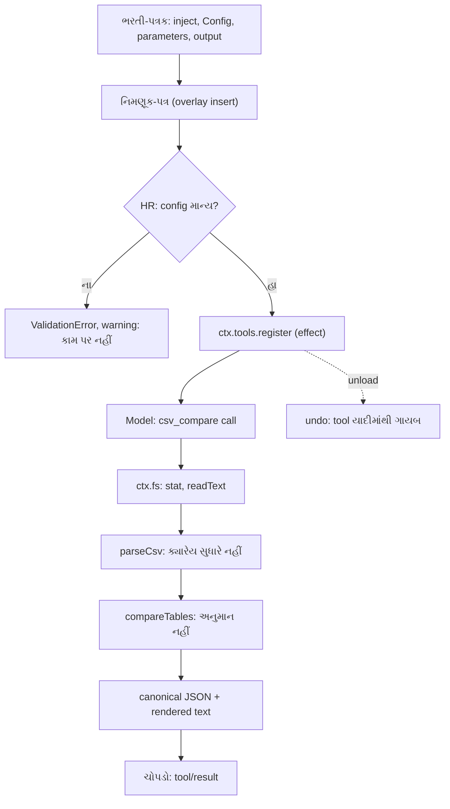

# વાર્તા 4 — પહેલી ભરતી

> **વાર્તા આવૃત્તિ, પ્રકરણ 4.** અત્યાર સુધી તમે ભોજનાલયના કર્મચારીઓને કામ કરતા જોયા. આજે **તમે પોતે** એક કર્મચારીની ભરતી કરશો. પહેલાં એક નાનો દરવાન (greet tool), પછી એક ઝીણવટવાળો હિસાબનીશ (`csv_compare` tool), જે બે યાદી સરખાવે છે અને **ક્યારેય અનુમાન નથી કરતો**.
> ઊંડી ટેકનિકલ વિગત: મુખ્ય પુસ્તકનું [પ્રકરણ 4](../book/04-potano-plugin.md).

## આ વાર્તા પછી તમે શું કરી શકશો

- નવો tool plugin ચાર સવાલથી design કરી શકશો: `inject`, `Config`, `parameters`, `output`.
- Overlay થી પોતાનો plugin `dsh` માં ઉમેરી, configure અને બંધ કરી શકશો.
- "Deterministic" નો અર્થ નિયમોથી સમજાવી, test થી સાબિત કરી શકશો.
- ખોટી config ને "fail loud" રીતે પકડાતી બતાવી શકશો.

## આ વાર્તાનાં નવાં પાત્રો

| વાર્તામાં | સાચું ટેકનિકલ નામ |
|---|---|
| ભરતી-પત્રક | plugin module (`inject`, `Config`, `apply`) |
| દરવાન | `greet` tool ([labs/greet/greet.ts](../labs/greet/greet.ts)) |
| હિસાબનીશ | `csv_compare` tool ([labs/csv-inspect/src/plugin.ts](../labs/csv-inspect/src/plugin.ts)) |
| નિમણૂક-પત્ર | overlay patch (`insert` row) |
| તાલીમ-પરીક્ષા | `node --test` tests |
| ઓડિટર | code review (Codex findings) |

---

## દ્રશ્ય 1 — ભરતી-પત્રકના ચાર સવાલ

**કથા.** HR મેનેજર (Cordis) તમને એક પત્રક આપે છે. તેમાં ચાર જ સવાલ છે. જવાબ આપ્યા વગર ભરતી નહીં.

| ભરતીનો સવાલ | Plugin માં | હિસાબનીશ (`csv_compare`) માટે |
|---|---|---|
| કયાં સાધન વગર કામ જ ન થાય? | `inject` | `['tools', 'fs']` |
| માલિક શું બદલી શકે? | `Config` | `toolName`, `maxBytes` |
| ગ્રાહક (model) શું કહી શકે? | `parameters` | `left_path`, `right_path`, `key_columns`, `compare_columns?` |
| કામનું પરિણામ શું, અને ગ્રાહકને શું કહેવું? | `output` | JSON report + ટૂંકું text |

**ટેકનિકલ નામ.** છેલ્લા સવાલના બે ભાગ છે: **canonical value** (સાચું, structured પરિણામ, ચોપડા અને UI માટે) અને **rendered content** (model ને દેખાતું text).

**શા માટે "માલિક શું બદલી શકે" અલગ?** Repository ના નિયમ ([AGENTS.md][agents-conventions]): **No hardcoded tunables in plugins** અને **Misconfiguration fails loud**. જે વસ્તુ deployment પ્રમાણે બદલાય તે code માં નહીં, validated `Config` માં.

**યાદ-ચાવી "ઇ-કો-પ-આ": ઇન્જેક્ટ, કોન્ફિગ, પેરામીટર, આઉટપુટ. "ઇકો પાછો આવે".**

---

## દ્રશ્ય 2 — પહેલો નાનો કર્મચારી: દરવાન

**કથા.** મોટી ભરતી પહેલાં નાની. દરવાનનું કામ એક જ: મહેમાનનું નામ સાંભળી સ્વાગત કરવું. શેઠ કહે છે: *"સ્વાગતનો શબ્દ હું નક્કી કરીશ. આજે 'નમસ્તે', કાલે 'કેમ છો'."*

**કેવી રીતે.** Repository ના ચકાસેલા `greet` example માં **બે જ ફેરફાર** ([labs/greet/greet.ts](../labs/greet/greet.ts)):

```ts
// change 1: a schema-validated config with a default
export const Config: z<Config> = z.object({
  greeting: z.string().default('નમસ્તે'),
})
…
      return `${config.greeting}, ${args.name}!` // change 2: use the config value
```

**નિમણૂક-પત્ર** (overlay; path **absolute** હોવો જ જોઈએ):

```yaml
- insert:
    - id: book-greet
      name: '/abs/path/to/tmp/book-labs/greet/greet.ts'
      config:
        greeting: 'કેમ છો'
```

**Terminal માં:**

```bash
O=$(GREETING='કેમ છો' bash tmp/book-labs/greet/make-overlay.sh)
```

```bash
TOOL_NAME=greet TOOL_ARGS='{"name":"Ada"}' SUCCESS_TEXT=done EXTRA_PATCH=$O TASK='Use the greet tool to greet Ada.' bash tmp/book-labs/request-trace/run-mock.sh
```

**ચોપડામાં** (🧪 [evidence/greet.err](../evidence/greet.err)): config વગર `"નમસ્તે, Ada!"`, config સાથે `"કેમ છો, Ada!"`.

**શા માટે પહેલાં નાનું?** ચકાસેલા example માં સૌથી નાનો ફેરફાર કરો તો ભૂલ થાય ત્યારે ખબર પડે કે **તમારા** ફેરફારમાં છે, harness માં નહીં.

---

## દ્રશ્ય 3 — હિસાબનીશની નિયમપોથી

**કથા.** હવે મોટી ભરતી. ભોજનાલય પાસે બે યાદી છે: "અમારી બિલ-યાદી" અને "સપ્લાયરની બિલ-યાદી". હિસાબનીશે બંને સરખાવવાની છે. મેનેજર પહેલાં code નહીં, **નિયમપોથી** લખાવે છે:

1. **ઓળખ (key)** = પસંદ કરેલા columns ની કિંમત, આજુબાજુની ખાલી જગ્યા કાઢીને.
2. એક ઓળખ કોઈ પણ બાજુ **બે વાર** દેખાય તો **duplicate**: એક પણ જોડી નહીં, કારણ કે "કઈ સાચી?" એ અનુમાન છે. બંને બાજુની lines group માં લખાય.
3. બંને બાજુ બરાબર એક વાર: **matched**; કિંમત સરખી તો identical, નહીં તો તફાવતની યાદી.
4. બાકીની: પોતાની બાજુએ **unmatched**.
5. ખરાબ લીટી: line number સાથે **problem**. Header માં ખાલી કે બેવડું column નામ હોય તો દરેક row `INVALID_HEADER`.
6. બધી યાદી ઓળખ, પછી line પ્રમાણે ગોઠવેલી.

**ટેકનિકલ નામ.** **Deterministic** = એ જ input → byte-identical output, અને કોઈ નિર્ણય અનુમાનથી નહીં. Code: [compare.ts](../labs/csv-inspect/src/compare.ts).

**ઉપમા ક્યાં તૂટે છે.** સાચો હિસાબનીશ શંકા પડે તો "આ જ હશે" ધારી લે. આપણો tool **ક્યારેય નથી ધારતો**; શંકા હોય તો કારણ સાથે report માં લખે છે.

**યાદ-ચાવી:** "**હિસાબનીશ ધારતો નથી, લખે છે.**"

---

## દ્રશ્ય 4 — કાગળ વાંચનાર કદી સુધારતો નથી

**કથા.** હિસાબનીશનો મદદનીશ CSV કાગળ વાંચે છે. કોઈ લીટીમાં એક ખાનું ઓછું હોય તો તે જાતે ભરી દેતો નથી; ફક્ત લખે છે, "લીટી 7: 4 ખાનાં જોઈએ, 3 મળ્યાં."

**ક્યાં.** [csv.ts](../labs/csv-inspect/src/csv.ts): comma, double-quoted fields, quote ની અંદર `""`, LF/CRLF, UTF-8 BOM.

**શા માટે?** "સુધારેલો" ડેટા ચૂપચાપ ખોટો હોઈ શકે. ભૂલ દેખાડવી એ ભૂલ છુપાવવા કરતાં સલામત છે.

---

## દ્રશ્ય 5 — ભોજનાલય સાથે જોડાણના ત્રણ નિર્ણય

**કથા.** હિસાબનીશ પહેલા દિવસે ત્રણ વાત શીખે છે:

1. *"કોઠારમાં જાતે નહીં જવાનું; કોઠારીને (`ctx.fs`) કહેવાનું."*
2. *"ઓર્ડરની directory હોય તો ત્યાંથી શોધવાનું; ન હોય તો પણ કામ ચાલે."*
3. *"હું ફક્ત વાંચું છું, લખતો નથી, એટલે બીજા વાંચનારાઓ સાથે એક સાથે કામ કરી શકું."*

**કેવી રીતે** ([plugin.ts](../labs/csv-inspect/src/plugin.ts)):

```ts
export const inject = ['tools', 'fs']

export const Config: z<Config> = z.object({
  toolName: z.string().default('csv_compare'),
  maxBytes: z.natural().default(5 * 1024 * 1024),
})
```

| નિર્ણય | Code | શા માટે |
|---|---|---|
| `ctx.fs`, `node:fs` નહીં | `ctx.fs.stat`, `ctx.fs.readText` | sandbox અને provider નિયંત્રણમાં રહે (વાર્તા 3 નો seam) |
| `workingDirectory` optional | `ctx.get('workingDirectory')` | upstream `read` ની જેમ ([`resolveRegularReadTarget`][read-target]); unit test માં તે વગર પણ ચાલે |
| `isConcurrencySafe: () => true` | tool definition | બીજા read-only calls સાથે parallel ([`executeToolBatch`][batch-execute]) |

**Expert નજર.** `workingDirectory` ને `inject` માં ન મૂકવાનો trade-off: tool વધુ જગ્યાએ ચાલે, પણ dependency HR ની ડાયરીમાં (startup audit માં) દેખાતી નથી. આ સભાન પસંદગી છે.

---

## દ્રશ્ય 6 — તાલીમ-પરીક્ષા

**કથા.** નોકરી પહેલાં પરીક્ષા. તેર સવાલ. છેલ્લો સવાલ ખાસ છે: *"તમે રજા પર જાઓ, ત્યારે સાધન-યાદીમાંથી તમારું નામ જાતે નીકળી જાય છે?"*

**Terminal માં** (harness checkout ના `tmp/book-labs` થી):

```bash
node --import tsx --test csv-inspect/test/*.test.ts
```

🧪 `tests 13, pass 13, fail 0`.

**કેવી રીતે.** Integration test ([plugin.test.ts](../labs/csv-inspect/test/plugin.test.ts)) સાચા `SystemPrompt`, `ToolRuntime`, `NativeToolExecutor`, `LocalFileSystem` plugins ને `await ctx.plugin(...)` થી **ક્રમસર** mount કરે છે, upstream [`mountAgentLoopTestDependencies`][testkit-mount] ની જેમ. તેથી વાર્તા 2 નો "ચિઠ્ઠીઓનો ક્રમ" race અહીં શક્ય નથી.

**શા માટે નામ જાતે નીકળે?** વાર્તા 2 નો **effect**: `register` પોતાનું "undo" સાથે લાવે છે; plugin unload થાય ત્યારે Cordis તે undo ચલાવે છે.

---

## દ્રશ્ય 7 — હિસાબનીશનો પહેલો સાચો દિવસ

**કથા.** ગ્રાહક (model) કહે છે: "આ બે યાદી સરખાવો." હિસાબનીશ કામ કરી ટૂંકી રસીદ આપે છે.

**Terminal માં:**

```bash
C=$(bash tmp/book-labs/csv-inspect/make-overlay.sh)
```

```bash
TOOL_NAME=csv_compare TOOL_ARGS='{"left_path":"tmp/book-labs/csv-inspect/fixtures/export-a.csv","right_path":"tmp/book-labs/csv-inspect/fixtures/export-b.csv","key_columns":["Ref"]}' EXTRA_PATCH=$C TASK='આ બે CSV export સરખાવો.' bash tmp/book-labs/request-trace/run-mock.sh
```

**ચોપડામાં** (🧪 [evidence/csv.err](../evidence/csv.err)):

```text
key: Ref; compared: Date, Party, Amount
left rows 5, right rows 4
identical 1, different 1, only-left 1, only-right 1, duplicate keys 1, problems 1
DIFF INV-1002 (left L3, right L3): Amount "8250.50"≠"8250.00"
ONLY-LEFT INV-1003 (L4)
ONLY-RIGHT INV-1005 (L5)
DUPLICATE INV-1004 (left L5, L6; right L4)
PROBLEM left L7 COLUMN_COUNT: expected 4 fields, found 3
```

**હિસાબ મેળવો.** ડાબી બાજુ 6 data lines (L2–L7): identical 1 + different 1 + only-left 1 + duplicate 2 + problem 1 = 6. જમણી બાજુ 4 (L2–L5): identical 1 + different 1 + only-right 1 + duplicate 1 = 4. **એક પણ લીટી ગાયબ નથી.** Test "every input data line appears in exactly one place in the report" આ જ સાબિત કરે છે.

---

## દ્રશ્ય 8 — ખોટો નિમણૂક-પત્ર: મોટેથી ના

**કથા.** કોઈ ભૂલથી નિમણૂક-પત્રમાં લખે છે: "વધુમાં વધુ −5 bytes વાંચવા." HR મેનેજર તરત પત્ર પાછો મોકલે છે; હિસાબનીશ કામ પર ચડતો જ નથી.

**ચોપડામાં** (🧪 [evidence/csv-badcfg.err](../evidence/csv-badcfg.err)):

```text
dsh: warning: 1 entry did not activate
book-csv-compare (file:///…/csv-inspect/src/plugin.ts): ValidationError: invalid config:
  - $.maxBytes expected number >= 0 but got -5 (at maxBytes)
```

**શા માટે ફક્ત warning, exit 1 નહીં?** હિસાબનીશ ફરજિયાત (required) કર્મચારી નથી. વાર્તા 2 યાદ કરો: ફરજિયાત (system prompt) ન હોય તો exit 1; વૈકલ્પિક ન હોય તો warning.

**યાદ-ચાવી:** "**ખોટો પત્ર, દરવાજે જ પાછો.**" (fail loud = load વખતે જ)

---

## દ્રશ્ય 9 — રજા આપવાના ત્રણ રસ્તા

**કથા.** શેઠ કહે છે, "આજે હિસાબનીશની જરૂર નથી." ત્રણ રસ્તા, નાનાથી મોટા:

1. નિમણૂક-પત્ર **ન** આપો (`--patch` કાઢો).
2. **બી**જો પત્ર: `- id: book-csv-compare` અને `disabled: true`.
3. **કા**યમ માટે: એ જ row profile ના `cordis.patch.yml` માં.

**યાદ-ચાવી "ન-બી-કા".**

**ચોપડામાં** (🧪 [evidence/csv-disabled.err](../evidence/csv-disabled.err)): ગ્રાહકે છતાં હિસાબનીશને બોલાવ્યો તો `Error: unknown tool "csv_compare"`, code `UNKNOWN_TOOL`. Crash નહીં, લાલ ચિઠ્ઠી (વાર્તા 3).

---

## દ્રશ્ય 10 — ઓડિટરે પકડેલી ત્રણ ભૂલો

**કથા.** પહેલા અઠવાડિયે ઓડિટર (code review) આવે છે અને ત્રણ ભૂલ પકડે છે. ત્રણેયનો પ્રકાર એક જ: **"હિસાબ ખૂટે, પણ report સાચો દેખાય."**

| ભૂલ | જૂનું વર્તન | સુધારો |
|---|---|---|
| Header માં `Amount,Amount` | બીજો column પહેલાને ચૂપચાપ ઢાંકે | આખી file ની rows `INVALID_HEADER` |
| એક બાજુ duplicate, બીજી બાજુ એક row | એકલી row report માંથી ગાયબ | duplicate group માં બંને બાજુની lines |
| (વાર્તા 7) `Debit` column જ નથી | ગેરહાજર = શૂન્ય; ₹900 ગાયબ | સ્પષ્ટ config error |

**શા માટે આ સૌથી અગત્યનું દ્રશ્ય?** Expert અને શરૂઆત કરનાર વચ્ચેનો તફાવત અહીં છે: "**ચૂપચાપ સાચું દેખાતું**" output સૌથી જોખમી છે. દરેક input row નો હિસાબ test થી સાબિત કરો.

---

## દ્રશ્ય 11 — "પરીક્ષામાં મળે છે, નોકરીમાં નથી મળતું"

**કથા.** તાલીમમાં `export-a.csv` મળી જાય છે, પણ સાચા દિવસે `cannot read "export-a.csv": not found`.

**નિદાનના ત્રણ પગલાં.**

1. Relative path કોની સામે? Test માં `LocalFileSystem { cwd: fixtures }`; `dsh` માં session ની working directory.
2. ચોપડાના `runtime-context` user message માં "Current working directory" જુઓ (વાર્તા 1 નું `#10`).
3. Checkout-relative path (`tmp/book-labs/...`) અથવા absolute path આપો.

**ઉપમા.** તાલીમ નાના રસોડામાં થઈ; નોકરી મોટા રસોડામાં છે. "ડાબે બીજું ખાનું" બંને જગ્યાએ જુદું છે.

---

## ભરતી એક ચિત્રમાં



## ક્યાં, કેવી રીતે, શા માટે

| દ્રશ્ય | ક્યાં | કેવી રીતે | શા માટે |
|---|---|---|---|
| 1 ચાર સવાલ | plugin module | `inject`, `Config`, `parameters`, `output` | design પહેલાં, code પછી |
| 2 દરવાન | `labs/greet/greet.ts` | config + overlay | નાનો ફેરફાર, સ્પષ્ટ ભૂલ |
| 3–4 નિયમો | `compare.ts`, `csv.ts` | duplicate પર match નહીં | અનુમાન = છુપી ભૂલ |
| 5 જોડાણ | `plugin.ts` | `ctx.fs`, optional `workingDirectory` | sandbox, testability |
| 6 પરીક્ષા | `test/*.test.ts` | ક્રમસર mount | race નહીં, unload સાબિત |
| 8 ખોટી config | Cordis config resolution | `z.natural()` | fail loud |
| 9 રજા | overlay / `cordis.patch.yml` | `disabled: true` | `UNKNOWN_TOOL` |
| 10 ઓડિટ | review + tests | દરેક row નો હિસાબ | ચૂપચાપ ખોટું સૌથી જોખમી |

## Lab — તમારો દરવાન બદલો

1. `GREETING='જય શ્રી કૃષ્ણ'` સાથે overlay બનાવી દ્રશ્ય 2 નો command ચલાવો.
2. ચોપડામાં `tool/result` text શોધો.
3. હવે `GREETING` વગર overlay બનાવો (`O=$(bash tmp/book-labs/greet/make-overlay.sh)`). પહેલાં લખો કે કયો શબ્દ આવશે, પછી ચલાવો. અપેક્ષિત (🧪 [evidence/greet.err](../evidence/greet.err)): default `"નમસ્તે, Ada!"`.

## આગાહી કસોટી

`export-b.csv` માં `INV-1004` ને **બે વાર** (lines 4 અને 6) કરો, `export-a.csv` જેમ છે તેમ રાખો. **પહેલાં લખો:** `duplicateKeys`, `onlyRight`, અને `duplicates` ની entries (`key`, `left`, `right`).

<details><summary>જવાબ (🧪)</summary>

```json
{"duplicateKeys":1,
 "onlyRight":[{"key":["INV-1005"],"line":5}],
 "duplicates":[{"key":["INV-1004"],"left":[5,6],"right":[4,6]}]}
```

એક જ key બંને બાજુ duplicate છે, તેથી **એક** group, જેમાં બંને બાજુની lines છે ([પરિશિષ્ટ D — Lab 4](../appendix/D-lab-solutions.md#lab-4)).
</details>

## Expert બનવાના પગથિયે

આ [માર્ગ](01-bhojanalay-no-pehlo-divas.md) નું **પગથિયું 4** (TypeScript, tests) છે. Expert ની કસોટી: પોતાનો ત્રીજો tool (દા.ત. CSV ની ફક્ત row-count આપતો) લખો, ચારે સવાલના જવાબ README માં લખો, તેના માટે ઓછામાં ઓછા ત્રણ tests (સાચું, ખોટી config, unload) લખો, અને `tsc` exit 0 બતાવો.

## પુનરાવર્તન કાર્ડ

<details><summary>1. ભરતી-પત્રકના ચાર સવાલ?</summary>

`inject` (સાધન), `Config` (માલિક શું બદલે), `parameters` (model શું કહે), `output` (value + render).
</details>

<details><summary>2. Duplicate key ને match કેમ નથી કરતા?</summary>

કઈ row સાચી તે પસંદ કરવું અનુમાન છે; ખોટો match ચૂપચાપ ખોટો હિસાબ આપે.
</details>

<details><summary>3. `ctx.fs` કેમ, `node:fs` કેમ નહીં?</summary>

Filesystem provider અને sandbox policy નિયંત્રણમાં રહે; provider બદલાય તો tool એ જ.
</details>

<details><summary>4. ખોટી config નું પરિણામ?</summary>

`ValidationError` load વખતે, tool register નહીં; required નથી એટલે warning.
</details>

<details><summary>5. Disable ના ત્રણ રસ્તા?</summary>

"ન-બી-કા": overlay ન આપો; બીજું overlay `disabled: true`; કાયમ માટે profile `cordis.patch.yml`.
</details>

## મિત્રને સમજાવો (3 મિનિટ)

"હિસાબનીશ ધારતો નથી, લખે છે" વાક્યથી શરૂ કરો. પછી દ્રશ્ય 7 ની રસીદ બતાવી ડાબી 6 અને જમણી 4 lines નો હિસાબ મિત્ર પાસે મેળવાવો.

---

પાછળ: [વાર્તા 3](03-kothar-dubhashiyo-chopdo.md) · આગળ: [વાર્તા 5 — કટોકટીનો દિવસ](05-katokati-no-divas.md)

<!-- citations:begin (generated by tools/refdefs.py) -->
[agents-conventions]: https://github.com/deepseek-ai/deepseek-harness/blob/fcc0ad462172522aaf5c93a7b2e01f6b9f0b0159/AGENTS.md#L130-L142
[batch-execute]: https://github.com/deepseek-ai/deepseek-harness/blob/fcc0ad462172522aaf5c93a7b2e01f6b9f0b0159/packages/core/tools/src/batch.ts#L50-L96
[read-target]: https://github.com/deepseek-ai/deepseek-harness/blob/fcc0ad462172522aaf5c93a7b2e01f6b9f0b0159/packages/fs/tool-fs/src/read-target.ts#L19-L34
[testkit-mount]: https://github.com/deepseek-ai/deepseek-harness/blob/fcc0ad462172522aaf5c93a7b2e01f6b9f0b0159/packages/test-support/agent-loop-testkit/src/index.ts#L74-L90
<!-- citations:end -->
