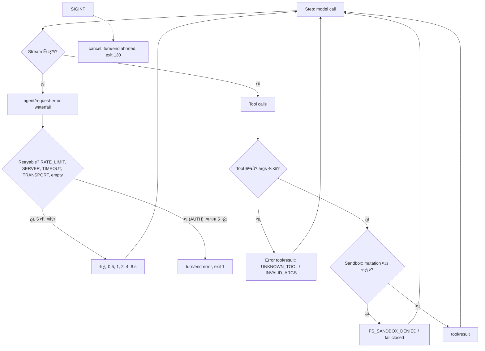

# વાર્તા 5 — કટોકટીનો દિવસ

> **વાર્તા આવૃત્તિ, પ્રકરણ 5.** આજે ભોજનાલયમાં બધું ખોટું થાય છે. ગ્રાહક અજાણ્યા કર્મચારીને બોલાવે છે, અધૂરી ચિઠ્ઠી આવે છે, રસોઇયાની agency નો ફોન વ્યસ્ત આવે છે, ખોટો પાસવર્ડ આવે છે, અને અચાનક લાઈટ જાય છે. પછી કોઈ રસોડાની વાડ કૂદવાનો પ્રયત્ન કરે છે. તમે **તપાસ અધિકારી** છો: દરેક કટોકટીનું કારણ પુરાવા સાથે શોધવાનું.
> ઊંડી ટેકનિકલ વિગત: મુખ્ય પુસ્તકનું [પ્રકરણ 5](../book/05-debugging-permissions-reliability.md).

## આ વાર્તા પછી તમે શું કરી શકશો

- ચાર પ્રકારની નિષ્ફળતા (unknown tool, invalid input, provider error, interruption) ઇચ્છા મુજબ ઉત્પન્ન કરી, ચોપડામાંથી કારણ કાઢી શકશો.
- Retry ક્યારે થાય, ક્યારે ન થાય, અને કેટલી રાહ જોવાય તે source થી બતાવી શકશો.
- Sandbox અને approval ની **સાચી** સીમાઓ, અને ક્યાં સીમા **નથી** તે, ચલાવીને સાબિત કરી શકશો.
- "Fix → પુરાવો" નો નિયમ લાગુ કરી શકશો.

## આ વાર્તાનાં નવાં પાત્રો

| વાર્તામાં | સાચું ટેકનિકલ નામ |
|---|---|
| CCTV | observer plugin (`trace-events.ts`) |
| ફોન-રેકોર્ડર | wire capture (`capture-wire.ts`) |
| "થોભો" બટન | breakpoint (`--inspect-brk`) |
| ફરી ફોન કરનાર મદદનીશ | `llm-retry` plugin |
| લાઈટ જવી | `SIGINT` (Ctrl+C) |
| રસોડાની વાડ | sandbox mode (`workspace-write`) |
| શેઠની મંજૂરી | approval policy (`ask`) |

---

## દ્રશ્ય 1 — તપાસ અધિકારીની પેટી

**કથા.** સવારે મેનેજર તમને એક પેટી આપે છે. અંદર છ સાધન છે. *"દરેક કટોકટીમાં પહેલાં નક્કી કરો કે કયું સાધન વાપરવું."*

| પેટીમાં | ક્યારે વાપરવું | Book tool / command |
|---|---|---|
| CCTV | કયું event ક્યારે, કયા ક્રમમાં | [`trace-events.ts`](../labs/request-trace/trace-events.ts) |
| ઓર્ડર-ચોપડો | model ને **ખરેખર** શું દેખાયું | [`print-session.mjs`](../labs/request-trace/print-session.mjs) `--full` |
| ફોન-રેકોર્ડર | દુભાષિયાએ HTTP પર શું મોકલ્યું | [`capture-wire.ts`](../labs/request-trace/capture-wire.ts) |
| "થોભો" બટન | એક line પર અટકવું | `node --inspect-brk --import tsx/esm apps/cli/src/bin.ts --profile headless "…"` |
| જૂની પરીક્ષાઓ | વર્તનનો કરાર | `pnpm exec vitest run <package path>` |
| HR ડાયરી | કર્મચારી કામ પર ચડ્યો જ નહીં | stderr નું `entries did not activate` (વાર્તા 2) |

**Expert નજર.** "થોભો" બટન: Chrome માં `chrome://inspect` ખોલી agent loop ના [`step`][loop-step] પર breakpoint મૂકો. Command 🧪 ચકાસ્યો (`Debugger listening on ws://127.0.0.1:9229/…`); interactive stepping અમે આ environment માં કર્યું નથી ⚠️.

**યાદ-ચાવી:** "**પહેલાં ચોપડો, પછી અનુમાન.**"

---

## દ્રશ્ય 2 — કટોકટી A: અજાણ્યો કર્મચારી

**કથા.** રસોઇયો ચિઠ્ઠી લખે છે: "**read_everything** ને બોલાવો." એવો કોઈ કર્મચારી નથી. વેઈટર ઝઘડતો નથી; લાલ ચિઠ્ઠી પાછી મોકલે છે, અને રસોઇયો બીજી રીતે કામ પૂરું કરે છે.

```bash
TOOL_NAME=read_everything bash tmp/book-labs/request-trace/run-mock.sh
```

**ચોપડામાં** (🧪 [evidence/unknown-tool.err](../evidence/unknown-tool.err)):

| જોયું | મૂલ્ય |
|---|---|
| Model ને દેખાયું | `Error: unknown tool "read_everything"` |
| ચોપડામાં `error` | `{"name":"ToolNotFoundError","code":"UNKNOWN_TOOL"}` |
| ઓર્ડર | `completed`, exit 0 |

**ક્યાં.** [`dispatchToolBody`][pipeline-body] → `resolveExecution` → `undefined` → [`ToolNotFoundError`][contracts-notfound].

**યાદ રાખો.** વાર્તા 4 માં રજા પર ગયેલો હિસાબનીશ પણ **આ જ** લક્ષણ આપે છે. "Unknown tool" દેખાય તો પહેલાં પૂછો: plugin load થયો હતો?

---

## દ્રશ્ય 3 — કટોકટી B: અધૂરી ચિઠ્ઠી

**કથા.** રસોઇયો રેસીપી-ચોપડી માંગે છે, પણ ખાનાનું નામ ખોટું લખે છે: `path` (સાચું `file_path`).

```bash
TOOL_ARGS='{"path":"README.md"}' bash tmp/book-labs/request-trace/run-mock.sh
```

**ચોપડામાં** (🧪 [evidence/invalid-args.err](../evidence/invalid-args.err)): `Error: invalid arguments: missing required property "file_path"`, `{"name":"ToolArgsError","code":"INVALID_ARGS"}`.

**ક્યાં.** [`defineTool` validation][schema-defineTool-validate].

**શા માટે turn ચાલુ?** A અને B બંને **સામાન્ય `tool/result`** (`isError: true`) બને છે. Step નિષ્ફળ થતો નથી, તેથી બીજો step રસોઇયાને સુધારવાની તક આપે છે.

---

## દ્રશ્ય 4 — કટોકટી C: agency નો ફોન

**કથા.** આજે agency ત્રણ રીતે તકલીફ આપે છે. દુભાષિયાની બાજુમાં એક નવો મદદનીશ બેઠો છે: **"ફરી ફોન કરનાર"**. તે દરેક ભૂલ જોઈને નક્કી કરે છે: ફરી પ્રયાસ કરવો કે નહીં.

| કટોકટી | Script | શું થયું | Calls | Exit |
|---|---|---|---|---|
| "લાઈન વ્યસ્ત" (429) | `SEQUENCE=rate_limit,tool_call_success,success` | `llm/retry`, ~1s પછી સફળ | 3 | 0 🧪 |
| "ખોટો પાસવર્ડ" (401) | `SEQUENCE=auth_error` | `turn/end` reason `error`, `AUTH`; **ફરી પ્રયાસ નહીં** | 1 | 1 🧪 |
| "agency બંધ" (500, script પૂરો) | title row ચાલુ + `tool_call_success,success` | 5 retries (~0.5, 1, 1.9, 3.9, 8.2 s), પછી `SERVER` | 8 | 1 🧪 |

**ચોપડામાં, ખોટો પાસવર્ડ** (🧪 [evidence/auth-error.err](../evidence/auth-error.err)):

```text
[trace +  377ms] session/event #17 turn/end reason={"kind":"error","error":{"message":"mock authentication failed","code":"AUTH","status":401}}
dsh: AUTH: mock authentication failed
```

**કેવી રીતે.** Stream નિષ્ફળ થાય ત્યારે વેઈટર `assistant/attempt` લખી `agent/request-error` **waterfall** ચલાવે છે ([source][loop-request-error]). "ફરી ફોન કરનાર" ([listener][retry-listener]) `{ kind: 'retry' }` પાછું આપે તો **એ જ step** માં ફરી પ્રયાસ. Defaults ([source][retry-defaults]):

```ts
const DEFAULT_MAX_RETRIES = 5
const DEFAULT_INITIAL_DELAY_MS = 500
const DEFAULT_MAX_DELAY_MS = 10_000
const DEFAULT_JITTER_RATIO = 0.1
```

**શા માટે પાસવર્ડમાં ફરી પ્રયાસ નહીં?** ખોટો પાસવર્ડ સો વાર લગાવો તો પણ ખોટો જ રહે; ફક્ત સમય અને પૈસા બગડે. ફરી પ્રયાસ ફક્ત **કામચલાઉ** ભૂલોમાં: `RATE_LIMIT`, `SERVER`, `TIMEOUT`, `TRANSPORT`, ખાલી જવાબ.

**યાદ-ચાવી "રે-સે-ટા-ટ્રા-ખા": "રેસે ટાટા ટ્રાફિક ખાલી". રાહ: 0.5 → 1 → 2 → 4 → 8 (દર વખતે બમણી, ઉપર 10 s, ±10%).**

**Expert નજર.** Retry એ જ step માં થાય છે, તેથી `agent/pre-step` અને user admission ફરી થતાં નથી (architecture doc ✅). Inbox નો નવો સંદેશ retry વચ્ચે ઘૂસી શકતો નથી.

---

## દ્રશ્ય 5 — કટોકટી D: અચાનક લાઈટ ગઈ

**કથા.** Agency નો ફોન ચાલુ છે, પણ સામે કોઈ બોલતું નથી (stall). ચાર સેકન્ડ પછી કોઈ મુખ્ય સ્વીચ બંધ કરે છે (Ctrl+C). ભોજનાલય બંધ થાય છે, પણ **વ્યવસ્થિત રીતે**: ચોપડામાં લખાય છે "ઓર્ડર રદ — દુકાન બંધ થઈ."

| જોયું | મૂલ્ય |
|---|---|
| Exit code | **130** (launcher: `SIGINT` → 130, `SIGTERM` → 0) ([`runProfile`][cli-runProfile]) |
| ચોપડો | `assistant/attempt {"stream":[]}`, `step/end`, `turn/end {"kind":"aborted","reason":{"kind":"disposed"}}` |
| Stderr | `dsh: session "session-…": flush on a closed handle` |

(🧪 [evidence/stall.err](../evidence/stall.err); પૂરા commands: [પરિશિષ્ટ B](../appendix/B-command-reference.md#interrupt-and-resume))

**કેવી રીતે રદ થવાનો સંદેશ વહે છે:**

```text
SIGINT → shutdown.interrupt(130) → root fiber dispose
  → agent loop નો cancel(cause) → AbortController.abort()
  → દરેક await પછી signal.throwIfAborted()
  → turn() નું catch: reason "aborted" → finally: turn/end
```

**ક્યાં.** [`cancel`][loop-cancel], [`turn`][loop-turn].

**શા માટે કામ અડધું છોડતા નથી?** Tool body ચાલુ હોય તો pipeline તેને છોડી દેતું નથી: "Cancellation never abandons the body: a started promise reaches quiescence before its outcome becomes `ABORTED`" ([`dispatchToolBody`][pipeline-body]). રસોઇયો અડધું શાક છોડી ગેસ ચાલુ રાખી ભાગતો નથી; ગેસ બંધ કરીને જાય છે.

**રહસ્ય.** ત્રીજી લીટી, `flush on a closed handle`, વિચિત્ર છે: બંધ થયા પછી પણ કોઈ ચોપડો સાચવવાનો પ્રયત્ન કરે છે. આ નાની ખામીનું **સમારકામ** વાર્તા 6 માં છે.

---

## દ્રશ્ય 6 — રસોડાની વાડ અને શેઠની મંજૂરી

**કથા.** રસોડાની આસપાસ વાડ છે. વાડના ત્રણ પ્રકાર છે: "ફક્ત જોવું" (`read-only`), "રસોડામાં કામ" (`workspace-write`), "આખું શહેર" (`danger-full-access`). વાડ બહાર જવું હોય તો શેઠની મંજૂરી (`ask`) જોઈએ.

**ચોપડાની પહેલી ત્રણ લીટી** (દરેક headless run માં 🧪):

```text
#0 permission/preset {"preset":"workspace-write"}
#1 sandbox/mode {"mode":"workspace-write"}
#2 approval/policy {"policy":"ask"}
```

**ક્યાં.** [`SandboxPolicyService`][sandbox-policy] (default `read-only`); base bundle `DSH_PERMISSION_MODE` ન હોય તો `workspace-write` અને `workspaceRoot: process.cwd()` ([rows][bundle-base-sandbox]); [`ApprovalPolicy`][approval-policy] = `'ask' | 'never'`.

---

## દ્રશ્ય 7 — વાડ કૂદવાના પાંચ પ્રયત્ન

**કથા.** એક તોફાની ગ્રાહક (model) પાંચ પ્રયત્ન કરે છે. તમે દરેકનું પરિણામ નોંધો છો.

| # | પ્રયત્ન | પરિણામ (model ને દેખાયું) | કોણે રોક્યું |
|---|---|---|---|
| 1 | `/etc/book-test.txt` માં લખવું | `Error: [sandbox: file access denied under workspace-write mode]`, `FS_SANDBOX_DENIED` | `dsh-fs-sandbox` ([policy][fs-sandbox-doc]) |
| 2 | એ જ, "મને આખું શહેર આપો" (`danger-full-access`) | `approval/decided {"outcome":"unavailable"}` → "requires approval, but no approval channel is available" | [escalation][sandbox-escalation]: headless માં શેઠ હાજર નથી |
| 3 | `bash touch /etc/book-bash-test` | "no sandbox backend is usable on this host; refusing to run the command unconfined" | [`SandboxUnavailableError`][sandbox-unavailable] |
| 4 | `/etc/os-release` **વાંચવું** | **સફળ** | કોઈએ નહીં |
| 5 | `NOPE.md` વાંચવું | `FS_NOT_FOUND` | `read` tool |

(🧪 બધા `workspace-write` માં: `outside-write.err`, `escalate-write.err`, `bash-outside.err`, `read-outside.err`, `missing-file.err`.) કોઈ પણ run પછી `/etc` માં file બની નથી (`ls` થી ચકાસ્યું). 🧪

**શા માટે 2 અને 3 માં "ના"?** **Fail closed:** ખાતરી ન હોય તો **ના**. શેઠ હાજર નથી તો મંજૂરી નહીં; વાડ ઊભી કરનાર (`bwrap`) નથી તો command વાડ વગર નહીં.

**ઉપમા ક્યાં તૂટે છે.** સાચી વાડ અંદર-બહાર **બંને** રોકે. આ વાડ ફક્ત **ફેરફાર** રોકે છે; **વાંચવું બધે ખુલ્લું છે** (પ્રયત્ન 4). Source પોતે કહે છે: "Reads pass through untouched: every mode permits reading" ([source][fs-sandbox-reads]) અને "This is containment, not a security boundary". તેથી secrets વાળા machine પર agent ચલાવતા પહેલાં [SAFETY.md](https://github.com/deepseek-ai/deepseek-harness/blob/fcc0ad462172522aaf5c93a7b2e01f6b9f0b0159/SAFETY.md) વાંચો: disposable VM/container, ઓછામાં ઓછી પરવાનગી.

**Expert નજર.** Kernel-level વાડ shell નું કામ છે: Linux પર `dsh-sandbox-local` પહેલાં `bwrap`, પછી Landlock ([source][sandbox-local-chain]); macOS `sandbox-exec`; Windows ACL runner. અમારા host પર કોઈ backend નહોતું, તેથી ફક્ત fail-closed રસ્તો ચકાસ્યો ⚠️.

**યાદ-ચાવી:** "**લખવામાં વાડ, વાંચવામાં ખુલ્લું મેદાન.**"

---

## દ્રશ્ય 8 — ભોજનાલયની બહાર શું જાય છે

**કથા.** તમને ખબર પડે છે કે દરેક ફોન સાથે દુભાષિયો **ચોપડાનો નવો ભાગ** પણ agency ને મોકલે છે (વાર્તા 3). આ ચોરી નથી; ભોજનાલયની ગોઠવણ છે. પણ તમારે જાણવું જોઈએ.

**ટેકનિકલ નામ.** **Data boundary**, permission નહીં. `dsh_session_log` (log નો incremental suffix) અને `dsh_plugin_packages`, headers માં anonymous user id અને session id. 🧪 ન મોકલવું હોય તો ([row][bundle-base-sessionlog]):

```yaml
- id: session-log-deepseek
  disabled: true
```

**Telemetry.** `session-telemetry-otel` row default `FEEDBACK_ONLY` ([row][bundle-base-telemetry]); non-empty `DSH_TELEMETRY_DISABLED` opt out કરે છે ✅ (અમારા બધા runs `DSH_TELEMETRY_DISABLED=1` સાથે).

---

## દ્રશ્ય 9 — એક સાથે દસ વાનગી

**કથા.** રસોઇયો એક સાથે પાંચ રેસીપી-ચોપડી માંગે છે. કોઠારમાં દસ લોકો એક સાથે **વાંચી** શકે છે, પણ **લખનાર** આવે તો બાકીના રાહ જુએ છે. અને પીરસતી વખતે ક્રમ હંમેશા ચિઠ્ઠીનો જ.

**ટેકનિકલ નામ.** [`executeToolBatch`][batch-execute] દરેક call માટે [`executionMode`][pipeline-executionMode] પૂછે છે: `parallel` calls rolling pool માં, બાકીના exclusive barrier. Pool મર્યાદા `maxParallelToolCalls` ([source][loop-maxparallel]), default 10 ([source][loop-maxparallel-default]), `volatile()` (restart વગર બદલાય). Results હંમેશા **model order** માં commit.

---

## દ્રશ્ય 10 — તપાસ અધિકારીનો સુવર્ણ નિયમ

**કથા.** સાંજે મેનેજર પૂછે છે: *"તમે સમારકામ કર્યું તે સાબિત કેવી રીતે કરશો?"* તમે ચાર પગલાં કહો છો:

1. **પહેલાં** નિષ્ફળતા ફરી ઉત્પન્ન કરો.
2. Fix કરો.
3. **એ જ પગલાંથી** ફરી ચલાવો.
4. Fix ઉલટાવી નિષ્ફળતા **પાછી આવે છે** તે પણ બતાવો.

| નિષ્ફળતા | Fix | પુરાવો |
|---|---|---|
| વાર્તા 2 નો race: `TOOL_EXECUTOR_UNAVAILABLE` | executor row + `loader.await()` | executor row છેલ્લે રાખી 3/3 runs સફળ |
| Title ચાલુ: ત્રીજો call script ખાઈ જાય | lab overlay માં title row બંધ, અથવા ત્રીજો `success` | metrics: `modelCalls` 3 → 2 (વાર્તા 6) |
| SIGINT પછી `flush on a closed handle` | headless runner patch | patch વગર 2/2 message, સાથે ગાયબ; regression test (વાર્તા 6) |

**યાદ-ચાવી "ફ-ફિ-ફ-ઉ": ફરી ઉત્પન્ન, ફિક્સ, ફરી ચલાવો, ઉલટાવો.**

---

## કટોકટીઓ એક ચિત્રમાં



## ક્યાં, કેવી રીતે, શા માટે

| કટોકટી | ક્યાં | કેવી રીતે | શા માટે |
|---|---|---|---|
| Unknown tool | `dispatchToolBody` | `ToolNotFoundError` → result | model સુધારે |
| Invalid args | `defineTool` | `ToolArgsError` → result | model સુધારે |
| Provider error | `agent/request-error`, `llm-retry` | એ જ step માં backoff | કામચલાઉ ભૂલ જ retry |
| Interruption | `cancel`, `turn` `finally` | abort → `aborted` turn/end, 130 | ચોપડો પૂરો રહે, resume શક્ય |
| Sandbox | `dsh-fs-sandbox`, escalation | mutation fence, fail closed | ખાતરી નહીં તો ના |
| Reads | fs-sandbox | ખુલ્લાં | containment, security boundary નહીં |
| Concurrency | `executeToolBatch` | parallel pool, model order | ઝડપ + નિશ્ચિત ક્રમ |

## Lab — ચારેય કટોકટી અને તેમની પરીક્ષા

દરેક run પહેલાં `rm -rf tmp/book-home` કરો, પછી ઉપરના commands ચલાવી કારણ કાઢો:

```bash
node tmp/book-labs/request-trace/print-session.mjs "$(find tmp/book-home/sessions -name 'session.v*.jsonl*' | head -1)" | grep -E "tool/result|turn/end"
```

એ જ વર્તનની upstream પરીક્ષાઓ:

```bash
pnpm exec vitest run packages/llm/llm-retry packages/core/tools packages/fs/fs-sandbox
```

અપેક્ષિત (🧪): `Test Files 16 passed (16)`, `Tests 321 passed (321)`.

## આગાહી કસોટી

```bash
rm -rf tmp/book-home && SEQUENCE=server_error,server_error,tool_call_success,success bash tmp/book-labs/request-trace/run-mock.sh
```

**પહેલાં લખો:** (1) કુલ model calls, (2) `llm/retry` events, (3) exit code, (4) આશરે કેટલી સેકન્ડ.

<details><summary>જવાબ (🧪)</summary>

**4** model calls, **2** `llm/retry`, exit **0**, આશરે 1.8 s (dsh ની અંદર; mock શરૂ કરવા સહિત ≈5.8 s). `SERVER` કામચલાઉ ભૂલ છે, તેથી retry ([evidence/server-error-twice.err](../evidence/server-error-twice.err)).
</details>

## Expert બનવાના પગથિયે

આ [માર્ગ](01-bhojanalay-no-pehlo-divas.md) નું **પગથિયું 5** (debugging, reliability) છે. Expert ની કસોટી: `SEQUENCE=auth_error` અને `SEQUENCE=rate_limit,…` ના ચોપડા બાજુ-બાજુમાં મૂકી, `llm/retry` ક્યાં છે અને ક્યાં નથી તે source ની લીટી ([retry defaults][retry-defaults], [listener][retry-listener]) સાથે સમજાવો.

## પુનરાવર્તન કાર્ડ

<details><summary>1. Unknown tool અને invalid args પછી turn કેમ ચાલુ રહે?</summary>

બંને સામાન્ય `tool/result` (`isError: true`) બને; step નિષ્ફળ નથી, model સુધારી શકે.
</details>

<details><summary>2. કઈ ભૂલો retry થાય? કઈ નહીં?</summary>

`RATE_LIMIT`, `SERVER`, `TIMEOUT`, `TRANSPORT`, ખાલી જવાબ: હા. `AUTH`: ના.
</details>

<details><summary>3. Retry ની રાહ?</summary>

500 ms થી શરૂ, દર વખતે બમણી, ઉપર 10 s, ±10% jitter, વધુમાં વધુ 5 વાર.
</details>

<details><summary>4. Ctrl+C પછી exit code અને ચોપડાની છેલ્લી લીટી?</summary>

130; `turn/end {"kind":"aborted","reason":{"kind":"disposed"}}`.
</details>

<details><summary>5. `workspace-write` માં બહારની file વાંચી શકાય? કેમ?</summary>

હા. Design: "Reads pass through untouched"; "containment, not a security boundary".
</details>

<details><summary>6. Headless માં escalation હંમેશા કેમ નકારાય?</summary>

Approval આપનાર (શેઠ) નથી; outcome `unavailable` → fail closed.
</details>

## મિત્રને સમજાવો (3 મિનિટ)

"ખોટો પાસવર્ડ સો વાર લગાવો તો પણ ખોટો" વાક્યથી retry નો નિયમ સમજાવો. પછી "લખવામાં વાડ, વાંચવામાં ખુલ્લું મેદાન" થી કહો કે agent ને સાચા secrets વાળા computer પર કેમ સીધો ન ચલાવવો.

---

પાછળ: [વાર્તા 4](04-paheli-bharti.md) · આગળ: [વાર્તા 6 — ભોજનાલયમાં સુધારો](06-bhojanalay-ma-sudharo.md)

<!-- citations:begin (generated by tools/refdefs.py) -->
[approval-policy]: https://github.com/deepseek-ai/deepseek-harness/blob/fcc0ad462172522aaf5c93a7b2e01f6b9f0b0159/packages/interaction/user-approval/src/index.ts#L68
[batch-execute]: https://github.com/deepseek-ai/deepseek-harness/blob/fcc0ad462172522aaf5c93a7b2e01f6b9f0b0159/packages/core/tools/src/batch.ts#L50-L96
[bundle-base-sandbox]: https://github.com/deepseek-ai/deepseek-harness/blob/fcc0ad462172522aaf5c93a7b2e01f6b9f0b0159/packages/bundle/base/cordis.patch.yml#L243-L278
[bundle-base-sessionlog]: https://github.com/deepseek-ai/deepseek-harness/blob/fcc0ad462172522aaf5c93a7b2e01f6b9f0b0159/packages/bundle/base/cordis.patch.yml#L43-L44
[bundle-base-telemetry]: https://github.com/deepseek-ai/deepseek-harness/blob/fcc0ad462172522aaf5c93a7b2e01f6b9f0b0159/packages/bundle/base/cordis.patch.yml#L218-L221
[contracts-notfound]: https://github.com/deepseek-ai/deepseek-harness/blob/fcc0ad462172522aaf5c93a7b2e01f6b9f0b0159/packages/core/tools/src/contracts.ts#L291
[fs-sandbox-doc]: https://github.com/deepseek-ai/deepseek-harness/blob/fcc0ad462172522aaf5c93a7b2e01f6b9f0b0159/packages/fs/fs-sandbox/src/index.ts#L20-L24
[fs-sandbox-reads]: https://github.com/deepseek-ai/deepseek-harness/blob/fcc0ad462172522aaf5c93a7b2e01f6b9f0b0159/packages/fs/fs-sandbox/src/index.ts#L7-L8
[loop-cancel]: https://github.com/deepseek-ai/deepseek-harness/blob/fcc0ad462172522aaf5c93a7b2e01f6b9f0b0159/packages/core/agent-loop/src/agent.ts#L191-L201
[loop-maxparallel]: https://github.com/deepseek-ai/deepseek-harness/blob/fcc0ad462172522aaf5c93a7b2e01f6b9f0b0159/packages/core/agent-loop/src/index.ts#L295
[loop-maxparallel-default]: https://github.com/deepseek-ai/deepseek-harness/blob/fcc0ad462172522aaf5c93a7b2e01f6b9f0b0159/packages/core/agent-loop/src/constants.ts#L6
[loop-request-error]: https://github.com/deepseek-ai/deepseek-harness/blob/fcc0ad462172522aaf5c93a7b2e01f6b9f0b0159/packages/core/agent-loop/src/agent.ts#L549-L564
[loop-step]: https://github.com/deepseek-ai/deepseek-harness/blob/fcc0ad462172522aaf5c93a7b2e01f6b9f0b0159/packages/core/agent-loop/src/agent.ts#L435-L610
[loop-turn]: https://github.com/deepseek-ai/deepseek-harness/blob/fcc0ad462172522aaf5c93a7b2e01f6b9f0b0159/packages/core/agent-loop/src/agent.ts#L327-L433
[pipeline-body]: https://github.com/deepseek-ai/deepseek-harness/blob/fcc0ad462172522aaf5c93a7b2e01f6b9f0b0159/packages/core/tools/src/pipeline.ts#L258-L288
[retry-defaults]: https://github.com/deepseek-ai/deepseek-harness/blob/fcc0ad462172522aaf5c93a7b2e01f6b9f0b0159/packages/llm/llm/src/retry-policy.ts#L14-L24
[retry-listener]: https://github.com/deepseek-ai/deepseek-harness/blob/fcc0ad462172522aaf5c93a7b2e01f6b9f0b0159/packages/llm/llm-retry/src/index.ts#L240
[sandbox-escalation]: https://github.com/deepseek-ai/deepseek-harness/blob/fcc0ad462172522aaf5c93a7b2e01f6b9f0b0159/packages/sandbox/sandbox/src/escalation.ts#L200-L204
[sandbox-local-chain]: https://github.com/deepseek-ai/deepseek-harness/blob/fcc0ad462172522aaf5c93a7b2e01f6b9f0b0159/packages/sandbox/sandbox-local/src/index.ts#L2
[sandbox-policy]: https://github.com/deepseek-ai/deepseek-harness/blob/fcc0ad462172522aaf5c93a7b2e01f6b9f0b0159/packages/sandbox/sandbox-policy/src/index.ts#L134-L138
[sandbox-unavailable]: https://github.com/deepseek-ai/deepseek-harness/blob/fcc0ad462172522aaf5c93a7b2e01f6b9f0b0159/packages/sandbox/sandbox/src/index.ts#L139-L150
<!-- citations:end -->
