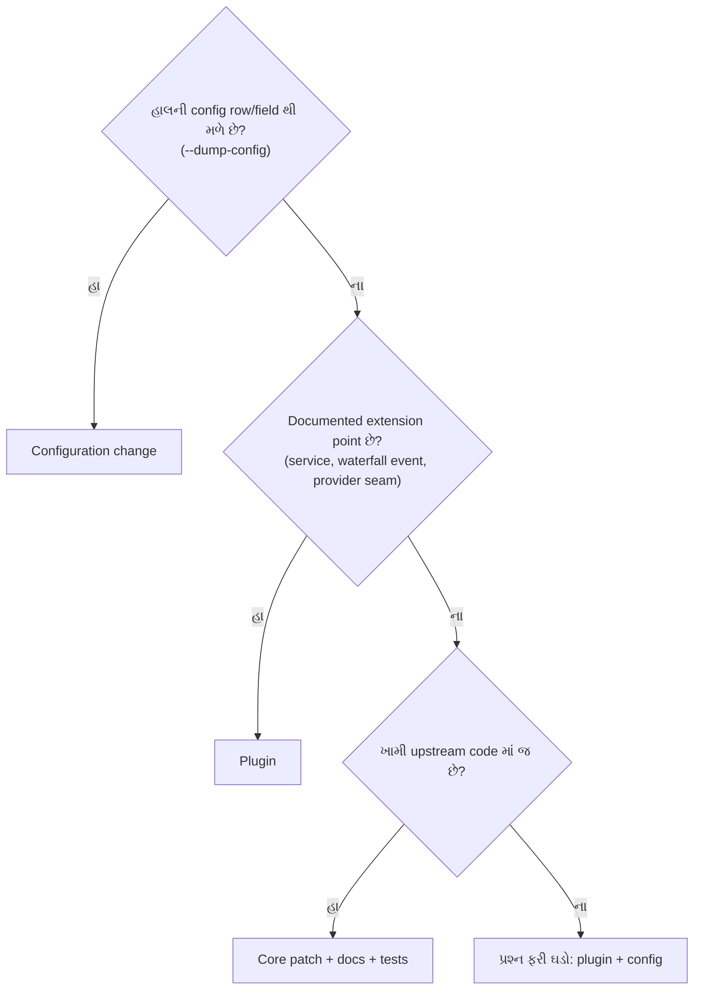
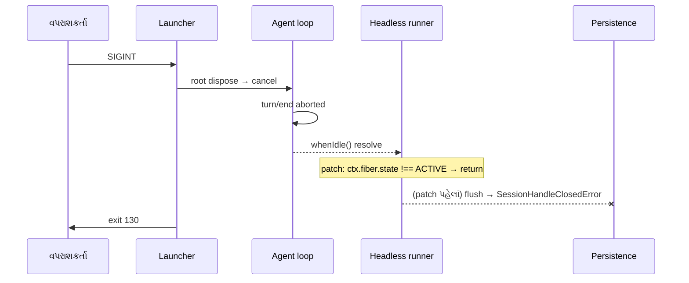

# વાર્તા 6 — ભોજનાલયમાં સુધારો

> **વાર્તા આવૃત્તિ, પ્રકરણ 6.** હવે તમે ફક્ત કર્મચારી નથી; ભોજનાલયના **સંચાલક સમિતિ** ના સભ્ય છો. આજે ત્રણ સવાલ: (1) નવું કામ આવે ત્યારે **ક્યાં** બદલવું: નિયમપોથીમાં, નવો કર્મચારી, કે ઇમારતમાં? (2) વર્તન બદલ્યા વગર **માપવું** કેવી રીતે? (3) વાર્તા 5 ના રહસ્ય ("flush on a closed handle") નું **સાચું સમારકામ** કેવી રીતે કરવું?
> ઊંડી ટેકનિકલ વિગત: મુખ્ય પુસ્તકનું [પ્રકરણ 6](../book/06-maintainer-architecture.md).

## આ વાર્તા પછી તમે શું કરી શકશો

- Configuration change, plugin, અને core patch વચ્ચે source પુરાવા સાથે પસંદગી કરી શકશો.
- Model calls અને tool latency ને વર્તન બદલ્યા વગર માપી, પરિણામની મર્યાદા પ્રામાણિકપણે લખી શકશો.
- Reproduce → root cause → patch → regression test → verification → review notes નો આખો ક્રમ પૂરો કરી શકશો.

## આ વાર્તાનાં નવાં પાત્રો

| વાર્તામાં | સાચું ટેકનિકલ નામ |
|---|---|
| નિયમપોથીમાં સુધારો | configuration change (YAML patch) |
| નવો કર્મચારી | plugin |
| ઇમારતમાં ફેરફાર | core patch (upstream source) |
| ગણતરી કરનાર નિરીક્ષક | metrics plugin ([metrics.ts](../labs/measure/metrics.ts)) |
| છેલ્લો ચોકીદાર | headless runner (`dsh-headless`) |
| ચોકીદારનો ઓરડો | runner નું fiber (`ctx.fiber`) |

---

## દ્રશ્ય 1 — સમિતિની બેઠક: ત્રણ રસ્તા

**કથા.** સમિતિ સામે ત્રણ ફરિયાદ આવે છે. અધ્યક્ષ નિયમ યાદ કરાવે છે: *"ઇમારત તોડવી છેલ્લો ઉપાય."*

| રસ્તો | વાર્તામાં | આ પુસ્તકનું ઉદાહરણ | જોખમ |
|---|---|---|---|
| **1. Configuration** | નિયમપોથીમાં એક લીટી | `session-title-llm` row બંધ (વાર્તા 1); `maxBytes` (વાર્તા 4) | સૌથી ઓછું |
| **2. Plugin** | નવો કર્મચારી | `trace-events`, `metrics`, `csv_compare`, `reconcile_bank_tally` | ઓછું; unload પર બધું પાછું |
| **3. Core patch** | ઇમારતમાં ફેરફાર | headless runner fix (દ્રશ્ય 5–9) | વધુ; review જરૂરી |

**ક્યાં.** Repository ના નિયમ ([AGENTS.md][agents-conventions]): "**Plugins, not loop changes**: new behavior goes on documented extension points; changing `agent-loop` requires updating docs/architecture.md." અને architecture doc નું "Where new behavior goes" table ([architecture.md][arch-where]).

**યાદ-ચાવી "નિ-ક-ઇ": નિયમપોથી, કર્મચારી, ઇમારત. "નીકળી" (પહેલા બે ચાલે તો ઇમારતમાંથી નીકળી જાઓ).**

---

## દ્રશ્ય 2 — ત્રણ ફરિયાદ, ત્રણ નિર્ણય



| ફરિયાદ | નિર્ણય | પુરાવો |
|---|---|---|
| "Title વાળો ત્રીજો ફોન બંધ કરવો છે." | નિયમપોથી | `--dump-config` માં `session-title-llm` row ([row][bundle-base-title]) |
| "દરેક ફોન ગણવો છે." | નવો કર્મચારી | `llm/stream` waterfall છે ([decl][llm-stream-decl]); loop બદલવાની જરૂર નથી |
| "Ctrl+C પછી ખોટી ભૂલ છપાય છે." | ઇમારત | ખામી headless `run()` માં જ ([source][headless-flush]); બહારથી plugin ન સુધારી શકે |

**શા માટે આ ક્રમ?** જેટલો નીચો રસ્તો, તેટલી ઓછી વસ્તુ તૂટી શકે, અને પાછું વાળવું તેટલું સહેલું.

---

## દ્રશ્ય 3 — ગણતરી કરનાર નિરીક્ષક

**કથા.** સમિતિ એક નિરીક્ષક રાખે છે. તેનો નિયમ એક જ: *"હું ફક્ત ગણું છું; કોઈનું કામ રોકતો નથી, બદલતો નથી."* તે બે દરવાજે ઊભો રહે છે: agency ના ફોન પાસે, અને કોઠારના દરવાજે સ્ટોપ-વૉચ સાથે.

**કેવી રીતે** ([metrics.ts](../labs/measure/metrics.ts)):

```ts
  ctx.on('llm/stream', (options, next) => {
    calls.push({ purpose: options.purpose ?? 'agent', messages: options.messages.length })
    return next()
  })

  ctx.on('tools/execute', async (exec, next) => {
    const start = performance.now()
    const result = await next()
    tools.push({ name: exec.name, ms: …, isError: result.isError === true })
    return result
  })
```

**શા માટે `next()` અતિ જરૂરી?** વાર્તા 2 ની waterfall સાંકળ: `return next()` ભૂલી જાઓ તો સાંકળ ત્યાં જ અટકે. "Waterfall listeners MUST call `next()` to delegate; returning without it short-circuits the chain" ([AGENTS.md][agents-conventions]). નિરીક્ષક દરવાજો રોકી દે તો ભોજનાલય બંધ!

**Expert નજર.** `tools/execute` એ around-dispatch waterfall છે ([decl][tools-events]); માપ tool body + અંદરના wrappers નું છે, `tools/pre-execute` policy નું નહીં. `options.purpose` title ફોનને (`session-title`) અલગ પાડે છે.

---

## દ્રશ્ય 4 — માપનું પરિણામ અને પ્રામાણિકતા

**કથા.** નિરીક્ષક પાંચ દિવસ title બંધ, પાંચ દિવસ ચાલુ રાખી ગણે છે (દર વખતે નવું `DSH_HOME`; commands: [પરિશિષ્ટ B](../appendix/B-command-reference.md#measure)).

| Title | Model calls (5 runs) | Purposes | `read` ms, median |
|---|---|---|---|
| **બંધ** | 2, 2, 2, 2, 2 | `agent` | 9.34 |
| **ચાલુ** | 3, 3, 3, 3, 3 | `agent`, `session-title` | 15.55 |

(🧪 [evidence/measure.jsonl](../evidence/measure.jsonl))

**બે જુદા પ્રકારના સત્ય.**

- **ફોનની સંખ્યા નિશ્ચિત છે:** દરેક નવા session માં title નો એક વધારાનો ફોન. Real provider પર = વધારાના tokens અને ખર્ચ.
- **સમયનો તફાવત ફક્ત એક અવલોકન છે** ⚠️: 5 samples, mock એ જ machine પર, એક 4-CPU container. સંભવિત કારણ (title request એ જ Node event loop પર overlap) અમે profile કરીને સાબિત કર્યું નથી.

**ઉપમા.** નિરીક્ષક કહે, "ચાલુ title વાળા દિવસે કોઠારી ધીમો હતો." સારો નિરીક્ષક ઉમેરે: "પણ પાંચ જ દિવસ જોયા છે, અને એ દિવસોમાં બીજું શું ચાલતું હતું તે મેં તપાસ્યું નથી."

**દાવો કરતાં પહેલાં ત્રણ પગલાં:** વધુ samples, CPU profile (`node --cpu-prof`), mock ને બીજા process/machine પર.

**યાદ-ચાવી:** "**ગણતરી સત્ય, ઘડિયાળ અંદાજ.**"

---

## દ્રશ્ય 5 — રહસ્ય ફરી: સમસ્યાનું વર્ણન

**કથા.** વાર્તા 5 યાદ કરો: Ctrl+C પછી ભોજનાલય વ્યવસ્થિત બંધ થયું (ચોપડામાં `aborted`, exit 130), છતાં છેલ્લો ચોકીદાર બૂમ પાડે છે: "**ચોપડો તિજોરીમાં મૂકી શકાયો નહીં!**" ગ્રાહકને લાગે, "મારો ડેટા ગયો?" ખરેખર કંઈ ખોટું થયું નથી.

**ટેકનિકલ problem statement.** `dsh --profile headless` ચાલુ stream દરમિયાન `SIGINT` પર `stderr` માં `dsh: session "…": flush on a closed handle`, અને `--json` mode માં `{"type":"error","message":"…flush on a closed handle"}`.

**Reproduction** (🧪 patch વગર 2/2 runs; [sigint-unpatched.err](../evidence/sigint-unpatched.err), [json-sigint-orig.jsonl](../evidence/json-sigint-orig.jsonl)):

```text
dsh exit=130
dsh: session "session-…": flush on a closed handle
```

---

## દ્રશ્ય 6 — મૂળ કારણ: પાંચ કડી

**કથા.** તમે CCTV (trace) અને source સાથે પાંચ કડી જોડો છો:

1. મુખ્ય સ્વીચ બંધ (SIGINT) → launcher `interrupt(130)` → આખી ઇમારત ખાલી કરવાનો આદેશ ([`runProfile`][cli-runProfile]).
2. વેઈટર ઓર્ડર રદ કરી `turn/end` લખે છે; "હું નવરો છું" (`agent.whenIdle()`) કહે છે.
3. છેલ્લો ચોકીદાર ([`run`][headless-run]) "નવરો" સાંભળી માને છે, "કામ સામાન્ય રીતે પૂરું થયું", અને ચોપડો તિજોરીમાં મૂકવા જાય છે ([`sessions.flush`][headless-flush]).
4. પણ તિજોરી પહેલેથી બંધ થઈ ચૂકી છે → [`SessionHandleClosedError`][persistence-closed].
5. ભૂલ [`fail`][headless-fail] સુધી પહોંચે: stderr line, `--json` error event, અને `io.exit(1)`, જે launcher ના 130 સાથે **સ્પર્ધા** કરે છે.

**ઉપમા.** આગનો એલાર્મ વાગ્યો; બધા બહાર નીકળ્યા; તિજોરીવાળો તાળું મારીને ગયો. છેલ્લો ચોકીદાર એલાર્મ સાંભળ્યો નહીં, અને "રોજની જેમ" ચોપડો તિજોરીમાં મૂકવા ગયો. તાળું જોઈ બૂમ પાડી.

**યાદ-ચાવી:** "**નવરો ≠ પૂરું.**" (idle હોવું એટલે સામાન્ય પૂર્ણતા નહીં)

---

## દ્રશ્ય 7 — સમારકામ: ત્રણ લીટી

**કથા.** ઉપાય સરળ છે: ચોકીદાર તિજોરી તરફ જતાં પહેલાં પોતાના ઓરડામાં જુએ: *"મારો ઓરડો હજી ચાલુ (`ACTIVE`) છે? ના? તો ઇમારત ખાલી થઈ રહી છે; બહાર નીકળવાનો હિસાબ launcher નો છે, મારો નહીં."*

**કેવી રીતે** ([labs/contribution/headless-teardown.patch](../labs/contribution/headless-teardown.patch); pinned commit પર `git apply --check` સ્વચ્છ 🧪):

```diff
-import type { Context } from '@deepseek-ai/cordis'
+import { FiberState, type Context } from '@deepseek-ai/cordis'
@@ async function run(ctx: Context, config: Config, io: HeadlessIo): Promise<void>
     } finally {
       stopReasoning?.()
     }
+    // Teardown (for example SIGINT) disposed this runner while the Agent settled;
+    // the launcher owns that exit status, and closed Session handles cannot flush.
+    if (ctx.fiber.state !== FiberState.ACTIVE) return
     await sessions.flush(agent.session)
```

**શા માટે `ctx.fiber.state`, `signal.aborted` નહીં?** સવાલ "turn રદ થયો?" નથી; સવાલ છે "**મારું (runner નું) જીવન ચાલુ છે?**" Turn નો signal turn નું lifetime કહે; runner નું fiber ([`FiberState`][cordis-fiberstate], વાર્તા 2) runner નું. ત્રણ lines, એક જ package.

---

## દ્રશ્ય 8 — પરીક્ષા જે સમારકામ પકડે

**કથા.** સમિતિ કહે: *"એવી પરીક્ષા બનાવો જે સમારકામ **વગર** નાપાસ થાય અને **સાથે** પાસ."*

**કેવી રીતે.** નવો `packages/bundle/headless/tests/teardown-flush.spec.ts`: real `AgentLoop` + mock adapter નું `'hang'` script, પહેલો chunk આવે ત્યારે `ctx.fiber.dispose()`, પછી:

```ts
    expect(err).toBe('')
    expect(exits).toEqual([])
```

**પ્રામાણિક નોંધ.** પહેલા draft માં `session/flush` listener stub કરી "closed handle" ઉત્પન્ન કરવો હતો, પણ root dispose stub ને પણ કાઢી નાખે છે. તેથી test **એ જ મૂળ કારણ** નું બીજું લક્ષણ પકડે છે: patch વગર runner `io.exit(1)` માંગે છે. Test નું નામ એ જ કહે છે: "leaves reporting and exit status to the launcher when the tree is disposed mid-turn".

---

## દ્રશ્ય 9 — પુરાવાની ફાઇલ

| Check | Patch વગર | Patch સાથે |
|---|---|---|
| Real SIGINT: `flush on a closed handle` | 2/2 runs માં | 1/1 run માં નથી; exit 130; `turn/end aborted` હાજર |
| નવો regression test | **fail** (`expected [ 1 ] to deeply equal []`) | pass |
| `pnpm exec vitest run packages/bundle/headless` | — | `Tests 136 passed (136)` |
| Coverage (`src/**`) | — | 100% |
| `tsc --noEmit` | — | exit 0 |
| oxlint | — | exit 0 (`Promise.withResolvers<void>` → `<undefined>` સુધાર્યા પછી) |

(બધું 🧪)

**યાદ-ચાવી (વાર્તા 5 નો સુવર્ણ નિયમ) "ફ-ફિ-ફ-ઉ":** ફરી ઉત્પન્ન (2/2), ફિક્સ, ફરી ચલાવો (1/1 સ્વચ્છ), ઉલટાવો (test fail).

---

## દ્રશ્ય 10 — Review notes: પડોશીઓ પર અસર

**કથા.** ઇમારતમાં ફેરફાર કરો તો પડોશીઓને જણાવવું પડે. તમે સમિતિને લખો છો:

- **Scope.** ફક્ત `@deepseek-ai/dsh-headless` runner. Agent loop, session store, persistence, બીજા profiles બદલાતા નથી.
- **Exit status.** પહેલાં પણ 130 (launcher જીતતો); હવે runner exit માંગતો જ નથી. Code નહીં, **race** બદલાય છે.
- **`--json` વાપરનારા: વર્તન બદલાય છે.** પહેલાં છેલ્લી line `{"type":"error",…closed handle}`; હવે કોઈ terminal line નથી ([json-sigint-patched.jsonl](../evidence/json-sigint-patched.jsonl)). કોઈ automation "છેલ્લી line terminal હોય જ" માનતું હોય તો ભાંગી શકે. **Reviewer માટે સવાલ:** `{"type":"interrupted"}` જેવો સ્પષ્ટ terminal event ઉમેરવો? (additive, અલગ PR માં)
- **Repository process.** AGENTS.md મુજબ PR description skill, `kind/*` અને `area/*` labels, snapshot ની ચર્ચા. આ પુસ્તક upstream PR **ખોલતું નથી**; patch શીખવા માટે છે.

**ઉપમા ક્યાં તૂટે છે.** સાચી ઇમારતમાં ફેરફાર દેખાય. Software માં "એક line ઓછી છપાય" જેવો નાનો ફેરફાર પણ કોઈ બીજાના machine-readable સાધનને તોડી શકે. તેથી **output = કરાર**.

---

## સુધારો એક ચિત્રમાં



## ક્યાં, કેવી રીતે, શા માટે

| વિષય | ક્યાં | કેવી રીતે | શા માટે |
|---|---|---|---|
| ત્રણ રસ્તા | AGENTS.md, architecture.md | config → plugin → core | ઓછું જોખમ પહેલાં |
| માપ | `llm/stream`, `tools/execute` | `next()` delegate | વર્તન બદલ્યા વગર |
| પ્રામાણિકતા | measure.jsonl | count vs latency | સત્ય અને અંદાજ જુદા |
| Root cause | headless `run`, `flush`, `fail` | idle ≠ complete | ખોટી error, exit race |
| Patch | `ctx.fiber.state` | runner નું lifetime | launcher exit નો માલિક |
| Test | `teardown-flush.spec.ts` | fail વગર, pass સાથે | fix સાબિત |
| Review | `--json` | terminal line ગઈ | output = કરાર |

## Lab — patch લગાવો, test ને fail/pass કરાવો

Pinned checkout માં:

```bash
git apply <book>/labs/contribution/headless-teardown.patch
```

```bash
pnpm exec vitest run packages/bundle/headless/tests/teardown-flush.spec.ts
```

અપેક્ષિત: `Tests 1 passed (1)`. પછી ફક્ત source ફેરફાર ઉલટાવો:

```bash
git checkout -- packages/bundle/headless/src/index.ts
```

```bash
pnpm exec vitest run packages/bundle/headless/tests/teardown-flush.spec.ts
```

અપેક્ષિત: `Tests 1 failed (1)` અને `AssertionError: expected [ 1 ] to deeply equal []`.

## આગાહી કસોટી

Metrics overlay સાથે વાર્તા 4 નો `csv_compare` run કરો. **પહેલાં લખો:** `modelCalls`, `toolCalls`, અને `csv_compare` નું latency `read` કરતાં વધુ કે ઓછું, અને કેમ.

<details><summary>જવાબ (🧪)</summary>

`modelCalls` 2, `toolCalls` 1, `csv_compare` 9.66 / 13.39 / 10.29 ms: `read` (8.3–11.4 ms) જેટલું જ. બે નાની files parallel (`Promise.all`) માં વંચાય છે અને parse નાનું છે; 3 samples પરથી "વધુ/ઓછું" કહી શકાય નહીં ⚠️ ([evidence/measure-csv.jsonl](../evidence/measure-csv.jsonl)). સાચો જવાબ "**માપ પૂરતું નથી**" પણ હોઈ શકે, અને એ જ expert જવાબ છે.
</details>

## Expert બનવાના પગથિયે

આ [માર્ગ](01-bhojanalay-no-pehlo-divas.md) નું **પગથિયું 6** (architecture, contribution) છે. Expert ની કસોટી: harness માં બીજી કોઈ નાની ખામી શોધો (દા.ત. docs અને code નો તફાવત, [પરિશિષ્ટ G](../appendix/G-verification-log.md)), અને દ્રશ્ય 5–10 ના છ પગલાં (problem, reproduction, root cause, patch, regression test, review notes) લખો.

## પુનરાવર્તન કાર્ડ

<details><summary>1. ત્રણ extension રસ્તા અને ઉદાહરણ?</summary>

Config: `session-title-llm` બંધ. Plugin: `metrics.ts`, `csv_compare`. Core patch: headless teardown fix.
</details>

<details><summary>2. `tools/execute` પરનું latency શું સમાવે?</summary>

Tool body + અંદરના wrappers; `tools/pre-execute` policy અને post-processing નહીં.
</details>

<details><summary>3. Root cause એક વાક્યમાં?</summary>

Runner એ teardown વખતના "idle" ને સામાન્ય પૂર્ણતા માની બંધ handle પર flush કર્યું.
</details>

<details><summary>4. `signal.aborted` કેમ નહીં?</summary>

સવાલ runner ના lifetime નો છે; તે runner નું fiber state કહે છે, turn નો signal નહીં.
</details>

<details><summary>5. Regression test patch વગર fail થાય તે કેમ જરૂરી?</summary>

નહીં તો test fix ને પકડે છે તેનો પુરાવો નથી; તે હંમેશા pass થતો "શણગાર" હોઈ શકે.
</details>

## મિત્રને સમજાવો (3 મિનિટ)

"આગનો એલાર્મ અને છેલ્લો ચોકીદાર" ઉપમાથી bug સમજાવો, પછી "મારો ઓરડો હજી ચાલુ છે?" થી fix. અંતે કહો કે "એક line ઓછી છપાય" પણ બીજાના સાધન માટે કેમ મોટો ફેરફાર છે.

---

પાછળ: [વાર્તા 5](05-katokati-no-divas.md) · આગળ: [વાર્તા 7 — સાંજનો હિસાબ](07-sanj-no-hisab.md)

<!-- citations:begin (generated by tools/refdefs.py) -->
[agents-conventions]: https://github.com/deepseek-ai/deepseek-harness/blob/fcc0ad462172522aaf5c93a7b2e01f6b9f0b0159/AGENTS.md#L130-L142
[arch-where]: https://github.com/deepseek-ai/deepseek-harness/blob/fcc0ad462172522aaf5c93a7b2e01f6b9f0b0159/docs/architecture.md#L144-L170
[bundle-base-title]: https://github.com/deepseek-ai/deepseek-harness/blob/fcc0ad462172522aaf5c93a7b2e01f6b9f0b0159/packages/bundle/base/cordis.patch.yml#L67-L78
[cordis-fiberstate]: https://github.com/deepseek-ai/deepseek-harness/blob/fcc0ad462172522aaf5c93a7b2e01f6b9f0b0159/vendor/cordis/src/fiber.ts#L147-L154
[headless-fail]: https://github.com/deepseek-ai/deepseek-harness/blob/fcc0ad462172522aaf5c93a7b2e01f6b9f0b0159/packages/bundle/headless/src/index.ts#L308-L313
[headless-flush]: https://github.com/deepseek-ai/deepseek-harness/blob/fcc0ad462172522aaf5c93a7b2e01f6b9f0b0159/packages/bundle/headless/src/index.ts#L435-L444
[headless-run]: https://github.com/deepseek-ai/deepseek-harness/blob/fcc0ad462172522aaf5c93a7b2e01f6b9f0b0159/packages/bundle/headless/src/index.ts#L322-L455
[llm-stream-decl]: https://github.com/deepseek-ai/deepseek-harness/blob/fcc0ad462172522aaf5c93a7b2e01f6b9f0b0159/packages/llm/llm/src/index.ts#L75
[persistence-closed]: https://github.com/deepseek-ai/deepseek-harness/blob/fcc0ad462172522aaf5c93a7b2e01f6b9f0b0159/packages/session/session-persistence/src/errors.ts#L68-L78
[tools-events]: https://github.com/deepseek-ai/deepseek-harness/blob/fcc0ad462172522aaf5c93a7b2e01f6b9f0b0159/packages/core/tools/src/events.ts#L29
<!-- citations:end -->
