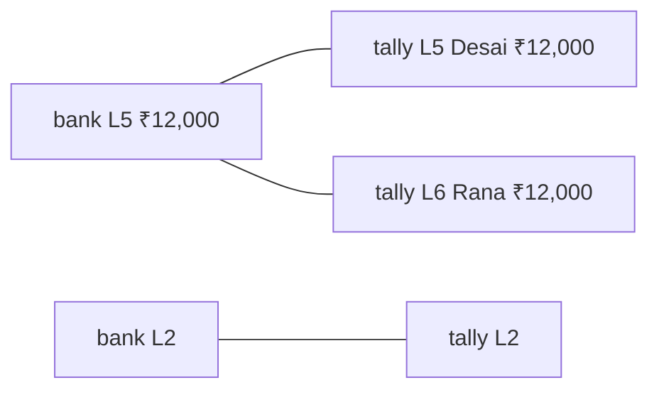
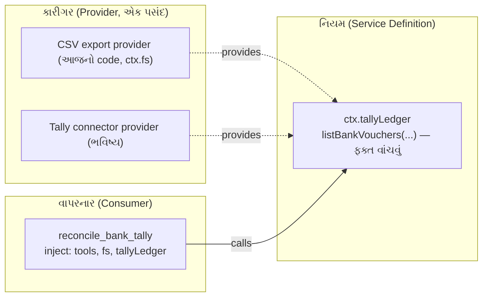
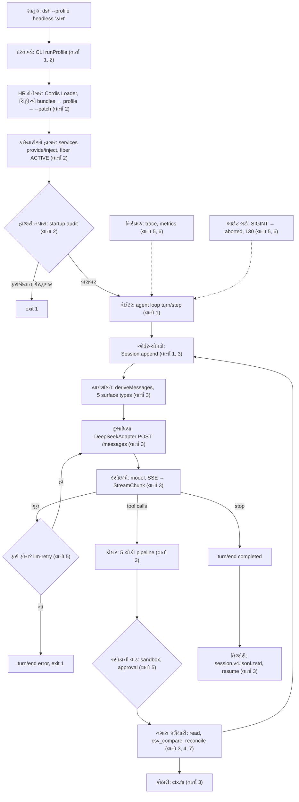

# વાર્તા 7 — સાંજનો હિસાબ

> **વાર્તા આવૃત્તિ, પ્રકરણ 7 (અંતિમ).** દિવસ પૂરો થયો. હવે ભોજનાલયના માલિકે બે ચોપડા મેળવવાના છે: **બેંકની પાસબુક** (bank statement) અને **પોતાનો હિસાબી ચોપડો** (Tally bank ledger). તમે એક નવો, સૌથી ઝીણવટવાળો કર્મચારી બનાવશો: **સાંજનો હિસાબનીશ** (`reconcile_bank_tally` tool). પછી, અંતે, **આખું ભોજનાલય શરૂથી અંત સુધી** એક જ નકશામાં જોઈશું, અને mastery પરીક્ષા આપીશું.
> ઊંડી ટેકનિકલ વિગત: મુખ્ય પુસ્તકનું [પ્રકરણ 7](../book/07-antim-project-mastery.md).

## આ વાર્તા પછી તમે શું કરી શકશો

- પૈસા, તારીખ, sign અને reference ને floating point વગર, નિશ્ચિત રીતે normalize કરી શકશો.
- ક્રમબદ્ધ, traceable matching rules બનાવી, "પહેલી મળે તે લઈ લો" ની ભૂલ ટાળી શકશો.
- Golden report, invariant test, અને rule-wise tests થી workflow સાબિત કરી શકશો.
- ભવિષ્યના Tally connector ને capability seam તરીકે design કરી શકશો.
- **સાતેય વાર્તાને એક જ request ની સફરમાં જોડી** સમજાવી શકશો.

## આ વાર્તાનાં નવાં પાત્રો

| વાર્તામાં | સાચું ટેકનિકલ નામ |
|---|---|
| બેંકની પાસબુક | bank statement CSV ([fixture](../labs/reconcile/fixtures/bank-statement.csv)) |
| હિસાબી ચોપડો | Tally bank ledger CSV ([fixture](../labs/reconcile/fixtures/tally-bank-ledger.csv)) |
| સાંજનો હિસાબનીશ | `reconcile_bank_tally` ([plugin.ts](../labs/reconcile/src/plugin.ts)) |
| છ નિયમની પોથી | rules V1, D1, R1, R2, A1, U1 ([reconcile.ts](../labs/reconcile/src/reconcile.ts)) |
| નમૂનાની રસીદ | golden report ([expected-report.txt](../labs/reconcile/fixtures/expected-report.txt)) |

> **Data notice.** Fixtures નાં બધાં નામ, reference numbers અને રકમ પુસ્તક માટે બનાવેલાં **synthetic** છે ([fixtures/README.md](../labs/reconcile/fixtures/README.md)). Tally export નો layout ધારેલો નમૂનો છે ⚠️.

---

## દ્રશ્ય 1 — બે ચોપડા, ઉલટી ભાષા

**કથા.** માલિક બે ચોપડા ખોલે છે અને મૂંઝાય છે. પાસબુકમાં ગ્રાહકના ₹15,000 "**Credit**" માં છે; પોતાના ચોપડામાં એ જ ₹15,000 "**Debit**" માં! ભૂલ નથી; બંને પોતપોતાની નજરે લખે છે.

| ચોપડો | પૈસા **આવ્યા** | પૈસા **ગયા** |
|---|---|---|
| બેંકની પાસબુક | `Credit` | `Debit` |
| Tally bank ledger | `Debit` | `Credit` |

**કેવી રીતે.** બંનેને એક જ નજર, "**bank account માં +**", માં ફેરવો ([normalize.ts](../labs/reconcile/src/normalize.ts)): bank માટે `credit − debit`, Tally માટે `debit − credit`, બંને **integer paise** માં.

**શા માટે paise, રૂપિયા નહીં?** Floating point માં `0.1 + 0.2` બરાબર `0.3` નથી. પૈસાના હિસાબમાં એક પૈસાની ભૂલ પણ ન ચાલે. `parseAmount('1,23,456.50')` → `12345650`, ફક્ત integer ગણિતથી.

**યાદ-ચાવી:** "**પહેલાં એક ભાષા, પછી સરખામણી.**"

---

## દ્રશ્ય 2 — છ નિયમની પોથી, ક્રમ સાથે

**કથા.** હિસાબનીશ નિયમો **ક્રમમાં** વાપરે છે. ક્રમ બદલો તો પરિણામ બદલાય.

| નિયમ | પરિણામ | શરત | કેમ આ ક્રમે |
|---|---|---|---|
| **V1** | `rejected` | ખરાબ CSV, ખોટી તારીખ (`31-02-2026`), ખોટી રકમ, debit **અને** credit બંને | ખરાબ કાગળ પર મેળ નહીં |
| **D1** | `duplicate` | **એક જ ચોપડા** માં date, amount, reference, text સરખાં | એક પસંદ કરવી = અનુમાન |
| **R1** | `matched` | reference + signed amount સરખાં, 1↔1 | સૌથી મજબૂત પુરાવો પહેલાં |
| **R2** | `matched` | signed amount સરખું, તારીખ ±`windowDays`, group બરાબર 1 + 1 | reference વગરની entries |
| **A1** | `ambiguous` | R1/R2 નો group 1+1 કરતાં મોટો | ક્યારેય અનુમાન નહીં |
| **U1** | `unmatched` | બાકી બધું | |

**યાદ-ચાવી "વ-ડુ-રે-રે-અ-ઉ": "વડુ રેરે અઉ" — વ**ાંધો, **ડુ**પ્લિકેટ, **રે**ફરન્સ, **રે**ન્જ (તારીખ), **અ**સ્પષ્ટ, **ઉ**ઘાડું (બાકી).

---

## દ્રશ્ય 3 — ખરાબ કાગળ અને બેવડી entry

**કથા.** પાસબુકમાં 31 ફેબ્રુઆરીની તારીખ છે (એવો દિવસ જ નથી!). એક લીટીમાં debit અને credit બંને ભરેલા છે. એક લીટી અધૂરી છે. Tally માં રકમ `12,00x.00` છે. હિસાબનીશ ચારેયને **V1** થી બાજુએ મૂકે છે.

પછી પાસબુકમાં Joshi Pharma ના ₹6,100 **બે વાર**, એકસરખા (L7, L8). હિસાબનીશ બંનેને **D1** થી રોકે છે: *"કઈ સાચી, તે માણસ નક્કી કરશે."*

**Expert નજર.** Duplicate ઓળખવા `fingerprint` માં **balance column સામેલ નથી**: બે સરખી entries નું running balance જુદું હોય (L7/L8: 1,29,090.50 vs 1,35,190.50). Text uppercase થાય છે, જેથી case નો ફરક duplicate છુપાવી ન શકે.

**ઉપમા ક્યાં તૂટે છે.** સાચી દુનિયામાં એક જ દિવસે સાચે જ બે સરખી payment થઈ શકે. Tool તેને પણ રોકે છે; **સલામતી પહેલાં, સગવડ પછી**. Override માનવ reviewer નું કામ (design review પ્રશ્ન 1).

---

## દ્રશ્ય 4 — R1 અને R2: મજબૂત પુરાવો પહેલાં

**કથા.**

- **R1:** પાસબુકમાં cheque `004512`, ચોપડામાં `4512`. આગળનાં શૂન્ય કાઢો (normalized reference) → એક જ cheque, એક જ રકમ (−₹8,250.50) → **match**. UTR `N0914000123`, ₹15,000 → **match**.
- **R2:** Mehta ના ₹4,300: reference ફક્ત પાસબુકમાં, તારીખ 1 દિવસ અલગ. Window ±3 દિવસ, બંને બાજુ એક જ ઉમેદવાર → **match**.

---

## દ્રશ્ય 5 — બે દાવેદાર, એક ખુરશી

**કથા.** પાસબુકમાં ₹12,000 આવ્યા (L5). ચોપડામાં એ જ અઠવાડિયે **બે** ₹12,000 ની receipts: Desai અને Rana (L5, L6). કઈ સાચી? "પહેલી મળે તે" લેવાય તો ફાઇલનો ક્રમ નક્કી કરે, હકીકત નહીં.

**કેવી રીતે: connected components.** Rows = nodes, નિયમની શરત = edge. દરેક જોડાયેલા ઝૂમખાને **એક સાથે** નક્કી કરો: 1+1 → match; મોટું → **A1 ambiguous**.



ડાબું ઝૂમખું 1+2 → **ambiguous**; જમણું 1+1 → **matched**. પરિણામ input ક્રમથી સ્વતંત્ર. Test: "two bank rows competing for one Tally row are ambiguous, not first-come".

**યાદ-ચાવી:** "**ઝૂમખું જુઓ, પહેલું નહીં.**"

---

## દ્રશ્ય 6 — બાકી રહેલા, અને એક ઉપયોગી નોંધ

**કથા.** બેંક charges ₹59 પાસબુકમાં છે, ચોપડામાં હજી નથી → **U1**. Cheque `004513` (₹2,500) ચોપડામાં છે, બેંકમાં હજી clear નથી → **U1**. ચોપડાનો Joshi Pharma (L7) ₹6,100 → **U1**, પણ નોંધ સાથે: *"આ reference પાસબુકની રોકેલી duplicate (lines 7, 8) માં પણ છે."* Reviewer ને સીધી દિશા મળે.

---

## દ્રશ્ય 7 — નમૂનાની રસીદ (golden report)

**કથા.** હિસાબનીશની રસીદ **અક્ષરે અક્ષર** નમૂના જેવી હોવી જોઈએ. 🧪 library, tool pipeline, અને real headless turn ત્રણેયમાં byte-identical:

```text
bank rows 10, tally rows 8, window ±3 day(s)
matched 3 (₹11049.50), ambiguous 1, unmatched bank 1, unmatched tally 2, duplicates 1, rejected 4
unexplained difference (unmatched bank - unmatched tally): -₹3659.00
MATCHED [R1] bank L2 ↔ tally L2 ₹15000.00: reference N0914000123 and amount ₹15000.00 agree
MATCHED [R1] bank L3 ↔ tally L3 -₹8250.50: reference 4512 and amount -₹8250.50 agree
MATCHED [R2] bank L4 ↔ tally L4 ₹4300.00: amount ₹4300.00 agrees; dates 1 day(s) apart (window 3)
AMBIGUOUS [A1] bank L5 ↔ tally L5,L6 ₹12000.00: amount ₹12000.00 within 3 day(s) fits 1 bank and 2 Tally rows
UNMATCHED [U1] bank L6 -₹59.00: no tally row with this reference or amount within 3 day(s)
UNMATCHED [U1] tally L7 ₹6100.00: reference N0970000456 also appears in held bank duplicates (lines 7, 8)
UNMATCHED [U1] tally L8 -₹2500.00: no bank row with this reference or amount within 3 day(s)
DUPLICATE [D1] bank L7,L8 ₹6100.00: 2 identical bank rows (date 2026-04-07, ₹6100.00); held for review
REJECTED [V1] bank L9: invalid date "31-02-2026"
REJECTED [V1] tally L9: invalid debit "12,00x.00"
REJECTED [V1] bank L10: both debit and credit are filled
REJECTED [V1] bank L11: COLUMN_COUNT: expected 7 fields, found 3
```

**હાથથી ચકાસો.** matched = 15,000 − 8,250.50 + 4,300 = **11,049.50**. unexplained = (−59) − (6,100 − 2,500) = **−3,659.00**.

**Invariant.** Test "every input row appears in exactly one result": દરેક input row રસીદમાં **બરાબર એક** જગ્યાએ. વાર્તા 4 ના હિસાબનીશનો જ સિદ્ધાંત, હવે પૈસા સાથે.

---

## દ્રશ્ય 8 — ભોજનાલય સાથે જોડાણ: ત્રણ ઉમેરા

**કથા.** આ કર્મચારી પણ વાર્તા 4 ના ભરતી-પત્રકથી આવે છે, ત્રણ ઉમેરા સાથે:

1. **Column names config માં** (`bankColumns`, `tallyColumns`). બીજી બેંકની પાસબુક? Overlay માં નામ બદલો, code નહીં. ખોટું નામ → matching પહેલાં `assertColumns` થી **fail loud**. નહીં તો ખૂટતો `Debit` column ચૂપચાપ શૂન્ય ગણાય, અને ₹900 નો ઉપાડ ગાયબ થઈ entry ખોટી રીતે R1 match થાય (વાર્તા 4 નું ઓડિટર-દ્રશ્ય).
2. **`windowDays`** default 3; model દરેક call માં `window_days` આપી શકે; negative → schema error ([`defineTool` validation][schema-defineTool-validate]).
3. **Canonical JSON report**: દરેક `ResultRow` માં `status`, `rule`, `bankLines`, `tallyLines`, `amount`, `reason`.

**Terminal માં** (harness checkout ના `tmp/book-labs` થી):

```bash
node --import tsx --test reconcile/test/*.test.ts
```

🧪 `tests 12, pass 12`.

```bash
O=$(bash tmp/book-labs/reconcile/make-overlay.sh)
```

```bash
TOOL_NAME=reconcile_bank_tally TOOL_ARGS='{"bank_path":"tmp/book-labs/reconcile/fixtures/bank-statement.csv","tally_path":"tmp/book-labs/reconcile/fixtures/tally-bank-ledger.csv"}' EXTRA_PATCH=$O TASK='bank statement અને Tally export reconcile કરો.' bash tmp/book-labs/request-trace/run-mock.sh
```

**ચોપડામાં** (🧪 [evidence/rec.err](../evidence/rec.err)): `tools/result reconcile_bank_tally isError=false chars=1210`; `turn/end completed`.

---

## દ્રશ્ય 9 — છુપાયેલો ખાડો (debugging challenge)

**કથા.** એક reviewer ફરિયાદ લાવે છે: *"₹100 નો refund **આપ્યો** (Tally payment) અને એ જ દિવસે ₹100 **મળ્યા** (bank receipt), અને રસીદ કહે છે R2 matched!"* પૈસા ગયા અને આવ્યા, બંને એક?

```bash
cd tmp/book-labs && patch -p1 < reconcile/challenge/planted-bug.patch
```

```bash
node --import tsx --test reconcile/test/*.test.ts
```

🧪 **બધા 12 tests pass.** એ જ challenge: પરીક્ષામાં ખાડો છે. તમારું કામ: ફરિયાદ પરથી નિષ્ફળ થતો test લખો, bug શોધો, fix કરો, અને fix વગર fail / fix સાથે pass બતાવો.

<details><summary>ઉકેલ (પહેલાં જાતે પ્રયત્ન કરો)</summary>

R2 ની શરત `b.amount === t.amount` ને બદલે `Math.abs(b.amount) === Math.abs(t.amount)`: આવક અને જાવક સરખી રકમ હોય તો match. અમારો test [challenge/sign.test.ts](../labs/reconcile/challenge/sign.test.ts): bug સાથે `actual: ['matched']` (fail), fix સાથે pass 🧪 ([પરિશિષ્ટ D — challenge](../appendix/D-lab-solutions.md#challenge)).

**શીખ:** tests **નિયમો પરથી** લખો, ફક્ત fixtures પરથી નહીં. દરેક શરત (amount, **sign**, window, uniqueness) માટે એક negative case.
</details>

**યાદ-ચાવી:** "**લીલી પરીક્ષા ≠ સાચો code.**"

---

## દ્રશ્ય 10 — ભવિષ્યનું સપનું: Tally સાથે સીધી વાત

> **આ દ્રશ્ય design છે, અમલમાં મૂક્યું નથી, ચલાવ્યું નથી.** ⚠️ Tally ની કોઈ API વિગત અહીં ચકાસેલી નથી.

**કથા.** માલિક પૂછે છે: *"રોજ CSV export કરવાને બદલે હિસાબનીશ સીધો Tally માંથી વાંચે તો?"* તમે વાર્તા 3 ના **ત્રણ કાગળ** (નિ-ક-વા) યાદ કરો છો:



| Design નિયમ | શા માટે | આધાર |
|---|---|---|
| Interface માં write method જ નહીં | read-only ની ખાતરી type level પર | — |
| Provider બદલવો = config | એક જ service નામ; બે સાથે register થાય તો સ્પષ્ટ error | [`provide`][cordis-provide] ✅ |
| Normalization consumer માં જ | CSV અને connector એક જ નિયમથી | `normalize.ts` |
| Network + credentials વિચારો | approval/sandbox policy (વાર્તા 5) | "Model-visible ⟺ logged" ([AGENTS.md][agents-conventions]) |
| Connector બંધ હોય તો structured error | નહીં તો "બધું unmatched" ખોટો report | fail loud |

**Expert નજર.** આ જ નમૂનો harness ના filesystem માં છે: abstract [`FileSystem`][fs-abstract] (નિયમ), `dsh-fs-sandbox` (કારીગર), `read` (વાપરનાર). Expert નવું design **શોધતો** નથી; હાલનો સાબિત નમૂનો **ફરી વાપરે** છે.

---

## અંત-થી-અંત: આખું ભોજનાલય એક દિવસમાં

**કથા.** રાત્રે, દુકાન બંધ કરતાં પહેલાં, મેનેજર તમને છત પર લઈ જાય છે. ઉપરથી આખું ભોજનાલય દેખાય છે. *"આજે તમે સાત ઓરડા અંદરથી જોયા. હવે એક ગ્રાહકનો એક ઓર્ડર, શરૂથી અંત સુધી, જુઓ."*



### સાત વાર્તા, એક વાક્યમાં

| વાર્તા | ઓરડો | એક વાક્યમાં શીખ | Technical core |
|---|---|---|---|
| [1](01-bhojanalay-no-pehlo-divas.md) | આખું ભોજનાલય | એક ઓર્ડર = ચોપડામાં લીટીઓ; model ને જે દેખાય તે લખાય | turn/step, session log, 2 calls (+title) |
| [2](02-hr-manager-ni-diary.md) | HR ની ઓફિસ | બધું plugin છે; ચિઠ્ઠીઓના ક્રમે ભોજનાલય બને | Cordis, layers, services, fibers, effects, events |
| [3](03-kothar-dubhashiyo-chopdo.md) | કોઠાર, દુભાષિયો, તિજોરી | નિયમ-કારીગર-વાપરનાર; ભૂલ = ચિઠ્ઠી; ચોપડો = યાદ | seam, pipeline, adapter, persistence, resume |
| [4](04-paheli-bharti.md) | ભરતી | ચાર સવાલ; હિસાબનીશ ધારતો નથી | `defineTool`, Config, overlay, tests |
| [5](05-katokati-no-divas.md) | કટોકટી | પહેલાં ચોપડો; ખાતરી નહીં તો ના | failures, retry, SIGINT, sandbox |
| [6](06-bhojanalay-ma-sudharo.md) | સમિતિ | config → plugin → core; ગણતરી સત્ય, ઘડિયાળ અંદાજ | metrics, contribution, review |
| 7 | સાંજનો હિસાબ | ઝૂમખું જુઓ; લીલી પરીક્ષા ≠ સાચો code | reconciliation, invariants, seam design |

### સાત "મંત્ર" (આખા પુસ્તકની યાદ-ચાવી)

1. **ચોપડો જ સત્ય.** (Model-visible ⟺ logged)
2. **ચિઠ્ઠીનો ક્રમ = ભોજનાલયનું રૂપ.** (layer order)
3. **ભૂલ = ચિઠ્ઠી, crash નહીં.** (error results)
4. **ધારવું નહીં, લખવું.** (determinism)
5. **ખાતરી નહીં તો ના.** (fail closed / fail loud)
6. **નીચો રસ્તો પહેલાં.** (config → plugin → core)
7. **ફરી ઉત્પન્ન, ફિક્સ, ફરી ચલાવો, ઉલટાવો.** (proof of fix)

---

## Mastery પરીક્ષા

ચાર ભાગ; દરેકનો અપેક્ષિત પુરાવો [પરિશિષ્ટ E — mastery rubric](../appendix/E-mastery-rubric.md) માં.

1. **Code walkthrough** (ખુલ્લા source સાથે, 15 મિનિટ): `parseAmount` floating point વગર કેવી રીતે? `fingerprint` માં balance કેમ નહીં? એક જ `components` R1 અને R2 બંને માટે કેવી રીતે? (પ્રશ્નો: [પ્રકરણ 7.6](../book/07-antim-project-mastery.md))
2. **Debugging challenge** (દ્રશ્ય 9): failing test + fix + fail/pass પુરાવો.
3. **Design review**: ઓછામાં ઓછા 4 પ્રશ્નોના લેખિત જવાબ, દરેકમાં source/test link ([પ્રકરણ 7.8](../book/07-antim-project-mastery.md)).
4. **Architecture trace**: મદદ વગર, `reconcile_bank_tally` call માટે sequence diagram: overlay row → Loader → `ctx.tools.register` → model tool call → pipeline → `ctx.fs` → `tool/result` → step 2.

**પાસ થવાનો નિયમ:** બધી 10 dimensions માં ઓછામાં ઓછું 2 (સ્વતંત્ર), અને failures, plugin, contribution માં 3 (maintainer).

## આગાહી કસોટી

Fixture બદલ્યા વગર `window_days: 0` સાથે tool ચલાવો. **પહેલાં લખો:** matched, ambiguous, unmatched bank, unmatched tally.

<details><summary>જવાબ (🧪)</summary>

matched 3 (bank L2↔L2 R1, L3↔L3 R1, **L5↔L5 R2**), ambiguous **0**, unmatched bank 2 (L4, L6), unmatched tally 4 (L4, L6, L7, L8); matched ₹18,749.50; unexplained −₹15,659.00 ([પરિશિષ્ટ D — Lab 7](../appendix/D-lab-solutions.md#lab-7)).

**શીખ:** window ઘટાડતાં Desai/Rana નું ઝૂમખું તૂટ્યું (ફક્ત Desai એ જ દિવસે) અને match બન્યો; 1 દિવસ અલગ Mehta બે unmatched બન્યા. Window એ **business નિર્ણય** છે, "વધુ સાચું" નહીં.
</details>

## Expert બનવાના પગથિયે

આ [માર્ગ](01-bhojanalay-no-pehlo-divas.md) નું **પગથિયું 7** છે. Maintainer (3) સ્તર માટે: Tally connector seam નું interface + fake provider + tests લખો, પછી બીજી harness commit પર આખો request trace ફરી કરી ફેરફારો નોંધો. પછી [પરિશિષ્ટ E](../appendix/E-mastery-rubric.md) સામે પ્રામાણિક સ્વ-મૂલ્યાંકન કરો.

## પુનરાવર્તન કાર્ડ

<details><summary>1. Bank અને Tally ના sign કેવી રીતે એક કરો?</summary>

Bank: `credit − debit`; Tally: `debit − credit`; બંને integer paise.
</details>

<details><summary>2. છ નિયમ ક્રમમાં?</summary>

V1 rejected, D1 duplicate, R1 reference+amount, R2 amount+window, A1 ambiguous, U1 unmatched.
</details>

<details><summary>3. Greedy matching કેમ નહીં?</summary>

પરિણામ input ક્રમ પર આધાર રાખે; connected components આખું ઝૂમખું એક સાથે નક્કી કરે.
</details>

<details><summary>4. Planted bug શું હતો?</summary>

R2 માં `Math.abs` વાપરી sign અવગણ્યો; આવક અને જાવક match થઈ.
</details>

<details><summary>5. Tally connector ની ત્રણ ભૂમિકા?</summary>

Definition `ctx.tallyLedger` (read-only), Providers (CSV / connector), Consumer `reconcile_bank_tally`.
</details>

<details><summary>6. આખા પુસ્તકનો પહેલો મંત્ર?</summary>

ચોપડો જ સત્ય: model ને જે દેખાય તે log માં હોય, અને log માંથી જ model ની history બને.
</details>

## મિત્રને સમજાવો (5 મિનિટ)

અંત-થી-અંત નકશો કાગળ પર **યાદથી** દોરો: ગ્રાહકથી તિજોરી સુધી, દરેક ખાનામાં વાર્તાનું નામ અને સાચું ટેકનિકલ નામ. પછી મિત્રને કોઈ પણ એક ખાનું પસંદ કરવા કહો, અને તે ખાનાનો source symbol મુખ્ય પુસ્તકમાંથી ખોલી બતાવો. આ કરી શકો તો તમે વાર્તા આવૃત્તિ પૂરી કરી છે.

---

પાછળ: [વાર્તા 6](06-bhojanalay-ma-sudharo.md) · શરૂઆત: [વાર્તા આવૃત્તિ — અનુક્રમ](README.md) · મુખ્ય પુસ્તક: [સમગ્ર નકશો](../book/overview-samagra-naksho.md)

<!-- citations:begin (generated by tools/refdefs.py) -->
[agents-conventions]: https://github.com/deepseek-ai/deepseek-harness/blob/fcc0ad462172522aaf5c93a7b2e01f6b9f0b0159/AGENTS.md#L130-L142
[cordis-provide]: https://github.com/deepseek-ai/deepseek-harness/blob/fcc0ad462172522aaf5c93a7b2e01f6b9f0b0159/vendor/cordis/src/reflect.ts#L291-L311
[fs-abstract]: https://github.com/deepseek-ai/deepseek-harness/blob/fcc0ad462172522aaf5c93a7b2e01f6b9f0b0159/packages/fs/fs/src/index.ts#L103
<!-- citations:end -->
